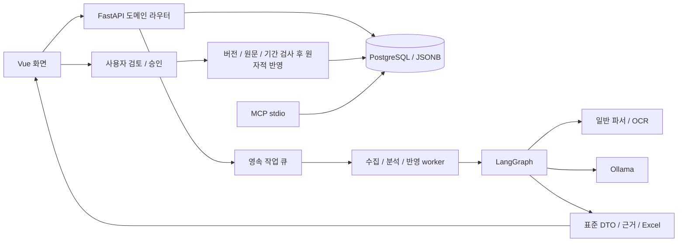

<!--
==============================================================================
FMS_FILE_SPEC
README.md - 프로젝트 문서 README
==============================================================================
설명:
    - 프로젝트 문서 README
입력·출력 명세:
    - 입력: 설계·구현·측정·검증 근거
    - 출력: 설명·명세·예제·검증 또는 발표 안내
실행 가정:
    - 계획·테스트 대역·실제 실행 결과를 구분하고 현재 상태는 README 및 검증 근거 확인
작성 정보:
    - 작성자: 김재현(Finn)
    - 이메일: penguin.klg@gmail.com
    - 작성일: 2026-10-20 (최초 Git 등록일 기준)
    - 라이선스: 미지정
    - 버전: 0.1.0
    - 상태: Development
변경 이력 (Revision History):
    DATE        AUTHOR      VERSION  DESCRIPTION
    --------------------------------------------------------------------
    2026-10-20  미지정      v0.1.0   최초 Git 등록 6dbae100
    2026-10-21  미지정      v0.1.0   파일 역할·입출력·가정·이력 명세 추가

    2026-10-21  김재현(Finn) v0.1.0   Agent 도구 선택 기반 리빌드·업무 경계 및 검증

    2026-10-22  김재현(Finn) v0.1.0   자료·Agent·검수 승인·식품 DB 중심 흐름 및 알레르기 표기 정리

    상세 Git 이력: git log --follow -- README.md
    공통 규칙: doc/file-header-policy.md
==============================================================================
-->
# skala-FMS · 식품장부

학교급식 게시글과 첨부 자료를 Agent가 읽고 처리 도구를 선택한 뒤, 표준 DTO로 추출한 정보를 사람이 검수·승인해 식품 DB에 반영하는 서비스입니다.

**자료 가져오기 → Agent 도구 선택·LangGraph 처리 → 검수·승인 → 식품 DB**

주요 화면은 자료 가져오기·검수/승인·식품 DB·Agent 로그 네 개입니다. 수동 JSON 변경안 작성과 별도 대시보드는 제거했습니다. 내부 검증·승인 revision·영속 반영 작업은 검수 화면의 한 번의 승인 요청으로 이어집니다. [현재 서비스 흐름과 API](doc/food-agent/service-workflow.md)를 참고하세요.

[상세 실행·API 명세](readmd.md) · [평가 기준 점검표](doc/submission/requirements-audit.md) · [5분 발표 구성·대본](doc/submission/presentation-5min.md) · [시연 준비](doc/submission/demo-guide.md) · [GitHub 저장소](https://github.com/SKALA-G116/skala-FMS)

## 1. 프로젝트명과 주제 선정 배경

**식품장부(Food Ledger, skala-FMS)**는 업체별 학교급식 공지를 식품 관리 데이터로 바꾸는 서비스입니다. 담당자는 게시글 본문·이미지·첨부파일에 흩어진 품절, 재개, 대체품과 가격 정보를 읽고 같은 제품을 찾아 수작업으로 정리해야 합니다. 업체마다 표기법과 규격이 달라 텍스트만 복사해서는 일관된 DB를 만들기 어렵습니다.

기존 실습 프로젝트의 Vue, FastAPI, LangGraph, MCP, 모델 연동 구성을 식품 정보 관리에 적용했습니다. 대화형 답변보다 **추출한 사실을 검토하고 출처와 함께 관리하는 업무 흐름**에 집중했습니다.

## 2. 해결하려는 문제

| 문제 | 구현한 대응 | 확인 방법 |
|---|---|---|
| 업체마다 이름·규격·단가 표기가 다름 | 하나의 nullable FoodRecord DTO로 정규화 | 표/텍스트 DTO 테스트, 식품 검수 화면 |
| 이미지와 첨부에 중요한 변경 정보가 있음 | 일반 파서와 별도 OCR, 구간별 근거 연결 | 셀·본문·이미지 좌표와 원문 조회 |
| 추출 오류가 그대로 DB에 반영될 위험 | 품목 확인, 최종 승인, 별도 반영 작업 구분 | 승인 전 facts 불변, 충돌 시 롤백 테스트 |
| 가격과 공급 상태의 변경 근거를 찾기 어려움 | 적용 기간·기록 시점·감사 이력·레퍼런스 보관 | 기간별 단가·식품 이력 조회 테스트 |
| AI 처리 중 다른 업무까지 지연됨 | 영속 작업 큐, 비동기 모델 호출, 작업별 lane | 지연 모델·DB 중 이벤트 루프 응답 테스트 |

수작업 시간 감소나 OCR/LLM 정확도의 전체 개선율은 아직 측정하지 않았습니다.

## 3. 개발 환경과 기술 선택

| 기술 | 사용 이유 | 비용·트레이드오프 |
|---|---|---|
| Vue 3 / Vite / Node 22 | View에서 사용자 여정을 조합하고 표·폼·근거 컴포넌트 재사용 | 복잡한 검수 상태와 저장 전 변경을 별도로 관리해야 함 |
| FastAPI / Python | API와 수집·파싱·AI 코드를 같은 언어로 연결 | DB·OCR 같은 동기 작업의 실행 위치를 제한해야 함 |
| LangGraph | 분석 단계를 명시하고 checkpoint·작업 재개 지원 | Agent가 자료별 도구를 선택하고 LangGraph가 실행·근거·재개를 관리. 임의 SQL·무제한 도구 실행은 제공하지 않음 |
| Ollama / Qwen3 4B·8B | 로컬에서 구조화 추출, 외부 모델 API 키 없이 개발 | 모델 RAM/VRAM과 생성 지연이 큼 |
| PaddleOCR | 한국어 이미지·스캔 PDF의 텍스트 추출 | 모델 설치와 메모리 부담, 표 구조·양식별 정확도 한계 |
| PostgreSQL 17 / JSONB | 관계·버전·승인 트랜잭션과 가변 식품 속성을 함께 저장 | 일부 조회의 개발용 상한과 저장 계층 개선이 남음 |
| MCP / FastMCP | 조회 실행(Tool), 근거·정책(Resource), 작업 안내(Prompt) 구분 | 기본 worker는 도메인을 직접 호출하며 MCP 실행 루프와 분리 |

로컬 검증은 macOS/Python 3.14, GitHub CI는 Ubuntu/Python 3.12/Node 22/PostgreSQL 17에서 수행했습니다. [CI 실행 결과](https://github.com/SKALA-G116/skala-FMS/actions/runs/39580269079).

## 4. 시스템 아키텍처



백엔드는 `backend/app/domains/`의 **identity, ingestion, catalog, pricing, analysis, review, jobs, reporting**으로 나눈 모듈형 모놀리스입니다. 공통 HTTP 경계는 인증·권한·CSRF·중복 요청 방지·트랜잭션을 담당합니다. 식품 읽기와 승인된 DB 쓰기의 책임을 분리했습니다.

Agent가 자료별 처리 도구와 이유를 결정하고 실행기가 그 선택을 따릅니다. 표 매핑·텍스트 의미 추출·상품 영역별 이미지 추출·원문 확인 요청을 구별하며 선택한 경우에만 DB 후보를 조회합니다. 서버는 공통 DTO·근거·업무 규칙을 검사합니다. 사용자가 반영을 결정합니다. 기본 MCP 서버에는 승인·DB 반영·임의 SQL 도구가 없습니다. [도메인 상세](readmd.md), [초기 리팩토링 내역](doc/food-agent/initial-refactor.md).

## 5. 주요 구현 기능

1. 게시글·첨부 수집, 변경 감지와 분석 자동 등록, 계정 암호화 저장
2. 텍스트·Excel·PDF 파싱, 이미지/스캔 PDF의 선택 OCR
3. 식품명·업체·규격·속성·알레르기·자료 가격을 표준 DTO로 정리
4. 원문/추출 텍스트 대조, 수정·확인·제외, 저장 전 이동 보호
5. 명시적 승인 후 작업자가 DB 반영, 버전·기간 충돌 검사와 전체 롤백
6. 식품·단가·변동 이력·레퍼런스 조회, 원본 단가표의 열 필터
7. 자료/식품 삭제·복구, 승인 근거를 보호하는 조건부 자료 영구 삭제
8. 검토용 Excel, 작업 진행·취소·재시도, 제한된 OCR/LLM 자원 사용

이번 리빌드는 [Agent 중심 실행 명세](doc/food-agent/agent-rebuild.md)를 따릅니다. 추출은 검토본만 만들고 확인 이후에 승인용 변경안을 준비합니다. 챗봇과 제한 없는 임의 도구·SQL 실행은 제공하지 않습니다.

## 6. 프로그램 실행 방법

```sh
python3 -m venv .venv
.venv/bin/python -m pip install -r backend/requirements.lock.txt
npm --prefix frontend ci
npm --prefix frontend run build
cp .env.food.example .env.food
```

`.env.food`의 DB와 초기 계정 비밀번호를 수정하고 PostgreSQL 17·Ollama 모델을 준비합니다.

```sh
./scripts/start-postgres.sh
.venv/bin/python -m backend.app.seed
ollama pull qwen3:4b
ollama pull qwen3:8b
bash run.sh
```

접속: `http://127.0.0.1:8100`. 시드 계정은 admin/reviewer/operator/reader이며 비밀번호는 설정한 `FOOD_SEED_PASSWORD`입니다. OCR 환경·Docker·외부 DB·개별 API/worker 실행은 [상세 실행법](readmd.md)을 따릅니다. Docker 빌드·기동은 이번 로컬 검증에 포함하지 않았습니다.

## 7. 테스트 결과와 실행 화면

| 검증 | 결과 | 근거 |
|---|---|---|
| 백엔드 기능·예외·도메인 경계 | 69개 통과 | `backend/tests/`, PR #1 CI |
| 프런트 검토 흐름 | 5개 통과 | `frontend/tests/reviewJourney.test.js`, PR #1 CI |
| Vue 배포 빌드 | 통과 | PR #1 CI |
| API/SPA smoke | 화면·health·docs·openapi 200, 미인증 API 401 | 초기 리팩토링 보고서 |
| 실제 MCP stdio | Tool/Resource/Prompt 조회와 실행 경계 테스트 통과 | `test_parsers_mcp.py` |
| 실제 모델·OCR | 과거 실행 기록 있음, 최종 발표 환경 재시연 필요 | performance 기록 및 시연 체크리스트 |

테스트는 `_test`로 끝나는 별도 DB만 사용합니다. 실제 모델 성공과 테스트 대역의 성공은 구분합니다. 재실행 명령과 구체 입력/결과는 [readmd.md](readmd.md)에 있습니다.


## 8. Before / After 비교

| 대상 | Before | After | 검증 범위 |
|---|---|---|---|
| 제공 실습의 목적 | 장애 문의를 분류하고 답변 생성 | 식품 사실을 추출하고 검토·승인 후 저장 | 이전 Git 커밋과 현재 도메인 코드 |
| 식품 API 구조 | 단일 API 파일에 업무 분기 집중 | 도메인 라우터와 공통 전송 경계 분리 | 도메인 소유권·역의존 테스트 |
| 검수 화면 | 전체 표와 긴 폼이 함께 노출 | 품목 선택·원문 대조·최종 반영 단계 | 화면 캡처와 검토 흐름 테스트 |
| 모델·OCR 실행 | 동기 모델 HTTP, OCR 초기화 반복 | 비동기 모델 HTTP, OCR 프로세스 재사용 | 동시성·재사용·정리 테스트 |
| 근거 관리 | 장애 답변·대화 기록 중심 | 식품 DTO의 필드 근거와 승인 감사 이력 | 기간별 사실·evidence 테스트 |

기록된 동일 이미지 OCR 첫 요청은 **12.879초**, 같은 프로세스의 두 번째 요청은 **10.347초**입니다. 차이는 2.532초, 약 19.66%입니다. 단일 이미지·2회 측정으로, 초기화/예열 효과를 포함합니다. 서로 다른 버전의 전체 Agent 처리시간을 같은 조건에서 비교한 결과가 아닙니다.

[측정 해석과 Before/After 추가 측정 방법](doc/submission/before-after.md). 보너스 평가용 전체 성능 개선은 반복 측정 전까지 확정하지 않습니다.

## 9. 개발 중 문제와 해결 방법

| 문제 | 원인/판단 | 적용한 해결 | 남은 확인 |
|---|---|---|---|
| 업체마다 별도 필드와 복합 식품명 | 업체명·식품명·규격·속성의 경계 불명확 | 단일 FoodRecord DTO와 정규화, 모르는 값 null | 업체별 정답 데이터로 정확도 측정 |
| 입력만 저장되고 DB 반영 과정이 모호 | AI 추출, 사용자 확인, 업무 반영 상태 혼재 | 추출/검토/승인/apply 분리와 감사 이력 | 실제 사용자 업무 시간 측정 |
| 긴 분석 중 응답 지연·재시작 부담 | 동기 호출, 공유 작업 순서, 반복 OCR 초기화 | 제한된 스레드·비동기 HTTP·lane·checkpoint·OCR 재사용 | 전체 문서 동일 조건 비교 |
| 한 화면의 정보 과다와 수정값 손실 | 긴 폼, 행 이동 시 draft 초기화 | 핵심 필드 우선, 속성 펼치기, 이동 전 미저장 보호 | 사용자 사용성 평가 |
| 코드 이동으로 권한 계약이 달라질 위험 | 공통 mutation 정책이 로그아웃에도 적용될 수 있음 | reader의 무키 로그아웃 회귀 테스트 추가 | 신규 API 추가 시 정책 확인 |

## 10. 한계와 향후 개선

- 모델 후보를 사람 검토 없이 확정하지 않습니다. 정확도·검토 소요시간은 정답 자료와 사용자 평가로 측정할 계획입니다.
- 8B 모델 추론과 OCR 초기화가 느릴 수 있습니다. 비동기화는 모델의 토큰 생성 속도 개선을 의미하지 않습니다.
- 일부 조회는 2,000건 개발 상한을 사용합니다. 대규모 SQL 검색·페이지네이션과 보존 기간 정책이 다음 작업입니다.
- 원격 MCP 인증, 범용 자율 루프, OpenAI 어댑터와 운영 배포 체계는 추가 작업입니다.
- 실제 사이트·최종 모델/OCR 리허설과 Zoom 화면·소리·해상도 확인은 발표자가 진행해야 합니다.

## 제출과 발표

| 자료 | 목적 |
|---|---|
| [평가 기준 점검표](doc/submission/requirements-audit.md) | 10개 보고서 항목, 배점별 근거, 최종 확인 상태 |
| [5분 발표 구성·대본](doc/submission/presentation-5min.md) | 설명+시연 합계 300초, 기술 선택과 한계, 예상 질문 |
| [시연 준비 안내](doc/submission/demo-guide.md) | 격리 환경, 사전 준비, 시연 순서, 실패 시 대응 |
| `demo/notice.txt`, `demo/prices.csv` | 개인정보 없는 가상 시연 입력 |
| `scripts/demo-preflight.py` | API·모델 설치·프런트 빌드 사전 점검 |

실제 회원 정보, 비밀키, 수집 assets, DB 파일, 모델 가중치, 로컬 환경·로그는 저장소에서 제외합니다.

## 파일별 명세와 변경 이력

모든 추적 파일의 역할·입력·출력·가정·작성 정보·Git 기록은 [파일별 목록](doc/file-specs.md)과 [관리 규칙](doc/file-header-policy.md)에서 확인합니다. 지원 형식의 작업 소스에는 상단 헤더와 Python 모듈 metadata를 추가하고, 원본 데이터·JSON·잠금 파일·legacy는 내용을 유지한 외부 명세로 관리합니다. 수정 코드·문서에는 사용자 승인 정보인 김재현(Finn)·penguin.klg@gmail.com을 적용하며 라이선스는 미지정입니다.
