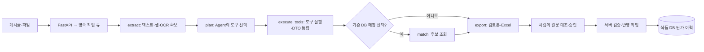
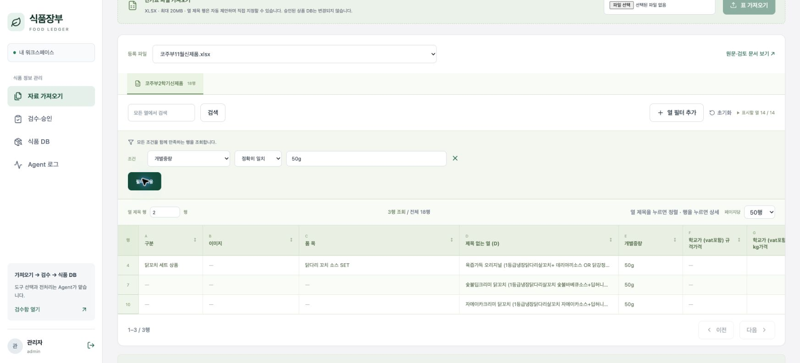
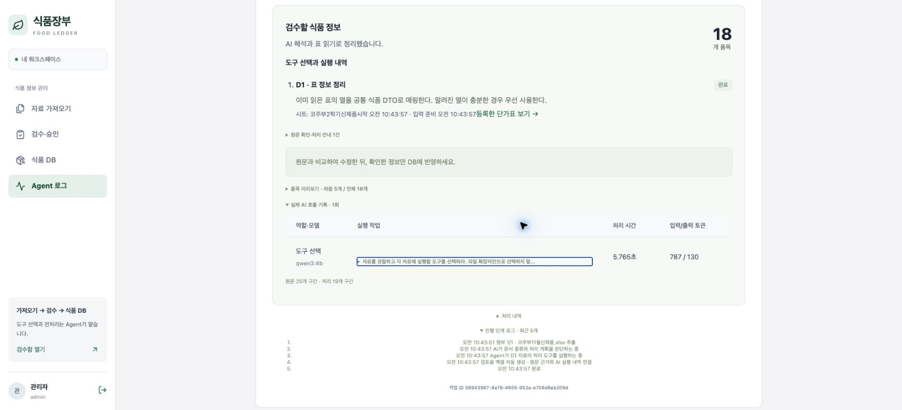
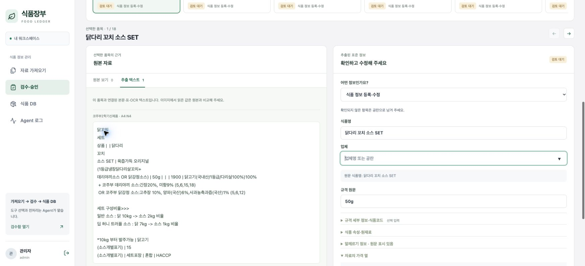
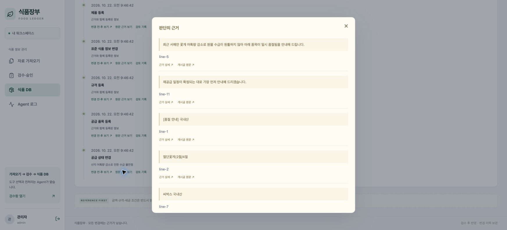

<!--
==============================================================================
FMS_FILE_SPEC
README.md - 프로젝트 문서 README
==============================================================================
설명:
    - 프로젝트 문서 README
입력·출력 명세:
    - 입력: 설계·구현·측정·검증 근거
    - 출력: 설명·명세·예제·검증 또는 발표 안내
실행 가정:
    - 계획·테스트 대역·실제 실행 결과를 구분하고 현재 상태는 README 및 검증 근거 확인
작성 정보:
    - 작성자: 김재현(Finn)
    - 이메일: penguin.klg@gmail.com
    - 작성일: 2026-10-20 (최초 Git 등록일 기준)
    - 라이선스: 미지정
    - 버전: 0.1.0
    - 상태: Development
변경 이력 (Revision History):
    DATE        AUTHOR      VERSION  DESCRIPTION
    --------------------------------------------------------------------
    2026-10-20  미지정      v0.1.0   최초 Git 등록 6dbae100
    2026-10-21  미지정      v0.1.0   파일 역할·입출력·가정·이력 명세 추가

    2026-10-21  김재현(Finn) v0.1.0   Agent 도구 선택 기반 리빌드·업무 경계 및 검증

    2026-10-22  김재현(Finn) v0.1.0   자료·Agent·검수 승인·식품 DB 중심 흐름 및 알레르기 표기 정리

    2026-10-22  김재현(Finn) v0.1.0   실제 화면·비교 근거·5분 발표 자료 작성

    2026-10-22  김재현(Finn) v0.1.0   README·결과 공유 중심 300초 발표 및 근거별 문제 해결 문서 구성

    상세 Git 이력: git log --follow -- README.md
    공통 규칙: doc/file-header-policy.md
==============================================================================
-->
# 식품장부 · skala-FMS

**업체 게시글과 단가표를 수집하고, Agent가 처리 도구를 선택해 정리한 정보를 사람이 검수·승인하는 식품 정보 CMS**입니다.

자료 가져오기 → Agent 판단·도구 실행 → 공통 식품 DTO → 원문 대조·승인 → 식품 DB·변경 이력

발표는 **이 README와 실제 실행 캡처**로 진행합니다. 아래 1~6절이 5분 발표 순서이며, 접힌 상세 명세와 개발 안내는 질의응답용입니다. 기존 PPT/PDF는 과거 제작본으로 보존하고 이번 발표의 기준으로 사용하지 않습니다.

[발표자 대본](doc/submission/presentation-5min.md) · [시연 순서·결과](doc/submission/demo-guide.md) · [트러블슈팅 Before/After](doc/submission/before-after.md) · [상세 실행법](readmd.md)

| 발표 시간 | 보여 줄 내용 | 전달할 핵심 |
|---|---|---|
| 0:00~0:45 | 1. 배경과 병목 | 지역 314개 초·중·고 규모에서 반복될 수 있는 자료 확인·대조 작업 |
| 0:45~1:20 | 2. 주요 Task | 가져오기·정리·검수·승인·이력 관리 |
| 1:20~2:10 | 3. Agent와 LangGraph | AI의 도구 선택과 서버의 실행·검증 책임 |
| 2:10~3:55 | 4. 실제 시연 결과 | 표 → Agent 로그 → 원문 대조 → 식품 DB 이력 |
| 3:55~4:40 | 5. Before/After | 정보 손실과 OCR 종료 문제를 어떻게 검증했는가 |
| 4:40~5:00 | 6. 한계와 다음 단계 | 정확도·검토 시간의 반복 측정과 운영 검증 |

## 1. 왜 만들었나: 광주 학교 영양 업무의 자료 확인 병목

공공데이터포털에 공개된 교육청 학교검색 자료의 **2025-11-09 기준 설명**에는 광주 지역 초등학교 **155개**, 중학교 **91개**, 고등학교 **68개**가 기재되어 있습니다. 세 학교급의 합계는 **314개교**입니다. [공식 공개자료](https://www.data.go.kr/data/15151786/fileData.do)

학교 영양 업무에서는 식단 설계에 사용할 제품과 가격뿐 아니라 현재 공급 가능 여부도 확인해야 합니다. 업체는 서로 다른 단가표를 올리고, 일시중단·단종·재공급·대체품 소식은 게시글 본문·이미지·첨부파일로 공유합니다. 학교별로 같은 공지를 다시 찾아 읽고 장부와 대조한다면, 하나의 변경이 지역 여러 담당자의 반복 확인으로 이어질 수 있습니다.

| 병목 | 담당자가 해야 하는 일 | 서비스가 줄이려는 반복 |
|---|---|---|
| 변경 공지가 흩어짐 | 게시판에서 새 글과 변경된 첨부 확인 | 수집 범위·변경 감지·원본 revision 보관 |
| 업체마다 다른 양식 | 상품명·규격·가격 기준·알레르기를 다시 해석 | 공통 DTO와 자료별 처리 도구 |
| 공지와 장부가 분리됨 | 기존 식품을 찾고 중단·대체·가격 변경 대조 | 기존 DB 후보 연결과 검수 초안 |
| 반영 근거를 다시 찾아야 함 | 언제·왜 바뀌었는지 원문 검색 | 승인 정보·이력·원문 근거 연결 |

**314개교는 문제의 지역 규모를 설명하는 공개자료 기준치**이며 서비스 이용 학교 수·영양 담당자 수·급식 운영 학교 수가 아닙니다. 업무 배경은 프로젝트 제안자의 설명에 기반하며, 병목의 확산은 그 구조에 대한 해석입니다. 절감 시간·학교별 중복 확인 횟수는 아직 측정하지 않았습니다. 기준일·출처·집계 범위는 [배경 근거](doc/submission/background-sources.md)에 정리했습니다.

## 2. 무엇을 구현했나: 네 가지 주요 Task

| Task | 사용자 경험 | 구현 결과 |
|---|---|---|
| 자료 가져오기 | 사이트 공지·첨부를 수집하거나 파일 업로드 | 원본·수집 시점·revision·분석 작업 보관 |
| Agent 처리 | 자료 구조에 맞는 도구와 이유를 Agent가 선택 | 표·텍스트·OCR를 같은 FoodRecord DTO로 정리 |
| 검수·승인 | 원문 옆에서 값 수정·확인·제외 후 최종 승인 | 승인 전에는 확정 식품·단가 DB를 변경하지 않음 |
| 식품 DB 관리 | 식품·단가·공급 상태와 변경 근거 조회 | 수정 사유·버전 검사·이력, Agent 로그 |

제공 실습의 Vue·FastAPI·LangGraph·LLM·MCP 틀을 재사용하고 장애 진단·대화 중심 흐름을 식품 업무 도메인으로 전환했습니다. 현재 화면은 **자료 가져오기 / 검수·승인 / 식품 DB / Agent 로그**를 중심으로 운영합니다. 별도 챗봇은 현재 업무 범위에 포함하지 않았습니다.

## 3. Agent는 판단하고, 도구는 처리하며, LangGraph는 흐름을 관리한다

LLM 기반 Agent가 읽힌 자료의 표 구조·본문 샘플·OCR 위치를 관찰해 **허용된 도구와 선택 이유**를 결정합니다. LangGraph는 그 판단 결과를 실행 단계에 전달하고 checkpoint로 진행 상태를 관리합니다. OCR과 셀 읽기는 판단에 필요한 입력을 준비하는 `extract` 단계에서 먼저 수행합니다. 즉, 원본 이미지 bytes 전체를 LLM에 보내서 모든 전처리를 지시하는 구조는 아닙니다.



| 책임 | 실제 기능 | 코드 근거 |
|---|---|---|
| Agent의 판단 | 자료 유형·Task·source별 도구·선택 이유 결정. 모든 source를 한 번씩 배정하고 누락·중복을 서버 검증 | [planning.py](backend/app/domains/analysis/planning.py) |
| 도구 실행 | 표 매핑, 텍스트 의미 추출, 이미지 상품 영역 해석, 공통 DTO 후보 통합 | [agent.py](backend/app/domains/analysis/agent.py) |
| LangGraph 실행 제어 | `extract → plan → execute_tools → match(조건부) → export`. PostgreSQL checkpoint와 재개 | [workflow.py](backend/app/domains/analysis/workflow.py) |
| 사용자·서버의 반영 결정 | 품목 확인·제외, 최종 승인, 근거·버전·기간 충돌 검사, 원자적 DB 반영 | [review 도메인](backend/app/domains/review) |

<details>
<summary>도구별 입력·처리·출력 명세 — 질의응답용</summary>

| Agent가 선택하는 도구 | 입력·선택 조건 | 하는 일과 출력 |
|---|---|---|
| `normalize_table` | 인식된 헤더와 구조화된 식품 행 | 원본 XLSX 표 등록, 명시적 병합 셀 복원, 결정적 DTO 매핑. 알려진 행을 다시 LLM으로 추출하지 않음 |
| `extract_text` | 공지 본문·비정형 텍스트/표 | 제한된 구간을 LLM으로 해석해 식품 정보·가격·공급 변경·대체품 후보와 근거 생성 |
| `extract_image_regions` | OCR 텍스트·좌표·페이지/이미지 위치 | 상품 영역과 공통 범례 구분 후 영역별 의미 추출. XLSX에서 연결할 상품 행이 하나면 별도 영역 분류 호출 생략 |
| `request_review` | 읽기 어렵거나 해석할 자료 부족 | 원문과 확인 필요 구간을 보존. 추측으로 DB 값을 생성하지 않음 |

`match_catalog`는 source별 전처리 도구와 별도로 Agent의 Task 선택에 따라 실행되는 **읽기 전용 DB 후보 조회**입니다. `export`는 검토 결과·Excel을 생성하는 마지막 실행 단계입니다. 분석 그래프 내부에 사용자 승인이나 확정 식품 DB CRUD를 맡기지 않았습니다. 수집 자료·분석 기록·검토 초안은 처리 중 저장됩니다.

텍스트·표·이미지의 공통 DTO에는 식품명, 업체, 공통식품코드, 맛·원산지·원재료·등급, 낱개/전체 규격, 포장 수량, 판매 단위, 알레르기, 자료 가격과 `field_sources`를 담습니다. 없는 값은 null입니다. 자료의 가격 기준(규격/kg/개당)과 공급 중단·제조 단종을 구분합니다. 알레르기 번호는 괄호 유무보다 문맥을 확인하고 원문 함유 표시와 추정 후보를 분리합니다.

XLSX 삽입 라벨은 OCR 결과를 해당 행의 상품 정보에 보완하고 표·이미지 근거를 함께 유지합니다. 모호한 연결·OCR 실패는 검수로 남깁니다. [지원 형식·한도·검증](doc/food-agent/embedded-table-images.md)

</details>

<details>
<summary>기술 선택과 적용 범위 — 질의응답용</summary>

| 기술 | 실제 적용과 선택 이유 |
|---|---|
| Vue 3·Vite / FastAPI | 원문 대조·표 필터·폼과 API를 분리한 CMS |
| LangGraph / Ollama Qwen3 | 업무 단계·재개 관리 / 4B planner, 8B 비정형 추출. 명확한 표는 행별 추론 생략 |
| PaddleOCR | 격리된 CPU 프로세스에서 텍스트·좌표 확보, 가중치 재사용과 유휴 정리 |
| PostgreSQL 17·JSONB | 승인·버전·기간·감사 이력의 트랜잭션과 업체별 가변 속성을 함께 관리 |
| 영속 worker·async HTTP | 웹 요청과 긴 분석 분리, 작업 상태·취소·제한된 재시도. async가 모델 자체를 더 빠르게 생성하게 하지는 않음 |
| MCP | Tool: 제한된 DB 조회 / Resource: 정책·스키마·근거 / Prompt: 업무 지침. stdio 경계 테스트. 기본 worker는 도메인을 직접 호출 |
| 모듈화·경량 DI | identity·ingestion·analysis·review·catalog·pricing·jobs 분리, `call` 콜백·RequestContext 전달 |
| 테스트 | 격리 DB 단위·통합 테스트와 프론트 테스트. 실제 LLM 결과와 테스트 대역을 구분 |

Multi-Agent·벡터 RAG·LangSmith는 현재 미적용입니다. 자체 Agent 로그에서 도구·이유·모델·토큰·시간을 확인합니다. MCP의 기본 모델용 도구에 승인·최종 반영·임의 SQL을 노출하지 않습니다.

[API 명세](doc/food-agent/openapi.json) · [업무 흐름](doc/food-agent/service-workflow.md) · [전체 코드 안내](readmd.md)

</details>

## 4. 실제 시연 결과: 수집 단가표가 검토 가능한 정보가 되기까지

**105초 동선:** 원본 표 20초 → Agent 로그 25초 → 원문 대조 검수 35초 → 식품 DB·이력 25초. 발표 중 모델 응답을 기다리지 않고 저장된 실제 실행 결과를 공유합니다.

2026-10-22 기수집한 실제 코주부 XLSX 첨부를 별도 문서로 재등록해 실행했습니다. 당시 작업은 **18개 검토 품목, qwen3:4b 도구 선택 1회, 시작~완료 6.027초**를 기록했습니다. 제목 1구간은 수동 확인으로 남았고 식품 DB 승인은 하지 않았습니다. [실제 실행 기록](doc/submission/table-demo-result.json)

문서 갱신 시 읽기 전용 확인 결과 이 과거 run은 현재 DB에 없어, 아래 **보존 캡처와 JSON을 발표 기준**으로 삼습니다. 현재 서비스의 같은 메뉴를 조회하는 것은 가능하지만, 과거 run 링크가 지금도 열린다고 가정하지 않습니다. 새 수집·OCR·승인까지 6초에 끝난 결과로 소개하지 않습니다.

### ① 원본 표: 서로 다른 맛·가격을 먼저 확인

개별중량 `50g` 필터로 원본 18행 중 3행을 조회한 화면입니다. 같은 이름·규격이라도 맛·가격이 다르면 별도 행이어야 합니다.



### ② Agent 로그: 도구와 호출 근거 확인

Agent가 `normalize_table`을 선택했고, 인식된 표 행에는 별도 추출 LLM을 호출하지 않았습니다. 모델 시간 5.765초, 입력 787/출력 130 tokens입니다. 작업 시간은 대기열·사이트 다운로드·사용자 검토 시간을 제외한 단일 관측입니다.



### ③ 검수: 원문 셀과 표준 DTO 대조

원문과 식품명·규격·맛·가격을 나란히 확인합니다. 근거가 없는 업체 등은 공란으로 두고 수정·확인·제외할 수 있습니다. **품목 확인 저장과 최종 DB 승인은 별도**입니다.



### ④ 식품 DB: 반영 결과와 변경 근거를 추적

아래는 기존 승인된 꽃게 품목의 공급 일시중단 이력을 조회한 화면입니다. 위 18행 시연의 새 승인 결과는 아닙니다. 동일 DTO의 식품 수정·단가·공급 상태·근거 링크를 확인하는 최종 도착 화면입니다.



현재 서비스 조회 메뉴: [자료](http://127.0.0.1:8100/documents) · [Agent 로그](http://127.0.0.1:8100/agent-logs) · [검수](http://127.0.0.1:8100/reviews) · [식품 DB](http://127.0.0.1:8100/products). 로컬 실행·로그인이 필요합니다. 승인 버튼을 실제 누르는 시연은 [별도 시연 DB 준비](doc/submission/demo-guide.md)를 따릅니다.

## 5. 의미 있었던 트러블슈팅: Before / After

발표에서는 **① 정보 손실, ② OCR 안정성** 두 사례를 45초 동안 설명합니다. 나머지는 질의응답 때 엽니다.

| 사례 | Before | After | 검증 수준 |
|---|---|---|---|
| [① 맛·가격별 행 손실](doc/submission/before-after/01-table-preservation.md) | 같은 이름·규격을 합쳐 입력 18행이 검토 8행으로 축소 | 맛·가격 기준을 구분해 18행 보존, 숫자 가격 9→19개 | 동일 XLSX, 이전/현재 파서·통합 코드 재실행 |
| [② OCR 프로세스 종료 충돌](doc/submission/before-after/02-ocr-lifecycle.md) | Python OCR 자식의 native SIGSEGV 보고 | 정상 shutdown 우선·자식 격리·CPU 제한·재시작 가능한 오류 | 실제 합성 이미지 2사이클 종료 0 + 회귀 테스트 |
| [③ 추출은 됐는데 승인 실패](doc/submission/before-after/03-review-contract.md) | OCR 근거 22~23개와 승인 스키마 상한 20개 불일치 | 유한 상한 2,000개로 통일, 근거 보존·짧은 오류 안내 | 격리 DB 41개 근거 승인·반영·감사 이력 검증 |
| [④ 표 안의 라벨 이미지 누락](doc/submission/before-after/04-embedded-labels.md) | XLSX 셀만 읽어 이미지의 원재료·알레르기 정보 누락 | 이미지 OCR와 상품 행 연결, 빈 DTO 속성 보완·원문 미리보기 | 합성 XLSX + 모의 OCR/LLM 통합 테스트 |


전체 **백엔드 153개·프론트 15개 테스트와 Vite 빌드 통과**를 2026-10-22 확인했습니다. 테스트 통과 수는 실제 자료의 추출 정확도가 아닙니다. [재현 범위·테스트·성과 근거](doc/submission/before-after.md)

## 6. 한계와 다음 단계

행·가격을 보존하고 승인 근거를 추적할 수 있게 됐지만, 모든 업체 자료를 정확히 읽는 수준은 아직 아닙니다. 기존 실제 혼합 자료에서 자동 확정하지 못한 구간 179개가 있었고, 작은 라벨은 OCR 해상도에 영향을 받습니다. XLSX 라벨 보완은 테스트 대역으로 통합 동작을 확인했으며 사용자 첨부 라벨의 실물 정확도를 측정한 결과가 아닙니다.

다음 단계는 업체별 정답셋으로 **필드 정확도·누락률**, 실제 담당자 검토의 **수정 횟수·소요 시간**, 전체 처리의 **지연시간·Retry·합산 메모리**를 반복 측정하는 것입니다. 단일 6.027초나 행 보존 수치를 비용·정확도·업무 시간 절감률로 바꾸어 주장하지 않습니다.

구현 과정에서는 LLM 호출 수보다 원본 정보 보존과 검수 가능성이 먼저라는 점을 확인했습니다. 자료에 맞는 처리 경로를 고르고 실패 구간을 남기는 것이 본 서비스의 핵심입니다. 현재는 수동/주기 수집과 승인 후 갱신이며 완전 자동·즉시 동기화 서비스는 아닙니다.

---

## 개발 환경과 실행 방법

PostgreSQL 17과 Ollama를 준비합니다. `.env.food`의 DB 주소와 초기 계정 비밀번호를 직접 설정합니다. 회원 비밀번호·세션·API 키는 저장소에 넣지 않습니다.

```sh
python3 -m venv .venv
.venv/bin/python -m pip install -r backend/requirements.lock.txt
npm --prefix frontend ci
npm --prefix frontend run build
cp .env.food.example .env.food
./scripts/start-postgres.sh
.venv/bin/python -m backend.app.seed
ollama pull qwen3:4b
ollama pull qwen3:8b
bash run.sh
```

로컬 주소는 `http://127.0.0.1:8100`입니다. 초기 admin/reviewer/operator/reader의 비밀번호는 설정한 `FOOD_SEED_PASSWORD`를 사용합니다. 실제 사이트 회원 계정은 서비스 로그인과 별도로 연결합니다. OCR은 별도 PaddleOCR 환경과 `FOOD_OCR_PYTHON` 설정이 필요합니다. [상세 실행법](readmd.md)을 확인하세요.


## 검증·운영 참고

```sh
# 반드시 운영 DB와 다른 *_test DB 사용
DATABASE_URL=postgresql://localhost:55432/food_fms_refactor_test \
FOOD_ANALYSIS_MODE=rules FOOD_SEED_PASSWORD=local-food-2026 \
.venv/bin/python -m pytest backend/tests -q
node --test frontend/tests/*.test.js
npm --prefix frontend run build
```

25MiB 파일 상한, 압축 해제·셀·픽셀·LLM 입력·동시성에 별도 한도를 둡니다. XLSX 이미지 자동 분석은 파일당 40개까지이며 초과분은 원문 검수로 남깁니다. 실제 LLM·OCR는 별도 실행 검증이 필요합니다. CI의 규칙 모드나 테스트 대역을 실제 AI 추론으로 설명하지 않습니다.

[최종 요구사항 점검](doc/submission/requirements-audit.md) · [파일별 명세와 이력](doc/file-specs.md) · [작성 규칙](doc/file-header-policy.md)

작성자 김재현(Finn) · 이메일 penguin.klg@gmail.com · 라이선스 미지정. 실제 계정·세션·원본 첨부·모델 가중치는 Git에서 제외합니다.
