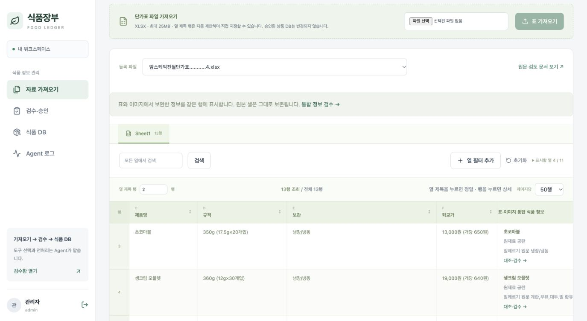
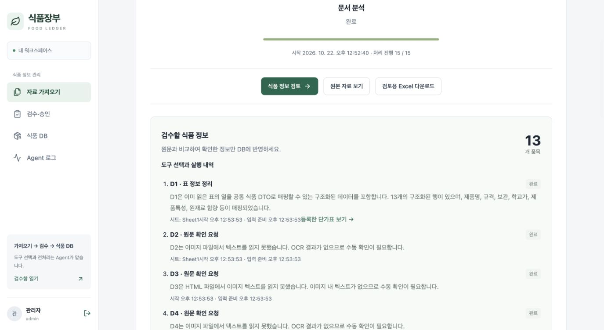
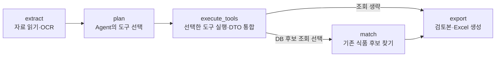

<!--
==============================================================================
FMS_FILE_SPEC
README.md - 프로젝트 문서 README
==============================================================================
설명:
    - 프로젝트 문서 README
입력·출력 명세:
    - 입력: 설계·구현·측정·검증 근거
    - 출력: 설명·명세·예제·검증 또는 발표 안내
실행 가정:
    - 계획·테스트 대역·실제 실행 결과를 구분하고 현재 상태는 README 및 검증 근거 확인
작성 정보:
    - 작성자: 김재현(Finn)
    - 이메일: penguin.klg@gmail.com
    - 작성일: 2026-10-20 (최초 Git 등록일 기준)
    - 라이선스: 미지정
    - 버전: 0.1.0
    - 상태: Development
변경 이력 (Revision History):
    DATE        AUTHOR      VERSION  DESCRIPTION
    --------------------------------------------------------------------
    2026-10-20  미지정      v0.1.0   최초 Git 등록 6dbae100
    2026-10-21  미지정      v0.1.0   파일 역할·입출력·가정·이력 명세 추가

    2026-10-21  김재현(Finn) v0.1.0   Agent 도구 선택 기반 리빌드·업무 경계 및 검증

    2026-10-22  김재현(Finn) v0.1.0   자료·Agent·검수 승인·식품 DB 중심 흐름 및 알레르기 표기 정리

    2026-10-22  김재현(Finn) v0.1.0   실제 화면·비교 근거·5분 발표 자료 작성

    2026-10-22  김재현(Finn) v0.1.0   README·결과 공유 중심 300초 발표 및 근거별 문제 해결 문서 구성

    2026-10-22  김재현(Finn) v0.1.0   청중 공유용 소개·실행 결과 중심 README와 발표자 안내 분리

    2026-10-22  김재현(Finn) v0.1.0   도구별 입출력·실제 LangGraph 단계·재개·로그 확인 설명 보강

    2026-10-22  김재현(Finn) v0.1.0   최신 main 코드·저장 결과·현재 화면 기준 발표 근거 갱신

    2026-10-22  김재현(Finn) v0.1.0   첫 청중을 위한 업무 예시·쉬운 용어·5분 발표 중심 본문 재구성

    상세 Git 이력: git log --follow -- README.md
    공통 규칙: doc/file-header-policy.md
==============================================================================
-->
# 식품장부 · Food Ledger

**업체마다 다른 식품 자료를 한 장부로 정리하고, 사람이 확인한 정보만 반영하는 서비스입니다.**

학교에서 식단을 준비할 때 필요한 가격·규격·공급 상태를 관리합니다. 게시글, 엑셀, 이미지에 흩어진 정보를 AI가 정리하고, 담당자는 원문과 비교해 승인합니다.

**자료 가져오기 → AI 정리 → 담당자 검수·승인 → 식품 장부 업데이트**

[왜 만들었나요?](#1-왜-만들었나요) · [어떻게 사용하나요?](#2-어떻게-사용하나요) · [Agent는 무엇을 하나요?](#3-agent는-무엇을-하나요) · [실제 화면](#4-실제-화면으로-보는-업무-흐름) · [개선한 점](#5-만들면서-어떤-문제를-해결했나요) · [남은 과제](#6-어디까지-구현했고-무엇이-남았나요)

## 1. 왜 만들었나요?

**“지난달 단가표에 있던 제품을 이번 달에도 주문할 수 있을까요?”**

학교 영양 업무에서는 가격뿐 아니라 공급 중단 여부와 대체품까지 확인해야 합니다. 그런데 가격은 엑셀에, 공급 중단 안내는 게시글에, 원재료·알레르기는 이미지에 있는 경우가 있습니다. 업체마다 양식도 달라 담당자가 직접 읽고 장부에 옮겨야 합니다.

광주 학교검색 공개자료의 **2025년 11월 9일 기준 설명에는 초·중·고 314개교**가 있습니다. 초등 155개·중학교 91개·고등학교 68개의 합계입니다. 학교마다 같은 공지를 확인한다면 반복되는 업무입니다. 이 자료를 모으고 정리하는 과정을 줄이는 것이 개발 목적입니다. [공공데이터포털 출처](https://www.data.go.kr/data/15151786/fileData.do)

학교 수는 서비스 이용 학교 수가 아닙니다. 업무 배경은 제안자의 설명에 기반하며 실제 시간 절감 효과는 아직 측정하지 않았습니다. [배경과 집계 범위](doc/submission/background-sources.md)

## 2. 어떻게 사용하나요?

담당자는 다음 흐름으로 작업합니다. **최종 승인 전에는 확정된 식품·단가 정보를 바꾸지 않습니다.**

| 순서 | 담당자가 하는 일 | 서비스가 돕는 일 |
|---|---|---|
| ① 자료 가져오기 | 사이트 자료를 가져오거나 파일 업로드 | 게시글·첨부를 수집하고 처리 상태 표시 |
| ② 원문과 비교하기 | 정리된 값을 확인하고 수정·제외 | 식품명·업체·규격·가격·원재료·알레르기를 같은 양식으로 정리 |
| ③ 승인하기 | 확인한 항목을 최종 승인 | 승인된 식품·단가·공급 상태와 변경 근거 저장 |
| ④ 장부 확인하기 | 현재 정보와 과거 변경 내역 조회 | 어떤 원문 때문에 바뀌었는지 연결 |

예를 들어 **“A제품은 공급 중단, B제품으로 대체”**라는 공지가 올라오면, 서비스가 제품·중단 내용·대체품을 검토할 초안으로 정리합니다. 담당자가 원문을 확인하고 승인하면 장부에 반영하는 방식입니다. 이 문장은 기능을 설명하기 위한 예시입니다.

## 3. Agent는 무엇을 하나요?

**Agent는 자료를 살펴보고 처리할 도구를 고르는 AI입니다.** 도구는 선택받은 작업을 실행하는 프로그램입니다.

| 자료를 보고 내리는 판단 | 선택하는 도구 | 정리하는 정보 |
|---|---|---|
| “이미 제품명·규격·가격 열이 읽혔다” | 표 정리 | 표의 값을 공통 양식에 연결 |
| “문장으로 공급 변경을 설명하고 있다” | 텍스트 해석 | 제품·변경 내용·날짜·사유·대체품 |
| “이미지 안의 상품 설명을 읽어야 한다” | 이미지 해석 | OCR로 읽은 글자에서 상품별 속성 추출 |
| “읽기 어렵거나 근거가 부족하다” | 원문 확인 요청 | 사람이 확인할 위치와 이유 |

**OCR**은 이미지 속 글자를 읽는 기술입니다. 표와 이미지에서 읽은 결과는 **DTO**, 즉 ‘식품 정보를 담는 공통 양식’에 모읍니다. 단가표에 규격이 있고 같은 행의 라벨에 원재료가 있다면, 한 품목에 연결해 보여 줍니다. 없는 정보는 공란으로 둡니다.

**LangGraph는 이 작업의 순서와 중간 저장을 관리합니다.** 한 번에 거대한 요청을 보내는 대신, 단계별로 진행하고 저장된 구간을 재사용합니다.


LangGraph는 **자료 읽기부터 검토본 생성까지** 맡습니다. 이후 담당자의 승인과 장부 반영은 별도 서버 절차로 처리합니다. 어떤 도구를 왜 선택했는지는 **Agent 로그**에서 확인합니다.

[네 도구의 코드 이름·입출력과 실제 LangGraph 단계](#agent와-langgraph-구현-상세) · [전체 구조 설명](doc/food-agent/agent-tools-langgraph.md)

## 4. 실제 화면으로 보는 업무 흐름

실제 업체 단가표의 저장된 분석 결과입니다. 아래 화면은 **검수 초안까지** 보여 줍니다. 촬영을 위해 새로 승인하거나 식품 DB를 변경하지 않았습니다.

### ① 가져온 자료를 한곳에서 확인합니다

분석을 기다리는 자료와 검수할 준비가 된 자료를 같은 목록에서 찾습니다.


### ② 표와 이미지의 정보를 같은 행에서 봅니다

원본 표 옆에서 정리된 식품 정보와 검수 링크를 확인합니다. 원본 셀은 그대로 두고 해석한 정보를 연결합니다.



### ③ 원문과 나란히 비교하고 승인 여부를 결정합니다

왼쪽은 제품 라벨, 오른쪽은 정리된 정보입니다. 누락되거나 잘못 읽은 값은 수정하고, 불필요한 항목은 제외합니다.


### ④ Agent가 한 작업을 확인합니다

선택한 도구와 이유, 처리 상태를 확인합니다. 자세한 모델 호출 기록도 이 화면에서 조회할 수 있습니다.



**분석이 끝났다고 정보가 모두 정확한 것은 아닙니다.** 이 사례에도 안내 문장을 식품으로 잘못 잡거나 알레르기 정보를 잘못 분류한 항목이 남아 있습니다. 그래서 원문 대조와 승인 단계를 두었습니다.

<details>
<summary>이 화면의 촬영 기준과 실제 집계</summary>

2026-10-22, 코드 `402f0c7` 기준 서비스에서 저장된 맘스케익 분석을 읽기 전용으로 조회했습니다. 아래 집계는 추출 정확도나 현재 최신 코드의 새 추론 성능을 뜻하지 않습니다. 이후 원재료 누락 수정은 별도로 추가됐으며 이 캡처에 소급 적용되지 않았습니다.

| 항목 | 촬영 당시 결과 |
|---|---|
| 검수함 | 5건: 분석 대기·진행 중 2건, 검수 가능 3건 |
| 검토 후보 | 13개: 확인 0개·제외 1개·대기 12개 |
| 원문 확인 구간 | 13개 — 품목 수와 다른 단위 |
| 저장된 실제 모델 호출 | 20회 |
| 표 행에 연결된 공통 식품 정보 | 13행 |
| 알레르기 목록이 채워진 행 | 9행 — 정확도 수치가 아님 |

`()`와 발주 안내 문장이 후보로 남고 보관 정보가 알레르기 원문으로 분류된 사례가 있습니다. [조회 기록 JSON](doc/submission/current-code-evidence.json) · [코드와 근거 대조](doc/submission/current-code-review.md)

과거 **18행·1회 호출·6.027초** 기록은 입력이 다른 별도 실행입니다. [과거 실행 기록](doc/submission/table-demo-result.json)에 보관하며 현재 전체 처리 속도로 인용하지 않습니다.

</details>

## 5. 만들면서 어떤 문제를 해결했나요?

| 문제 | 원인과 개선 |
|---|---|
| 18행을 읽었는데 검토에는 8행만 남음 | 이름·규격만으로 다른 맛과 가격까지 합쳤습니다. 통합 기준을 바꿔 같은 입력의 **18행을 보존**했습니다. |
| 라벨 하나의 응답 오류로 전체 분석이 중단됨 | 라벨 응답을 필요한 속성 중심으로 줄이고, 실패 구간은 원문 확인으로 넘겨 나머지 처리를 이어가게 했습니다. |
| 함량 없는 원재료가 ‘기타 속성’으로 빠짐 | 원재료 전용 추출값을 추가해 대두유·마늘처럼 **함량이 없는 재료도 저장**하도록 보완했습니다. |

첫 두 사례는 수정 당시의 과거 실행·회귀 비교입니다. 현재 시연과 입력·조건이 다릅니다. [Before/After와 검증 근거](doc/submission/before-after.md) · [원재료 누락 원인·수정 범위](doc/food-agent/ingredient-extraction.md)

검증 기록은 **백엔드 171개·프론트엔드 16개 테스트와 빌드 통과**입니다. 백엔드 최신 수정은 격리 DB와 규칙 모드·모의 AI로 검증했고, 프론트엔드는 앞선 검증 기록입니다. 테스트 통과 수가 실제 문서의 추출 정확도를 뜻하지는 않습니다.

## 6. 어디까지 구현했고, 무엇이 남았나요?

**자료 수집 → AI의 도구 선택·정보 정리 → 원문 검수·승인 → 식품 장부와 이력 관리** 흐름을 구현했습니다. AI가 자료 정리를 맡고 담당자가 확인한 정보로 장부를 갱신하는 것이 서비스의 핵심입니다.

작은 라벨의 누락, 안내 문장 오인식, 알레르기 오분류는 개선 과제입니다. 앞으로는 업체별 정답 자료로 정확도를 확인하고, 실제 담당자의 수정 횟수와 검토 시간을 측정해 업무에 도움이 되는지 검증하려 합니다.

---

## 구현 상세와 실행 안내

발표에서는 위 1~6절을 순서대로 봅니다. 아래는 구현을 더 확인하거나 직접 실행할 때 참고하는 자료입니다.

<a id="agent와-langgraph-구현-상세"></a>

<details>
<summary>Agent와 LangGraph 구현 상세</summary>

### 네 가지 도구의 코드 이름과 역할

| 도구 | 이런 자료에 사용 | 처리 결과 |
|---|---|---|
| **표 정리** `normalize_table` | 제품명·규격·학교가처럼 열이 읽힌 단가표 | 열을 공통 식품 양식에 연결하고, 맛·규격·가격 기준을 구분한 품목 생성 |
| **텍스트 해석** `extract_text` | “11월부터 공급 중단, B제품으로 대체” 같은 공지 | LLM이 식품·변경 종류·날짜·사유·대체품과 원문 근거 추출 |
| **이미지 해석** `extract_image_regions` | 상품 사진 옆 설명, 원재료·알레르기 라벨 | OCR의 글자와 위치를 상품별로 묶어 정보 추출. 엑셀 라벨은 해당 행의 빈 속성 보완 |
| **원문 확인 요청** `request_review` | 글자가 읽히지 않거나 해석 근거가 부족한 자료 | 확인할 원문을 남기고 사용자 검수로 연결 |

표 정리 도구는 이미 읽힌 행을 LLM으로 다시 추출하지 않습니다. 이미지의 경우 OCR가 글자와 좌표를 확보하고 LLM이 의미를 해석합니다. 상품 행이 명확한 엑셀 라벨은 그 행과 함께 처리해 영역 분류 호출을 생략합니다.

**예를 들어, 단가표 행에 제품명·50g·가격이 있고 라벨 이미지에 “우유 함유”가 있다면:** 표 도구가 기본 정보를 채우고 이미지 도구가 같은 품목의 알레르기를 보완합니다. 사용자는 두 개의 별도 상품이 아닌 **표와 이미지 근거가 연결된 한 품목**을 검수합니다. 설명을 위한 가상 예시이며 실제 추출 정확도 측정과는 별개입니다.

### LangGraph에 실제로 구성한 실행 단계

LangGraph의 **노드**는 하나의 처리 단계, **분기**는 다음 단계의 선택, **상태**는 단계 사이에 전달하는 작업 참조입니다. 이 프로젝트는 다음 다섯 노드를 등록해 실행합니다.



| 단계 | 실제로 하는 일 | 다음 단계에 넘기는 것 |
|---|---|---|
| `extract` | 본문·셀·OCR를 읽고 페이지·행·좌표 근거 저장 | 추출 결과 ID |
| `plan` | Agent가 자료별 도구와 이유, 필요한 업무를 선택 | 처리 계획이 담긴 보고서 ID |
| `execute_tools` | 네 도구 중 선택된 경로를 실행하고 같은 식품 DTO로 통합 | 검토할 품목·근거·확인 필요 구간 |
| `match` | 계획에 DB 조회가 포함됐을 때 기존 상품 후보 검색 | 신규·단일 후보·복수 후보 상태 |
| `export` | 결과와 원문 근거를 검토 화면·Excel로 제공 | 검토본·Excel 파일 ID |

중간 결과는 PostgreSQL에 저장합니다. 재개할 때 추출 결과·도구별 준비 결과·완료 구간 수를 재사용하므로 끝난 구간을 매번 다시 추론하지 않습니다. 진행 중이던 호출은 저장 시점에 따라 다시 실행될 수 있습니다.

검토본이 생성되면 분석 그래프가 끝나고, 사용자는 CMS에서 원문을 대조합니다. **최종 승인과 확정 DB 반영은 별도 서버 절차**로 수행합니다.

### 도구 선택과 실행을 확인하는 방법

**Agent 로그**에서 자료별 선택 도구·이유, 실행 단계, 실제 모델 호출과 토큰·시간을 확인할 수 있습니다. 원문 검수 화면에서는 그 결과에 연결된 표 행·이미지 근거를 비교할 수 있습니다.

구현 확인: [도구 목록·선택 검증](backend/app/domains/analysis/planning.py) · [도구 실행 분기](backend/app/domains/analysis/agent.py) · [LangGraph 노드·분기·checkpoint](backend/app/domains/analysis/workflow.py)

[가상 입력으로 따라가는 처리 예제·상태 저장·MCP와의 관계](doc/food-agent/agent-tools-langgraph.md)에서 세부 동작을 확인할 수 있습니다.

**주요 기술:** Vue 3 · FastAPI · LangGraph · Ollama(Qwen3) · PaddleOCR · PostgreSQL/JSONB · MCP


</details>


<details>
<summary>도구별 입력·처리·출력 명세</summary>

| Agent가 선택하는 도구 | 입력·선택 조건 | 하는 일과 출력 |
|---|---|---|
| `normalize_table` | 인식된 헤더와 구조화된 식품 행 | 원본 XLSX 표 등록, 명시적 병합 셀 복원, 결정적 DTO 매핑. 알려진 행을 다시 LLM으로 추출하지 않음 |
| `extract_text` | 공지 본문·비정형 텍스트/표 | 제한된 구간을 LLM으로 해석해 식품 정보·가격·공급 변경·대체품 후보와 근거 생성 |
| `extract_image_regions` | OCR 텍스트·좌표·페이지/이미지 위치 | 상품 영역과 공통 범례 구분 후 영역별 의미 추출. XLSX에서 연결할 상품 행이 하나면 별도 영역 분류 호출 생략 |
| `request_review` | 읽기 어렵거나 해석할 자료 부족 | 원문과 확인 필요 구간을 보존. 추측으로 DB 값을 생성하지 않음 |

`match_catalog`는 source별 전처리 도구와 별도로 Agent의 Task 선택에 따라 실행되는 **읽기 전용 DB 후보 조회**입니다. `export`는 검토 결과·Excel을 생성하는 마지막 실행 단계입니다. 분석 그래프 내부에 사용자 승인이나 확정 식품 DB CRUD를 맡기지 않았습니다. 수집 자료·분석 기록·검토 초안은 처리 중 저장됩니다.

텍스트·표·이미지의 공통 DTO에는 식품명, 업체, 공통식품코드, 맛·원산지·원재료·등급, 낱개/전체 규격, 포장 수량, 판매 단위, 알레르기, 자료 가격과 `field_sources`를 담습니다. 없는 값은 null입니다. 자료의 가격 기준(규격/kg/개당)과 공급 중단·제조 단종을 구분합니다. 알레르기 번호는 괄호 유무보다 문맥을 확인하고 원문 함유 표시와 추정 후보를 분리합니다.

XLSX 삽입 라벨은 OCR 결과를 해당 행의 상품 정보에 보완하고 표·이미지 근거를 함께 유지합니다. 모호한 연결·OCR 실패는 검수로 남깁니다. [지원 형식·한도·검증](doc/food-agent/embedded-table-images.md)

</details>

<details>
<summary>기술 선택과 적용 범위</summary>

| 기술 | 실제 적용과 선택 이유 |
|---|---|
| Vue 3·Vite / FastAPI | 원문 대조·표 필터·폼과 API를 분리한 CMS |
| LangGraph / Ollama Qwen3 | 업무 단계·재개 관리 / 4B planner, 8B 비정형 추출. 명확한 표는 행별 추론 생략 |
| PaddleOCR | 격리된 CPU 프로세스에서 텍스트·좌표 확보, 가중치 재사용과 유휴 정리 |
| PostgreSQL 17·JSONB | 승인·버전·기간·감사 이력의 트랜잭션과 업체별 가변 속성을 함께 관리 |
| 영속 worker·async HTTP | 웹 요청과 긴 분석 분리, 작업 상태·취소·제한된 재시도. async가 모델 자체를 더 빠르게 생성하게 하지는 않음 |
| MCP | Tool: 제한된 DB 조회 / Resource: 정책·스키마·근거 / Prompt: 업무 지침. stdio 경계 테스트. 기본 worker는 도메인을 직접 호출 |
| 모듈화·경량 DI | identity·ingestion·analysis·review·catalog·pricing·jobs 분리, `call` 콜백·RequestContext 전달 |
| 테스트 | 격리 DB 단위·통합 테스트와 프론트 테스트. 실제 LLM 결과와 테스트 대역을 구분 |

Multi-Agent·벡터 RAG·LangSmith는 현재 미적용입니다. 자체 Agent 로그에서 도구·이유·모델·토큰·시간을 확인합니다. MCP의 기본 모델용 도구에 승인·최종 반영·임의 SQL을 노출하지 않습니다.

[API 명세](doc/food-agent/openapi.json) · [업무 흐름](doc/food-agent/service-workflow.md) · [전체 코드 안내](readmd.md)

</details>

<details>
<summary>개발 환경·설치·테스트 실행</summary>

## 개발 환경과 실행 방법

PostgreSQL 17과 Ollama를 준비합니다. `.env.food`의 DB 주소와 초기 계정 비밀번호를 직접 설정합니다. 회원 비밀번호·세션·API 키는 저장소에 넣지 않습니다.

```sh
python3 -m venv .venv
.venv/bin/python -m pip install -r backend/requirements.lock.txt
npm --prefix frontend ci
npm --prefix frontend run build
cp .env.food.example .env.food
./scripts/start-postgres.sh
.venv/bin/python -m backend.app.seed
ollama pull qwen3:4b
ollama pull qwen3:8b
bash run.sh
```

로컬 주소는 `http://127.0.0.1:8100`입니다. 초기 admin/reviewer/operator/reader의 비밀번호는 설정한 `FOOD_SEED_PASSWORD`를 사용합니다. 실제 사이트 회원 계정은 서비스 로그인과 별도로 연결합니다. OCR은 별도 PaddleOCR 환경과 `FOOD_OCR_PYTHON` 설정이 필요합니다. [상세 실행법](readmd.md)을 확인하세요.


## 검증·운영 참고

```sh
# 반드시 운영 DB와 다른 *_test DB 사용
DATABASE_URL=postgresql://localhost:55432/food_fms_refactor_test \
FOOD_ANALYSIS_MODE=rules FOOD_SEED_PASSWORD=local-food-2026 \
.venv/bin/python -m pytest backend/tests -q
node --test frontend/tests/*.test.js
npm --prefix frontend run build
```

25MiB 파일 상한, 압축 해제·셀·픽셀·LLM 입력·동시성에 별도 한도를 둡니다. XLSX 이미지 자동 분석은 파일당 40개까지이며 초과분은 원문 검수로 남깁니다. 실제 LLM·OCR는 별도 실행 검증이 필요합니다. CI의 규칙 모드나 테스트 대역을 실제 AI 추론으로 설명하지 않습니다.

[최종 요구사항 점검](doc/submission/requirements-audit.md) · [파일별 명세와 이력](doc/file-specs.md) · [작성 규칙](doc/file-header-policy.md)

작성자 김재현(Finn) · 이메일 penguin.klg@gmail.com · 라이선스 미지정. 실제 계정·세션·원본 첨부·모델 가중치는 Git에서 제외합니다.

</details>

[발표자용 5분 진행안](doc/submission/presentation-5min.md) · [시연 환경 준비](doc/submission/demo-guide.md) · [전체 구현 문서](readmd.md)
