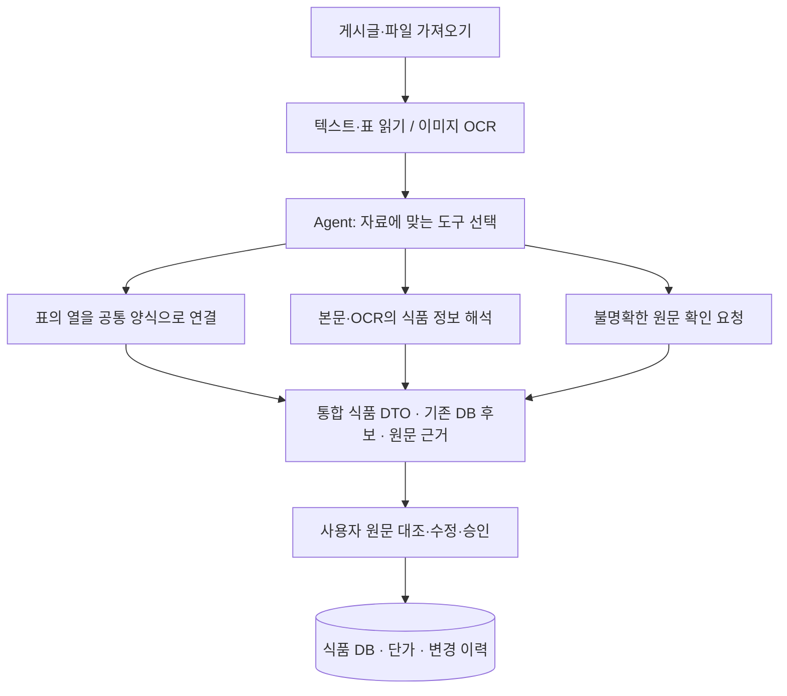
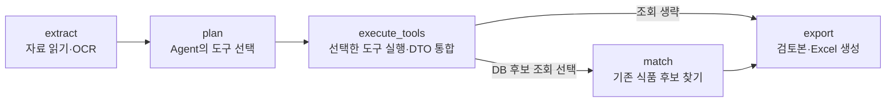

<!--
==============================================================================
FMS_FILE_SPEC
README.md - 프로젝트 문서 README
==============================================================================
설명:
    - 프로젝트 문서 README
입력·출력 명세:
    - 입력: 설계·구현·측정·검증 근거
    - 출력: 설명·명세·예제·검증 또는 발표 안내
실행 가정:
    - 계획·테스트 대역·실제 실행 결과를 구분하고 현재 상태는 README 및 검증 근거 확인
작성 정보:
    - 작성자: 김재현(Finn)
    - 이메일: penguin.klg@gmail.com
    - 작성일: 2026-10-20 (최초 Git 등록일 기준)
    - 라이선스: 미지정
    - 버전: 0.1.0
    - 상태: Development
변경 이력 (Revision History):
    DATE        AUTHOR      VERSION  DESCRIPTION
    --------------------------------------------------------------------
    2026-10-20  미지정      v0.1.0   최초 Git 등록 6dbae100
    2026-10-21  미지정      v0.1.0   파일 역할·입출력·가정·이력 명세 추가

    2026-10-21  김재현(Finn) v0.1.0   Agent 도구 선택 기반 리빌드·업무 경계 및 검증

    2026-10-22  김재현(Finn) v0.1.0   자료·Agent·검수 승인·식품 DB 중심 흐름 및 알레르기 표기 정리

    2026-10-22  김재현(Finn) v0.1.0   실제 화면·비교 근거·5분 발표 자료 작성

    2026-10-22  김재현(Finn) v0.1.0   README·결과 공유 중심 300초 발표 및 근거별 문제 해결 문서 구성

    2026-10-22  김재현(Finn) v0.1.0   청중 공유용 소개·실행 결과 중심 README와 발표자 안내 분리

    2026-10-22  김재현(Finn) v0.1.0   도구별 입출력·실제 LangGraph 단계·재개·로그 확인 설명 보강

    상세 Git 이력: git log --follow -- README.md
    공통 규칙: doc/file-header-policy.md
==============================================================================
-->
# 식품장부 · Food Ledger

### 자료는 Agent가 정리하고, 식품 정보는 사람이 확인해 확정합니다.

광주 지역 학교의 영양 업무를 위한 **식품 정보 관리 CMS**입니다. 업체 게시글·이미지·단가표를 읽어 같은 형식의 식품 정보로 정리하고, 원문을 확인한 담당자의 승인에 따라 장부를 갱신합니다.

**자료 가져오기 → Agent 처리 → 원문 대조·승인 → 식품 DB와 변경 이력**

[개발 배경](#1-개발-배경) · [주요 기능](#2-주요-기능) · [Agent와 아키텍처](#3-agent와-아키텍처) · [실제 실행 결과](#4-실제-실행-결과) · [개선 과정](#5-개선-과정) · [다음 단계](#6-한계와-다음-단계)

## 1. 개발 배경

**광주 초·중·고 314개교 규모에서 반복될 수 있는 자료 확인 업무에 주목했습니다.**

| 초등학교 | 중학교 | 고등학교 | 합계 |
|---:|---:|---:|---:|
| 155개 | 91개 | 68개 | **314개교** |

교육청 학교검색 공개자료의 **2025년 11월 9일 기준 설명**을 합산한 수치입니다. 서비스 이용 학교 수를 뜻하지 않습니다. [공공데이터포털 출처](https://www.data.go.kr/data/15151786/fileData.do)

식단에 사용할 식품을 고를 때는 가격·규격과 함께 **지금도 공급 가능한 제품인지** 확인해야 합니다. 그런데 업체마다 단가표 양식이 다르고, 일시중단·단종·재공급·대체품 안내는 게시글과 이미지, 첨부파일에 흩어져 있습니다.

학교마다 같은 공지를 찾아 읽고 장부와 대조한다면 동일한 확인 작업이 여러 담당자에게 반복될 수 있습니다. 식품장부는 이 과정에서 필요한 **자료 수집·정보 정리·변경 근거 추적**을 하나의 업무 흐름으로 연결합니다.

| 현재의 병목 | 서비스의 대응 |
|---|---|
| 게시판과 첨부에서 변경 사항을 직접 찾음 | 자료 수집과 변경 감지 |
| 업체별 양식을 다시 읽고 옮겨 적음 | 공통 식품 정보 형식으로 정리 |
| 중단·대체·가격 변경을 장부와 대조 | 기존 식품 후보와 검수 초안 연결 |
| 수정 이유를 확인하려고 원문을 다시 검색 | 변경 이력에서 원문 근거 조회 |

업무 배경은 프로젝트 제안자의 설명에 기반합니다. 실제 확인 횟수와 업무 시간 절감률은 향후 검증 대상입니다. [집계 범위와 배경 근거](doc/submission/background-sources.md)

## 2. 주요 기능

| 업무 | 사용자가 할 수 있는 일 |
|---|---|
| **자료 가져오기** | 사이트 공지·첨부를 수집하거나 파일을 올리고 처리 상태 확인 |
| **Agent 처리 확인** | 자료에 맞게 선택한 도구·선택 이유·실행 기록 조회 |
| **검수·승인** | 원문과 추출값을 비교하고 수정·확인·제외한 뒤 최종 승인 |
| **식품 DB 관리** | 식품·단가·공급 상태·대체품과 변경 이력·근거 조회 |

본문·표·이미지의 결과는 같은 **FoodRecord DTO(식품 정보를 담는 공통 양식)**로 정리합니다. 식품명과 업체, 맛, 낱개·전체 규격, 포장 수량, 가격 기준, 원재료·알레르기를 구분하고, 없는 정보는 공란으로 둡니다.

가져온 자료는 분석 전부터 검수 대기 목록에 표시됩니다. 표의 같은 행에서 이미지로 보완한 정보와 검수 경로를 확인하며, 검수에서 저장한 수정값도 동일한 DTO로 조회합니다. **최종 승인 전에는 확정 식품·단가 DB를 변경하지 않습니다.**

## 3. Agent와 아키텍처

**Agent는 처리 방법을 고르고, 도구는 자료를 정리하며, LangGraph는 실행 순서와 재개를 관리합니다.**



| 구성 | 맡은 역할 |
|---|---|
| **Agent·LLM** | 읽힌 열·본문·OCR 위치를 보고 처리 도구와 이유 결정 |
| **처리 도구** | 표 매핑, 텍스트 의미 추출, 상품 영역별 이미지 정보 추출, 원문 검수 요청 |
| **LangGraph** | 추출 → 계획 → 도구 실행 → 기존 DB 후보 조회(선택) → 검토본 생성, 진행 상태 저장·재개 |
| **검수·반영 서버** | 사용자 승인과 근거·버전·기간을 확인한 뒤 DB 반영 |

### 자료에 따라 선택하는 네 가지 도구

| 도구 | 이런 자료에 사용 | 처리 결과 |
|---|---|---|
| **표 정리** `normalize_table` | 제품명·규격·학교가처럼 열이 읽힌 단가표 | 열을 공통 식품 양식에 연결하고, 맛·규격·가격 기준을 구분한 품목 생성 |
| **텍스트 해석** `extract_text` | “11월부터 공급 중단, B제품으로 대체” 같은 공지 | LLM이 식품·변경 종류·날짜·사유·대체품과 원문 근거 추출 |
| **이미지 해석** `extract_image_regions` | 상품 사진 옆 설명, 원재료·알레르기 라벨 | OCR의 글자와 위치를 상품별로 묶어 정보 추출. 엑셀 라벨은 해당 행의 빈 속성 보완 |
| **원문 확인 요청** `request_review` | 글자가 읽히지 않거나 해석 근거가 부족한 자료 | 확인할 원문을 남기고 사용자 검수로 연결 |

표 정리 도구는 이미 읽힌 행을 LLM으로 다시 추출하지 않습니다. 이미지의 경우 OCR가 글자와 좌표를 확보하고 LLM이 의미를 해석합니다. 상품 행이 명확한 엑셀 라벨은 그 행과 함께 처리해 영역 분류 호출을 생략합니다.

**예를 들어, 단가표 행에 제품명·50g·가격이 있고 라벨 이미지에 “우유 함유”가 있다면:** 표 도구가 기본 정보를 채우고 이미지 도구가 같은 품목의 알레르기를 보완합니다. 사용자는 두 개의 별도 상품이 아닌 **표와 이미지 근거가 연결된 한 품목**을 검수합니다. 설명을 위한 가상 예시이며 실제 추출 정확도 측정과는 별개입니다.

### LangGraph에 실제로 구성한 실행 단계

LangGraph의 **노드**는 하나의 처리 단계, **분기**는 다음 단계의 선택, **상태**는 단계 사이에 전달하는 작업 참조입니다. 이 프로젝트는 다음 다섯 노드를 등록해 실행합니다.



| 단계 | 실제로 하는 일 | 다음 단계에 넘기는 것 |
|---|---|---|
| `extract` | 본문·셀·OCR를 읽고 페이지·행·좌표 근거 저장 | 추출 결과 ID |
| `plan` | Agent가 자료별 도구와 이유, 필요한 업무를 선택 | 처리 계획이 담긴 보고서 ID |
| `execute_tools` | 네 도구 중 선택된 경로를 실행하고 같은 식품 DTO로 통합 | 검토할 품목·근거·확인 필요 구간 |
| `match` | 계획에 DB 조회가 포함됐을 때 기존 상품 후보 검색 | 신규·단일 후보·복수 후보 상태 |
| `export` | 결과와 원문 근거를 검토 화면·Excel로 제공 | 검토본·Excel 파일 ID |

중간 결과는 PostgreSQL에 저장합니다. 재개할 때 추출 결과·도구별 준비 결과·완료 구간 수를 재사용하므로 끝난 구간을 매번 다시 추론하지 않습니다. 진행 중이던 호출은 저장 시점에 따라 다시 실행될 수 있습니다.

검토본이 생성되면 분석 그래프가 끝나고, 사용자는 CMS에서 원문을 대조합니다. **최종 승인과 확정 DB 반영은 별도 서버 절차**로 수행합니다.

### 도구 선택과 실행을 확인하는 방법

**Agent 로그**에서 자료별 선택 도구·이유, 실행 단계, 실제 모델 호출과 토큰·시간을 확인할 수 있습니다. 원문 검수 화면에서는 그 결과에 연결된 표 행·이미지 근거를 비교할 수 있습니다.

구현 확인: [도구 목록·선택 검증](backend/app/domains/analysis/planning.py) · [도구 실행 분기](backend/app/domains/analysis/agent.py) · [LangGraph 노드·분기·checkpoint](backend/app/domains/analysis/workflow.py)

[가상 입력으로 따라가는 처리 예제·상태 저장·MCP와의 관계](doc/food-agent/agent-tools-langgraph.md)에서 세부 동작을 확인할 수 있습니다.

**주요 기술:** Vue 3 · FastAPI · LangGraph · Ollama(Qwen3) · PaddleOCR · PostgreSQL/JSONB · MCP

## 4. 실제 실행 결과

실제 업체 단가표를 처리한 결과에서 **원본 확인 → Agent 판단 → 검수 → 변경 이력**의 흐름을 확인했습니다. 아래는 2026년 10월 22일에 보관한 실행 화면입니다.

### 원본 단가표에서 다른 맛과 가격 확인

같은 제품명·50g 규격의 원본 세 행을 조회한 화면입니다. 맛이나 가격 조건이 다른 품목은 각각 보존해야 합니다.


### Agent의 도구 선택과 실행 기록

이 표에서는 Agent가 `normalize_table`을 선택했습니다. 4B 모델을 도구 선택에 1회 호출하고, 인식된 행은 표 매핑 도구로 정리했습니다.

| 실제 실행에서 관찰한 값 | 결과 |
|---|---:|
| 검토할 품목 | **18개** |
| 도구 선택 모델 호출 | **1회** |
| 표 행 추출용 LLM 호출 | **0회** |
| 해당 분석 작업의 시작~완료 | **6.027초** |


기수집 엑셀을 재등록한 단일 실행입니다. 시간에는 사이트 다운로드·대기열·사람 검토가 포함되지 않으며, 제목 1구간은 수동 확인으로 남았습니다. [실행 기록](doc/submission/table-demo-result.json)

### 원문 옆에서 검수하고 승인

원본 셀과 정리된 식품 정보를 나란히 대조합니다. 공란을 확인하고 값을 수정하거나 품목을 제외할 수 있습니다. 품목 확인 저장 후 최종 승인으로 이어집니다. 아래 18개 품목은 검토 대기 상태까지 촬영했으며 승인하지 않았습니다.


### 식품 DB에서 변경 사유와 근거 조회

기존에 승인돼 있던 꽃게 품목의 공급 일시중단 이력입니다. 변경 사유에서 게시글 원문까지 연결됩니다. 앞의 18개 품목을 새로 승인한 결과와는 별도의 조회 사례입니다.


<details>
<summary>실행 기록의 범위와 최근 수정 결과</summary>

위 18행 실행의 과거 run은 현재 DB에 남아 있지 않아 보존된 캡처와 JSON으로 공유합니다. 모델 시간은 5.765초, 입력 787/출력 130 tokens였습니다. 반복 성능이나 필드 정확도를 측정한 결과는 아닙니다.

이후 라벨 형식 오류가 난 실제 분석을 저장 지점부터 재개해 15/15구간 완료·13품목 통합·검토 Excel 생성을 확인했습니다. 이전에 보류한 원문 70구간은 수동 확인 대상으로 유지했습니다. [오류 재현과 복구](doc/submission/before-after/05-model-schema-recovery.md)

검수함에서는 미반영 대기 자료 5건, 표 조회에서는 13행의 동일 DTO 연결을 읽기 전용으로 확인했습니다. 승인된 식품 DB를 시연 목적으로 변경하지 않았습니다. [검수함·표 연결 기준](doc/food-agent/review-material-flow.md)

</details>

## 5. 개선 과정

### 읽은 정보가 사라지지 않도록 통합 기준 수정

이전에는 이름과 규격이 같다는 이유로 다른 맛·가격의 행까지 합쳤습니다. 병합 셀과 맛·가격 기준을 구분해 **같은 입력의 18개 행을 모두 보존**했습니다.

| 동일 XLSX의 파서·통합 코드 비교 | Before | After |
|---|---:|---:|
| 읽은 상품 행 | 18 | 18 |
| 검토에 남은 행 | 8 | **18** |
| 보존한 숫자 가격 값 | 9 | **19** |


DTO helper는 현재 코드를 공유한 회귀 비교이며 전체 과거 환경의 성능 비교는 아닙니다. [입력 해시·재현 범위](doc/submission/before-after/01-table-preservation.md)

### 한 구간의 형식 오류로 전체 분석이 멈추지 않도록 복구 경계 추가

상품 라벨에서 포장 단가와 개당 단가를 별도 품목으로 반환하면서 ‘결과 1개’ 조건을 위반한 문제가 있었습니다. 라벨 응답을 **원재료·알레르기 보완에 필요한 속성만** 받도록 줄였습니다. 형식 오류가 남는 구간은 제한적으로 분할하거나 원문 검수로 넘기고 다른 구간을 계속 처리합니다.

같은 실패 입력의 재실행에서 수정한 응답 형식의 검증 통과를 확인했습니다. 출력은 1,091→397 tokens였으며 정확도 개선율을 뜻하지는 않습니다. [원인·실제 재현·회귀 검증](doc/submission/before-after/05-model-schema-recovery.md)

그 밖에 OCR 프로세스 종료 충돌, 다중 근거 승인 실패, 표 안의 라벨 이미지 누락을 개선했습니다. [Before/After 전체 사례](doc/submission/before-after.md)

**검증 결과: 백엔드 165개 · 프론트엔드 16개 테스트 및 Vite 빌드 통과** — 2026-10-22 기준. 테스트 통과 수와 실제 추출 정확도는 별도로 평가합니다.

## 6. 한계와 다음 단계

현재는 자료를 정리하고 근거를 보존해 **검수 가능한 초안**을 만드는 단계입니다. 작은 라벨과 다양한 업체 양식의 누락이 남아 있으며, 수집 주기와 사용자 승인에 따라 DB 갱신 시점이 달라집니다.

| 다음 검증 | 확인하려는 것 |
|---|---|
| 업체별 정답 데이터 | 식품명·규격·알레르기·가격의 정확도와 누락률 |
| 실제 담당자 검수 | 수정 횟수와 검토 시간 |
| 반복 실행·운영 측정 | 전체 지연시간·재시도·합산 메모리와 안정성 |

구현 과정에서 정보의 보존, 처리 실패의 설명, 원문을 확인할 수 있는 검수 흐름이 함께 필요하다는 점을 확인했습니다. 다음 단계는 이 구조가 실제 영양 업무의 반복 확인을 얼마나 줄이는지 검증하는 것입니다.

---

## 구현 상세와 실행 안내

<details>
<summary>도구별 입력·처리·출력 명세</summary>

| Agent가 선택하는 도구 | 입력·선택 조건 | 하는 일과 출력 |
|---|---|---|
| `normalize_table` | 인식된 헤더와 구조화된 식품 행 | 원본 XLSX 표 등록, 명시적 병합 셀 복원, 결정적 DTO 매핑. 알려진 행을 다시 LLM으로 추출하지 않음 |
| `extract_text` | 공지 본문·비정형 텍스트/표 | 제한된 구간을 LLM으로 해석해 식품 정보·가격·공급 변경·대체품 후보와 근거 생성 |
| `extract_image_regions` | OCR 텍스트·좌표·페이지/이미지 위치 | 상품 영역과 공통 범례 구분 후 영역별 의미 추출. XLSX에서 연결할 상품 행이 하나면 별도 영역 분류 호출 생략 |
| `request_review` | 읽기 어렵거나 해석할 자료 부족 | 원문과 확인 필요 구간을 보존. 추측으로 DB 값을 생성하지 않음 |

`match_catalog`는 source별 전처리 도구와 별도로 Agent의 Task 선택에 따라 실행되는 **읽기 전용 DB 후보 조회**입니다. `export`는 검토 결과·Excel을 생성하는 마지막 실행 단계입니다. 분석 그래프 내부에 사용자 승인이나 확정 식품 DB CRUD를 맡기지 않았습니다. 수집 자료·분석 기록·검토 초안은 처리 중 저장됩니다.

텍스트·표·이미지의 공통 DTO에는 식품명, 업체, 공통식품코드, 맛·원산지·원재료·등급, 낱개/전체 규격, 포장 수량, 판매 단위, 알레르기, 자료 가격과 `field_sources`를 담습니다. 없는 값은 null입니다. 자료의 가격 기준(규격/kg/개당)과 공급 중단·제조 단종을 구분합니다. 알레르기 번호는 괄호 유무보다 문맥을 확인하고 원문 함유 표시와 추정 후보를 분리합니다.

XLSX 삽입 라벨은 OCR 결과를 해당 행의 상품 정보에 보완하고 표·이미지 근거를 함께 유지합니다. 모호한 연결·OCR 실패는 검수로 남깁니다. [지원 형식·한도·검증](doc/food-agent/embedded-table-images.md)

</details>

<details>
<summary>기술 선택과 적용 범위</summary>

| 기술 | 실제 적용과 선택 이유 |
|---|---|
| Vue 3·Vite / FastAPI | 원문 대조·표 필터·폼과 API를 분리한 CMS |
| LangGraph / Ollama Qwen3 | 업무 단계·재개 관리 / 4B planner, 8B 비정형 추출. 명확한 표는 행별 추론 생략 |
| PaddleOCR | 격리된 CPU 프로세스에서 텍스트·좌표 확보, 가중치 재사용과 유휴 정리 |
| PostgreSQL 17·JSONB | 승인·버전·기간·감사 이력의 트랜잭션과 업체별 가변 속성을 함께 관리 |
| 영속 worker·async HTTP | 웹 요청과 긴 분석 분리, 작업 상태·취소·제한된 재시도. async가 모델 자체를 더 빠르게 생성하게 하지는 않음 |
| MCP | Tool: 제한된 DB 조회 / Resource: 정책·스키마·근거 / Prompt: 업무 지침. stdio 경계 테스트. 기본 worker는 도메인을 직접 호출 |
| 모듈화·경량 DI | identity·ingestion·analysis·review·catalog·pricing·jobs 분리, `call` 콜백·RequestContext 전달 |
| 테스트 | 격리 DB 단위·통합 테스트와 프론트 테스트. 실제 LLM 결과와 테스트 대역을 구분 |

Multi-Agent·벡터 RAG·LangSmith는 현재 미적용입니다. 자체 Agent 로그에서 도구·이유·모델·토큰·시간을 확인합니다. MCP의 기본 모델용 도구에 승인·최종 반영·임의 SQL을 노출하지 않습니다.

[API 명세](doc/food-agent/openapi.json) · [업무 흐름](doc/food-agent/service-workflow.md) · [전체 코드 안내](readmd.md)

</details>

<details>
<summary>개발 환경·설치·테스트 실행</summary>

## 개발 환경과 실행 방법

PostgreSQL 17과 Ollama를 준비합니다. `.env.food`의 DB 주소와 초기 계정 비밀번호를 직접 설정합니다. 회원 비밀번호·세션·API 키는 저장소에 넣지 않습니다.

```sh
python3 -m venv .venv
.venv/bin/python -m pip install -r backend/requirements.lock.txt
npm --prefix frontend ci
npm --prefix frontend run build
cp .env.food.example .env.food
./scripts/start-postgres.sh
.venv/bin/python -m backend.app.seed
ollama pull qwen3:4b
ollama pull qwen3:8b
bash run.sh
```

로컬 주소는 `http://127.0.0.1:8100`입니다. 초기 admin/reviewer/operator/reader의 비밀번호는 설정한 `FOOD_SEED_PASSWORD`를 사용합니다. 실제 사이트 회원 계정은 서비스 로그인과 별도로 연결합니다. OCR은 별도 PaddleOCR 환경과 `FOOD_OCR_PYTHON` 설정이 필요합니다. [상세 실행법](readmd.md)을 확인하세요.


## 검증·운영 참고

```sh
# 반드시 운영 DB와 다른 *_test DB 사용
DATABASE_URL=postgresql://localhost:55432/food_fms_refactor_test \
FOOD_ANALYSIS_MODE=rules FOOD_SEED_PASSWORD=local-food-2026 \
.venv/bin/python -m pytest backend/tests -q
node --test frontend/tests/*.test.js
npm --prefix frontend run build
```

25MiB 파일 상한, 압축 해제·셀·픽셀·LLM 입력·동시성에 별도 한도를 둡니다. XLSX 이미지 자동 분석은 파일당 40개까지이며 초과분은 원문 검수로 남깁니다. 실제 LLM·OCR는 별도 실행 검증이 필요합니다. CI의 규칙 모드나 테스트 대역을 실제 AI 추론으로 설명하지 않습니다.

[최종 요구사항 점검](doc/submission/requirements-audit.md) · [파일별 명세와 이력](doc/file-specs.md) · [작성 규칙](doc/file-header-policy.md)

작성자 김재현(Finn) · 이메일 penguin.klg@gmail.com · 라이선스 미지정. 실제 계정·세션·원본 첨부·모델 가중치는 Git에서 제외합니다.

</details>

[발표자용 5분 진행안](doc/submission/presentation-5min.md) · [시연 환경 준비](doc/submission/demo-guide.md) · [전체 구현 문서](readmd.md)
