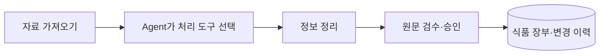

<!--
==============================================================================
FMS_FILE_SPEC
README.md - 프로젝트 문서 README
==============================================================================
설명:
    - 프로젝트 문서 README
입력·출력 명세:
    - 입력: 설계·구현·측정·검증 근거
    - 출력: 설명·명세·예제·검증 또는 발표 안내
실행 가정:
    - 계획·테스트 대역·실제 실행 결과를 구분하고 현재 상태는 README 및 검증 근거 확인
작성 정보:
    - 작성자: 김재현(Finn)
    - 이메일: penguin.klg@gmail.com
    - 작성일: 2026-10-20 (최초 Git 등록일 기준)
    - 라이선스: 미지정
    - 버전: 0.1.0
    - 상태: Development
변경 이력 (Revision History):
    DATE        AUTHOR      VERSION  DESCRIPTION
    --------------------------------------------------------------------
    2026-10-20  미지정      v0.1.0   최초 Git 등록 6dbae100
    2026-10-21  미지정      v0.1.0   파일 역할·입출력·가정·이력 명세 추가

    2026-10-21  김재현(Finn) v0.1.0   Agent 도구 선택 기반 리빌드·업무 경계 및 검증

    2026-10-22  김재현(Finn) v0.1.0   자료·Agent·검수 승인·식품 DB 중심 흐름 및 알레르기 표기 정리

    2026-10-22  김재현(Finn) v0.1.0   실제 화면·비교 근거·5분 발표 자료 작성

    2026-10-22  김재현(Finn) v0.1.0   README·결과 공유 중심 300초 발표 및 근거별 문제 해결 문서 구성

    2026-10-22  김재현(Finn) v0.1.0   청중 공유용 소개·실행 결과 중심 README와 발표자 안내 분리

    2026-10-22  김재현(Finn) v0.1.0   도구별 입출력·실제 LangGraph 단계·재개·로그 확인 설명 보강

    2026-10-22  김재현(Finn) v0.1.0   최신 main 코드·저장 결과·현재 화면 기준 발표 근거 갱신

    2026-10-22  김재현(Finn) v0.1.0   과정·결과·쉬운 사례와 기대효과 중심 5분 발표 README 정리

    2026-10-22  김재현(Finn) v0.1.0   향후 개선 목표·Agent 선택 도구 요약 및 300초 진행안 반영

    상세 Git 이력: git log --follow -- README.md
    공통 규칙: doc/file-header-policy.md
==============================================================================
-->
# 식품장부

**학교 영양 업무에 필요한 식품 자료를 AI가 정리하고, 담당자가 확인해 장부에 반영하는 서비스입니다.**

## 1. 왜 만들었나요?

“지난달 단가표에 있던 제품을 이번 달에도 주문할 수 있을까요?”

가격은 엑셀에, 공급 중단 안내는 게시글에, 원재료와 알레르기는 이미지에 흩어져 있습니다. 업체마다 양식도 달라 담당자는 자료를 찾아 읽고 다시 정리해야 합니다.

광주 초·중·고는 공개자료 설명 기준 **314개교**입니다. 학교마다 같은 공지를 확인한다면 반복되는 업무입니다. 식품장부는 이 자료 수집과 정리를 하나의 흐름으로 연결하기 위해 만들었습니다.

학교 수는 2025-11-09 기준 초등 155·중학교 91·고등학교 68개교 합계이며 서비스 이용 학교 수가 아닙니다. [공식 출처](https://www.data.go.kr/data/15151786/fileData.do) · [배경 근거](doc/submission/background-sources.md)

## 2. 어떤 일을 도와주나요?

**예를 들어, 빵 단가표와 제품 라벨을 함께 받았다고 생각해 보겠습니다.**

| 받은 자료 | 서비스가 정리하는 내용 | 담당자가 확인하는 내용 |
|---|---|---|
| 엑셀의 제품명·규격·가격 | 제품별 식품 정보와 단가 초안 | 어떤 규격의 가격인지 |
| 라벨 이미지의 원재료·알레르기 | 같은 제품의 속성으로 연결 | 원문을 정확하게 읽었는지 |
| 게시글의 “일시 공급 중단” 안내 | 공급 상태 변경 초안 | 대상 제품과 적용 시점 |

담당자는 원문과 정리된 값을 비교해 **수정·제외·승인**합니다. 승인한 정보는 식품 장부에 반영하고, 나중에도 변경 근거를 확인할 수 있습니다. 위 표는 처리 방식을 설명하는 예시입니다.

## 3. 어떻게 처리하나요?

**Agent는 자료를 보고 다음 네 가지 도구 중 알맞은 것을 선택합니다.**

| 선택 가능한 도구 | 하는 일 |
|---|---|
| 표 정리 | 엑셀에서 읽은 제품명·규격·가격을 같은 양식으로 정리 |
| 텍스트 해석 | 게시글에서 가격·공급 중단·변경 사유 등을 추출 |
| 이미지 해석 | OCR로 읽은 글자와 위치를 보고 상품별 정보 추출 |
| 원문 확인 요청 | 읽기 어렵거나 근거가 부족한 부분을 검수 대상으로 남김 |

LangGraph에는 **자료 읽기 → 도구 선택 → 실행 → 기존 식품 후보 조회(선택) → 검토본·Excel 생성** 단계를 구성했습니다. [실제 도구 이름과 실행 단계](doc/food-agent/agent-tools-langgraph.md)

**LangGraph는 처리 순서와 중간 저장을 관리합니다.** 담당자는 Agent 로그에서 어떤 도구를 왜 선택했는지 확인할 수 있습니다. 최종 승인 전에는 확정된 식품·단가를 바꾸지 않습니다.

## 4. 실제 화면에서는 이렇게 사용합니다

### 자료를 가져와 처리 상태를 확인합니다

분석을 기다리는 자료와 검수할 자료를 한곳에서 확인합니다.

### 원문과 나란히 비교해 확인합니다

왼쪽 제품 라벨과 오른쪽 정리된 식품 정보를 대조합니다. 틀린 값은 수정하고, 불필요한 항목은 제외한 뒤 승인합니다.

### 승인된 단가와 변경 근거를 조회합니다

실제 승인된 눈꽃치즈 **29,000원/2.5kg**을 식품 상세에서 확인한 화면입니다. 적용일과 근거도 함께 조회합니다.

각 화면은 서로 다른 저장 자료를 조회한 사례입니다. 앞의 빵 검수를 통해 뒤의 치즈 단가를 등록했다는 뜻은 아닙니다. 최신 OCR 개선을 적용해 새로 추론한 결과도 아닙니다. [촬영·집계 기록](doc/submission/current-code-evidence.json) · [단가 표시 확인](doc/food-agent/approved-price-readmodel.md)

## 5. 만들면서 무엇을 개선했나요?

| 문제 | 개선한 방식 |
|---|---|
| 이름과 규격이 같으면 다른 맛까지 한 제품으로 합쳐짐 | 맛·규격·가격 조건을 구분해 서로 다른 항목 보존 |
| 이미지에서 가까운 설명이 다른 제품에 붙을 위험 | 문장별 위치와 상품 소속을 유지하고, 근거가 불명확한 값은 검수 요청 |
| 단가는 승인됐지만 식품 화면에서 찾기 어려움 | 승인 단가를 상세 상단에 표시하고 자료의 참고 가격과 구분 |

예를 들어 **딸기맛 50g과 초코맛 50g은 무게가 같아도 다른 항목**입니다. 이런 구분을 유지하면서 원문 근거까지 연결하는 것이 중요했습니다. 이 맛 예시는 개선 원리를 설명하기 위한 예시이며, 실제 비교 기록은 [Before/After](doc/submission/before-after.md)에 있습니다.

작은 라벨의 누락과 오인식은 남아 있습니다. AI 결과를 바로 확정하지 않고 사람이 검수하도록 설계했으며, 앞으로 실제 자료의 정확도와 담당자의 검토 시간을 측정하려 합니다.

더 확인하려면: [Agent·도구·LangGraph 상세](doc/food-agent/agent-tools-langgraph.md) · [OCR 개선과 검증](doc/food-agent/ocr-spatial-evidence.md) · [실행 방법](readmd.md) · [발표자용5분 진행안](doc/submission/presentation-5min.md)

## 6. 앞으로 개선하고 싶은 부분

- **더 정확하게 읽기:** 작은 라벨이나 상품이 붙어 있는 이미지에서 필요한 부분을 확대해 다시 읽고, 다른 제품의 정보가 섞이는 오류를 줄이고 싶습니다.
- **더 빠르게 처리하기:** 같은 자료의 분석 결과를 더 잘 재사용하고, 변경되거나 확인이 필요한 부분만 처리해 대기 시간을 줄이고 싶습니다.
- **실제 업무에서 검증하기:** 영양 업무 담당자가 직접 사용해 보면서 수정 횟수와 검토 시간을 측정하고, 자주 확인하는 정보를 더 쉽게 찾도록 개선하고 싶습니다.

현재도 일부 결과 재사용과 근거 검증은 구현돼 있습니다. 위 내용은 이를 더 발전시키고 실제 효과를 확인하기 위한 향후 목표입니다.

## 7. 기대효과

- **자료 확인 부담 감소:** 게시글·엑셀·이미지를 찾아 옮겨 적는 반복 작업을 줄입니다.
- **변경 정보 확인 지원:** 가격·공급 중단·대체품 안내를 승인된 장부와 근거로 함께 확인합니다.
- **업무 인수인계 지원:** 언제, 무엇이, 어떤 자료 때문에 바뀌었는지 추적할 수 있습니다.

기대효과는 개발 목표이며, 실제 시간 절감률과 업무 개선 효과는 사용자 검증을 통해 확인할 예정입니다.
