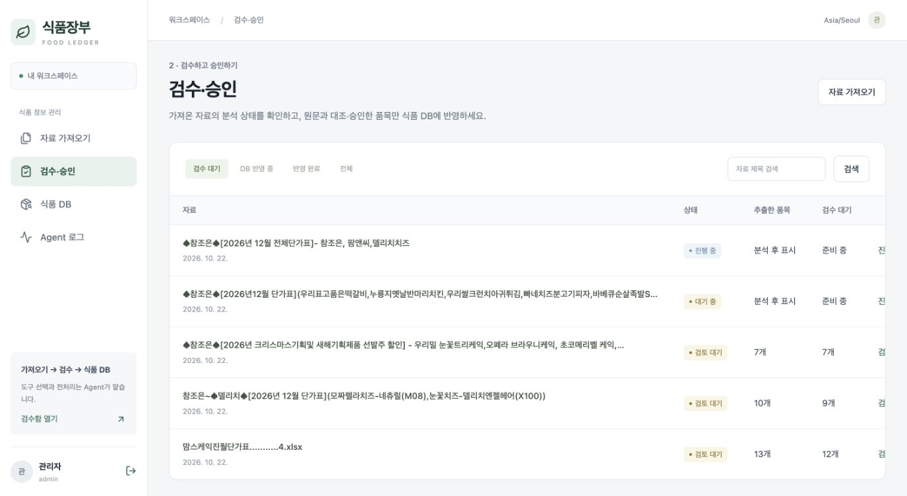
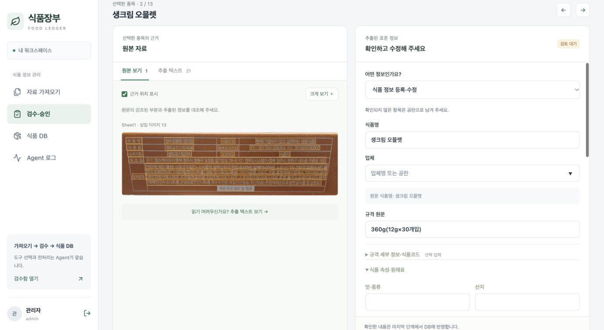
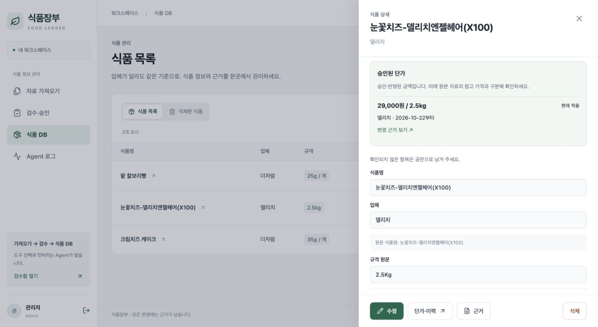
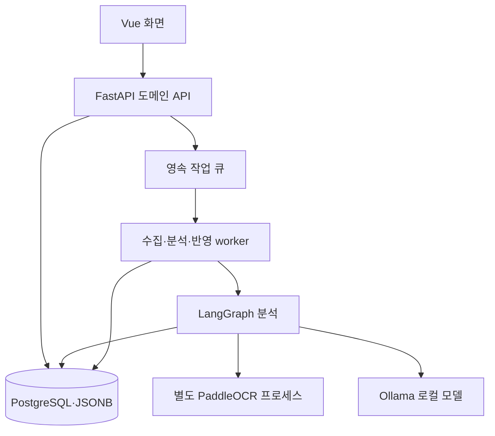
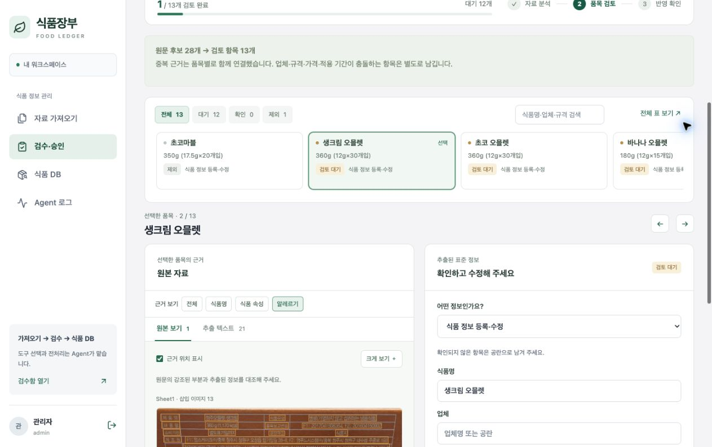

<!--
==============================================================================
FMS_FILE_SPEC
README.md - 프로젝트 문서 README
==============================================================================
설명:
    - 프로젝트 문서 README
입력·출력 명세:
    - 입력: 설계·구현·측정·검증 근거
    - 출력: 설명·명세·예제·검증 또는 발표 안내
실행 가정:
    - 계획·테스트 대역·실제 실행 결과를 구분하고 현재 상태는 README 및 검증 근거 확인
작성 정보:
    - 작성자: 김재현(Finn)
    - 이메일: penguin.klg@gmail.com
    - 작성일: 2026-10-20 (최초 Git 등록일 기준)
    - 라이선스: 미지정
    - 버전: 0.1.0
    - 상태: Development
변경 이력 (Revision History):
    DATE        AUTHOR      VERSION  DESCRIPTION
    --------------------------------------------------------------------
    2026-10-20  미지정      v0.1.0   최초 Git 등록 6dbae100
    2026-10-21  미지정      v0.1.0   파일 역할·입출력·가정·이력 명세 추가

    2026-10-21  김재현(Finn) v0.1.0   Agent 도구 선택 기반 리빌드·업무 경계 및 검증

    2026-10-22  김재현(Finn) v0.1.0   자료·Agent·검수 승인·식품 DB 중심 흐름 및 알레르기 표기 정리

    2026-10-22  김재현(Finn) v0.1.0   실제 화면·비교 근거·5분 발표 자료 작성

    2026-10-22  김재현(Finn) v0.1.0   README·결과 공유 중심 300초 발표 및 근거별 문제 해결 문서 구성

    2026-10-22  김재현(Finn) v0.1.0   청중 공유용 소개·실행 결과 중심 README와 발표자 안내 분리

    2026-10-22  김재현(Finn) v0.1.0   도구별 입출력·실제 LangGraph 단계·재개·로그 확인 설명 보강

    2026-10-22  김재현(Finn) v0.1.0   최신 main 코드·저장 결과·현재 화면 기준 발표 근거 갱신

    2026-10-22  김재현(Finn) v0.1.0   과정·결과·쉬운 사례와 기대효과 중심 5분 발표 README 정리

    2026-10-22  김재현(Finn) v0.1.0   향후 개선 목표·Agent 선택 도구 요약 및 300초 진행안 반영

    2026-10-22  김재현(Finn) v0.1.0   제출 10개 항목의 기술·실행·검증·비교 근거를 README에 보완

    상세 Git 이력: git log --follow -- README.md
    공통 규칙: doc/file-header-policy.md
==============================================================================
-->
# 식품장부

**학교 영양 업무에 필요한 식품 자료를 AI가 정리하고, 담당자가 확인해 장부에 반영하는 서비스입니다.**

## 1. 왜 만들었나요?

“지난달 단가표에 있던 제품을 이번 달에도 주문할 수 있을까요?”

가격은 엑셀에, 공급 중단 안내는 게시글에, 원재료와 알레르기는 이미지에 흩어져 있습니다. 업체마다 양식도 달라 담당자는 자료를 찾아 읽고 다시 정리해야 합니다.

광주 초·중·고는 공개자료 설명 기준 **314개교**입니다. 학교마다 같은 공지를 확인한다면 반복되는 업무입니다. 식품장부는 이 자료 수집과 정리를 하나의 흐름으로 연결하기 위해 만들었습니다.

<sub>학교 수는 2025-11-09 기준 초등 155·중학교 91·고등학교 68개교 합계이며 서비스 이용 학교 수가 아닙니다. [공식 출처](https://www.data.go.kr/data/15151786/fileData.do) · [배경 근거](doc/submission/background-sources.md)</sub>

## 2. 어떤 일을 도와주나요?

**예를 들어, 빵 단가표와 제품 라벨을 함께 받았다고 생각해 보겠습니다.**

| 받은 자료 | 서비스가 정리하는 내용 | 담당자가 확인하는 내용 |
|---|---|---|
| 엑셀의 제품명·규격·가격 | 제품별 식품 정보와 단가 초안 | 어떤 규격의 가격인지 |
| 라벨 이미지의 원재료·알레르기 | 같은 제품의 속성으로 연결 | 원문을 정확하게 읽었는지 |
| 게시글의 “일시 공급 중단” 안내 | 공급 상태 변경 초안 | 대상 제품과 적용 시점 |

담당자는 원문과 정리된 값을 비교해 **수정·제외·승인**합니다. 승인한 정보는 식품 장부에 반영하고, 나중에도 변경 근거를 확인할 수 있습니다. 위 표는 처리 방식을 설명하는 예시입니다.

## 3. 어떻게 처리하나요?


**Agent는 자료를 보고 다음 네 가지 도구 중 알맞은 것을 선택합니다.**

| 선택 가능한 도구 | 하는 일 |
|---|---|
| 표 정리 | 엑셀에서 읽은 제품명·규격·가격을 같은 양식으로 정리 |
| 텍스트 해석 | 게시글에서 가격·공급 중단·변경 사유 등을 추출 |
| 이미지 해석 | OCR로 읽은 글자와 위치를 보고 상품별 정보 추출 |
| 원문 확인 요청 | 읽기 어렵거나 근거가 부족한 부분을 검수 대상으로 남김 |

LangGraph에는 **자료 읽기 → 도구 선택 → 실행 → 기존 식품 후보 조회(선택) → 검토본·Excel 생성** 단계를 구성했습니다. [실제 도구 이름과 실행 단계](doc/food-agent/agent-tools-langgraph.md)

**LangGraph는 처리 순서와 중간 저장을 관리합니다.** 담당자는 Agent 로그에서 어떤 도구를 왜 선택했는지 확인할 수 있습니다. 최종 승인 전에는 확정된 식품·단가를 바꾸지 않습니다.

## 4. 실제 화면에서는 이렇게 사용합니다

### 자료를 가져와 처리 상태를 확인합니다

분석을 기다리는 자료와 검수할 자료를 한곳에서 확인합니다.



### 원문과 나란히 비교해 확인합니다

왼쪽 제품 라벨과 오른쪽 정리된 식품 정보를 대조합니다. 틀린 값은 수정하고, 불필요한 항목은 제외한 뒤 승인합니다.



### 승인된 단가와 변경 근거를 조회합니다

실제 승인된 눈꽃치즈 **29,000원/2.5kg**을 식품 상세에서 확인한 화면입니다. 적용일과 근거도 함께 조회합니다.



<sub>각 화면은 서로 다른 저장 자료를 조회한 사례입니다. 앞의 빵 검수를 통해 뒤의 치즈 단가를 등록했다는 뜻은 아닙니다. 최신 OCR 개선을 적용해 새로 추론한 결과도 아닙니다. [촬영·집계 기록](doc/submission/current-code-evidence.json) · [단가 표시 확인](doc/food-agent/approved-price-readmodel.md)</sub>

## 5. 만들면서 무엇을 개선했나요?

| 문제 | 개선한 방식 |
|---|---|
| 이름과 규격이 같으면 다른 맛까지 한 제품으로 합쳐짐 | 맛·규격·가격 조건을 구분해 서로 다른 항목 보존 |
| 이미지에서 가까운 설명이 다른 제품에 붙을 위험 | 문장별 위치와 상품 소속을 유지하고, 근거가 불명확한 값은 검수 요청 |
| 단가는 승인됐지만 식품 화면에서 찾기 어려움 | 승인 단가를 상세 상단에 표시하고 자료의 참고 가격과 구분 |

예를 들어 **딸기맛 50g과 초코맛 50g은 무게가 같아도 다른 항목**입니다. 이런 구분을 유지하면서 원문 근거까지 연결하는 것이 중요했습니다. 이 맛 예시는 개선 원리를 설명하기 위한 예시이며, 실제 비교 기록은 [Before/After](doc/submission/before-after.md)에 있습니다.

작은 라벨의 누락과 오인식은 남아 있습니다. AI 결과를 바로 확정하지 않고 사람이 검수하도록 설계했으며, 앞으로 실제 자료의 정확도와 담당자의 검토 시간을 측정하려 합니다.

더 확인하려면: [Agent·도구·LangGraph 상세](doc/food-agent/agent-tools-langgraph.md) · [OCR 개선과 검증](doc/food-agent/ocr-spatial-evidence.md) · [실행 방법](readmd.md) · [발표자용5분 진행안](doc/submission/presentation-5min.md)

## 6. 앞으로 개선하고 싶은 부분

- **더 정확하게 읽기:** 작은 라벨이나 상품이 붙어 있는 이미지에서 필요한 부분을 확대해 다시 읽고, 다른 제품의 정보가 섞이는 오류를 줄이고 싶습니다.
- **더 빠르게 처리하기:** 같은 자료의 분석 결과를 더 잘 재사용하고, 변경되거나 확인이 필요한 부분만 처리해 대기 시간을 줄이고 싶습니다.
- **실제 업무에서 검증하기:** 영양 업무 담당자가 직접 사용해 보면서 수정 횟수와 검토 시간을 측정하고, 자주 확인하는 정보를 더 쉽게 찾도록 개선하고 싶습니다.

현재도 일부 결과 재사용과 근거 검증은 구현돼 있습니다. 위 내용은 이를 더 발전시키고 실제 효과를 확인하기 위한 향후 목표입니다.

## 결과 보고서 · 개발 및 검증 상세

5분 발표는 **1~7절과 대표 화면3장**을 중심으로 진행합니다. 아래는 제출 항목을 확인하거나 프로그램을 실행할 때 펼쳐 보는 자료입니다.

<details>
<summary>개발 환경·기술 스택·시스템 아키텍처</summary>

### 개발 환경 및 기술 스택

| 구분 | 사용 기술·환경 | 선택 이유와 역할 |
|---|---|---|
| 개발 환경 | macOS, Python3.12 이상, Node.js22, PostgreSQL17 | 로컬 API·worker·모델 실행. 최근 로컬 API 검증 환경은 Python3.14 |
| 화면 | Vue3·Vite | View가 화면 흐름과 API 호출을 조합하고 Component가 표·폼·원문 비교를 재사용 |
| 서버 | FastAPI | 인증·수집·검수·식품·단가 API 제공 |
| Agent | LangGraph·Ollama Qwen3 | 단계별 실행·재개 관리와 로컬 LLM 추론. 기본 설정은4B 도구 선택·8B 의미 추출 |
| OCR | PaddleOCR, 별도 Python3.11 CPU 프로세스 | 한국어 글자·좌표 추출, OCR 모델 재사용과 수명 분리 |
| 저장 | PostgreSQL·JSONB·원본 파일 저장소 | 승인·가격 적용 기간·이력의 트랜잭션과 업체별 가변 속성을 함께 관리 |
| 외부 연동 | MCP stdio | 제한된 조회 Tool, 정책·근거 Resource, 작업 안내 Prompt 제공 |
| 검증 | pytest·Node.js test·Vite build | 도메인·API·경계 조건·화면 로직·배포 빌드 검사 |

실제 적용한 기술은 도메인별 모듈화, 콜백·요청 컨텍스트를 통한 경량 의존성 주입, MCP, LangGraph, 비동기 모델 호출, 영속 작업 큐입니다. Multi-Agent·벡터 RAG·LangSmith는 현재 적용하지 않았습니다.

### 시스템 아키텍처



API와 worker를 별도 프로세스로 실행하는 **도메인별 모듈형 모놀리스**입니다. 긴 수집·분석은 작업 큐로 보내 화면 요청과 분리합니다. 분석 결과는 검수 초안으로 저장하고, 확정 식품·단가 변경은 사용자 승인 후 반영 작업에서 처리합니다.

백엔드는 `identity`(인증), `ingestion`(자료 수집), `analysis`(AI 분석), `review`(검수·승인), `catalog`(식품), `pricing`(단가), `jobs`(작업)로 구분합니다. 기본 worker는 도메인 서비스를 직접 호출하며 MCP는 별도 연동 진입점입니다.

[전체 코드 구조](readmd.md) · [실제 도구·LangGraph 노드 명세](doc/food-agent/agent-tools-langgraph.md) · [API 계약](doc/food-agent/openapi.json)

</details>

<details>
<summary>프로그램 실행 방법</summary>

### 1. 설치

Python3.12 이상·Node.js22·PostgreSQL17·Ollama를 준비합니다. 아래 PostgreSQL 스크립트는 macOS Homebrew 개발 환경용이며 `rg`(ripgrep)를 사용합니다. 외부 DB는 별도로 준비하고 `.env.food`에 주소를 설정합니다.

```sh
git clone https://github.com/SKALA-G116/skala-FMS.git
cd skala-FMS
python3 -m venv .venv
.venv/bin/python -m pip install -r backend/requirements.lock.txt
npm --prefix frontend ci
npm --prefix frontend run build
cp .env.food.example .env.food
```

### 2. 환경 설정과 DB 준비

`.env.food`에서 `DATABASE_URL`과 `FOOD_SEED_PASSWORD`를 본인 환경에 맞게 수정합니다. API와 worker는 같은 환경 파일을 사용합니다.

```sh
# macOS Homebrew 개발 DB: 기본 localhost:55432/food_agent
./scripts/start-postgres.sh
# 최초 한 번 가상 예제와 계정 생성
.venv/bin/python -m backend.app.seed
```

PostgreSQL 설치 경로가 다르면 `PG_BIN`을 지정합니다. 외부 DB를 사용한다면 위 개발 DB 스크립트 대신 API와 worker를 직접 실행하는 [상세 방법](readmd.md)을 따릅니다.

### 3. 모델과 서비스 실행

Ollama 서버를 실행합니다. 이미 Ollama 앱이나 서비스가 실행 중이면 중복 실행하지 않습니다.

```sh
# 별도 터미널: Ollama 서버를 실행 상태로 유지
ollama serve
```

```sh
# 프로젝트 터미널
ollama pull qwen3:4b
ollama pull qwen3:8b
bash run.sh
```

접속 주소는 **http://127.0.0.1:8100**입니다. `run.sh`는 개발 DB·API·worker를 실행합니다. 시드 계정은 `admin`, `reviewer`, `operator`, `reader`이고 비밀번호는 시드 시점에 설정한 `FOOD_SEED_PASSWORD`입니다. 실제 수집 사이트 회원 계정은 로그인 후 별도로 연결합니다.

### 4. 이미지 OCR 설정

이미지·스캔 문서를 분석하려면 별도 OCR 환경을 준비합니다. OCR 없이도 일반 텍스트와 읽을 수 있는 엑셀 셀 경로는 사용할 수 있습니다.

```sh
python3.11 -m venv .venv-ocr
.venv-ocr/bin/python -m pip install -r backend/requirements-ocr.lock.txt
```

`.env.food`에 `FOOD_OCR_ENABLED=true`, `FOOD_OCR_PYTHON=/절대경로/skala-FMS/.venv-ocr/bin/python`을 설정하고 API·worker를 다시 시작합니다. 최초 OCR 모델 가중치 다운로드와 플랫폼별 설치 확인이 필요합니다.

실행 후 **로그인 → 파일 가져오기 → Agent 로그 확인 → 원문 검수 → 승인 → 식품·단가 조회** 순서로 확인합니다. 실제 모델·OCR·DB 연결이 준비되지 않으면 분석 성공을 보장하지 않습니다. [시연 환경 준비](doc/submission/demo-guide.md)

</details>

<details>
<summary>테스트 결과·실행 화면·검증 범위</summary>

### 최근 코드 검증 기록

2026-10-22 OCR 개선 코드(`6d925ed`)에서 확인한 기록입니다. **이번 README 보완에서는 코드 테스트를 재실행하지 않고 문서 검사를 수행했습니다.**

| 검증 | 결과 | 확인 범위 |
|---|---|---|
| 백엔드 pytest | **179개 통과** | 격리 DB의 도메인·API 통합 및 모의 OCR/LLM 회귀 |
| 프론트엔드 Node.js test | **18개 통과** | 인증·검수 이동·오류 안내·필드별 근거 선택 |
| Vite 배포 빌드 | **통과** | Vue 컴포넌트와 정적 파일 생성 |
| 실제 화면 조회 | 승인 단가29,000원/2.5kg과 항목별 근거 선택 확인 | 저장된 운영 자료의 읽기 전용 조회, 신규 승인 시연 아님 |

| 대표 테스트 입력·상황 | 확인한 결과 |
|---|---|
| 엑셀 행과 삽입 라벨 이미지 | 같은 품목의 원재료·알레르기와 근거 연결 |
| 공통 알레르기 범례 또는 다른 상품의 근거 ID | 상품 속성으로 잘못 사용하는 값 제외·원문 검수 요청 |
| 함량 없는 원재료 목록 | 함량은 공란으로 두고 재료명 보존 |
| 승인 단가와 다른 조사가를 수정 | 승인 단가는 유지하고 참고 가격과 구분 |
| 권한 없는 수정·오래된 검수 버전·근거 개수 초과 | 요청 차단과 오류 반환 |
| 저장 지점에서 분석 재개 | 문장 좌표와 상품/공통 소속 유지·복구 |

실제 화면은4절에 있습니다. 아래는 기존 저장 분석에서 항목별 근거 선택 UI를 확인한 추가 캡처입니다. 이전 분석의 근거를 보여 주는 화면이며 새 OCR 추론의 정확도 평가가 아닙니다.



테스트 통과 수는 실제 업체 문서의 필드 정확도·상품 간 혼입률·업무 시간 절감률과 다릅니다. 실제 LLM 호출 기록, 모의 테스트, 과거 실행 캡처를 구분합니다. [OCR 검증 범위](doc/food-agent/ocr-spatial-evidence.md) · [저장 결과 조회 기록](doc/submission/current-code-evidence.json)

### 테스트 재현

**별도 `_test` DB만 사용합니다. 테스트는 해당 DB 테이블을 초기화합니다.** 아래 DB가 준비돼 있고 운영 DB와 다른지 확인한 뒤 실행합니다.

```sh
# 본인 환경의 PostgreSQL 계정·포트로 별도 테스트 DB 준비
createdb -h 127.0.0.1 -p 55432 food_fms_refactor_test
DATABASE_URL=postgresql://localhost:55432/food_fms_refactor_test \
FOOD_ANALYSIS_MODE=rules FOOD_SEED_PASSWORD=local-food-2026 \
.venv/bin/python -m pytest backend/tests -q
node --test frontend/tests/*.test.js
npm --prefix frontend run build
```

</details>

<details>
<summary>Before / After 비교·문제점과 해결 과정</summary>

### 제공 프로젝트에서 바꾼 점

| 항목 | Before: 제공 장애 진단 프로젝트 | After: 식품장부 |
|---|---|---|
| 사용자 흐름 | 채팅으로 장애 문의·답변 | 자료 가져오기·원문 검수·승인·장부 조회 |
| Agent | 장애 유형 분류·진단 | 자료별 도구 선택·식품 정보 추출 |
| 화면·API | 단일 채팅 화면·FastAPI 중심 | Vue View/Component·도메인별 FastAPI |
| 데이터 | 장애 샘플·SQLite 대화 기록 | PostgreSQL의 식품·작업·승인·근거·이력 |
| 유지한 기술 | Vue·FastAPI·LangGraph·LLM·MCP | 식품 업무에 맞게 흐름·프롬프트·도구 재구성 |

### 같은 단가표에서 다른 맛이 사라지던 문제

같은 제품명·무게라는 이유로 다른 맛과 가격까지 합쳤습니다. 통합 기준을 수정해 원본 행을 보존하도록 했습니다.

| 동일 XLSX 비교 | Before | After |
|---|---:|---:|
| 읽은 상품 행 | 18 | 18 |
| 검토에 남은 행 | 8 | **18** |
| 보존한 숫자 가격 값 | 9 | **19** |
| 행 추출용 LLM 호출 | 0 | 0 |


이 표는 과거 수정 당시 동일 파일에 대한 파서·통합 회귀 비교입니다. Before는 `13e4847`, After는 `5a8ff51`의 해당 코드이며 DTO helper는 당시 현재 코드를 공유했습니다. DB·모델·네트워크를 제외했으므로 전체 서비스의 속도 개선이나 실제 추출 정확도 비교는 아닙니다. 숫자 가격 값 개수도 정답률이 아닙니다. [입력 해시·재현 범위](doc/submission/before-after/01-table-preservation.md)

### 주요 트러블슈팅

| 문제 | 확인한 원인과 해결 | 검증 근거 |
|---|---|---|
| 원재료 일부가 기타 속성으로 분류됨 | 함량% 위주 분류를 보완하고 전용 원재료 추출값과 근거 연결 | [함량 없는 원재료 회귀](doc/food-agent/ingredient-extraction.md) |
| 라벨 하나의 응답 오류로 분석 중단 | 필요한 속성 중심 응답, 실패 구간 분리·원문 검수 전환 | [실패 입력 복구와 회귀](doc/submission/before-after/05-model-schema-recovery.md) |
| 근거가 많으면 승인 실패 | 추출·승인 계약의 상한을 일치시키고 근거를 보존 | [41개 근거 승인·이력 검증](doc/submission/before-after/03-review-contract.md) |
| OCR 종료 중 Python 자식 프로세스 충돌 | 정상 종료와 비정상 종료를 분리하고 OCR 수명·복구 경계 보완 | [실제 OCR 종료 관찰](doc/submission/before-after/02-ocr-lifecycle.md) |
| 승인 단가를 식품 화면에서 찾기 어려움 | 승인 사실과 원본 조사가의 조회·표시를 구분 | [실제 저장·화면 확인](doc/food-agent/approved-price-readmodel.md) |

OCR 충돌의 내부 최초 결함이나 장시간 안정성을 모두 입증한 것은 아닙니다. 각 링크에서 실제 관찰과 테스트 대역의 범위를 확인할 수 있습니다.

### 한계와 다음 검증

현재는 원문 근거가 있는 **검수 초안**을 생성하는 개발 MVP입니다. 작은 라벨 누락·잘못된 상품 영역 연결·모델 응답 오류가 남습니다. 확대 재OCR·멀티모달 검증은 향후 목표이며 자동 구현된 기능이 아닙니다.

대규모 자료에서의 전체 지연시간·모델 포함 메모리·실제 필드 정확도와 사용자 검토 시간은 추가 측정이 필요합니다. 일부 조회는 개발용 건수 상한이 있어 운영 규모에 맞춘 검색·페이지 조회 개선도 필요합니다. 공급 변경이 장부에 반영되는 시점은 수집 주기와 사람의 승인에 따라 달라집니다.

[전체 문제 해결 사례](doc/submission/before-after.md) · [최종 제출 점검](doc/submission/requirements-audit.md)

</details>

## 7. 기대효과

- **자료 확인 부담 감소:** 게시글·엑셀·이미지를 찾아 옮겨 적는 반복 작업을 줄입니다.
- **변경 정보 확인 지원:** 가격·공급 중단·대체품 안내를 승인된 장부와 근거로 함께 확인합니다.
- **업무 인수인계 지원:** 언제, 무엇이, 어떤 자료 때문에 바뀌었는지 추적할 수 있습니다.

기대효과는 개발 목표이며, 실제 시간 절감률과 업무 개선 효과는 사용자 검증을 통해 확인할 예정입니다.
