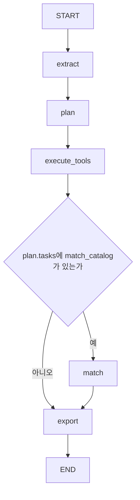

<!--
==============================================================================
FMS_FILE_SPEC
agent-tools-langgraph.md - 프로젝트 문서 agent-tools-langgraph
==============================================================================
설명:
    - 프로젝트 문서 agent-tools-langgraph
입력·출력 명세:
    - 입력: 설계·구현·측정·검증 근거
    - 출력: 설명·명세·예제·검증 또는 발표 안내
실행 가정:
    - 계획·테스트 대역·실제 실행 결과를 구분하고 현재 상태는 README 및 검증 근거 확인
작성 정보:
    - 작성자: 김재현(Finn)
    - 이메일: penguin.klg@gmail.com
    - 작성일: 2026-10-22 (최초 Git 등록일 기준)
    - 라이선스: 미지정
    - 버전: 0.1.0
    - 상태: Development
변경 이력 (Revision History):
    DATE        AUTHOR      VERSION  DESCRIPTION
    --------------------------------------------------------------------
    2026-10-22  미지정      v0.1.0   파일 역할·입출력·가정·이력 명세 추가

    상세 Git 이력: git log --follow -- doc/food-agent/agent-tools-langgraph.md
    공통 규칙: doc/file-header-policy.md
==============================================================================
-->
# Agent 도구와 LangGraph 구현 안내

식품장부에서 자료 한 건이 검토본이 되는 과정을 실제 코드와 연결한 설명입니다. 아래 가상 예시는 실행 성과를 측정한 기록이 아닙니다. 실제 모델 기록은 [시연 JSON](../submission/table-demo-result.json)에 별도로 있습니다.

## 1. Agent·도구·LangGraph의 역할

| 구성 | 이 프로젝트에서의 의미 |
|---|---|
| Agent | 자료의 구조·내용 샘플을 관찰해 허용된 처리 도구와 업무 계획을 선택하는 LLM 기반 판단 |
| 도구 | 선택한 작업을 수행하는 Python 처리 경로. 정해진 입력·검증·예산·출력을 가짐 |
| LangGraph | 등록한 노드와 조건부 연결을 따라 분석을 실행하고 상태를 저장하는 실행 구조 |
| Worker | 영속 큐에서 수집·분석·반영 작업을 꺼내 실행하는 별도 프로세스 |
| 검수·승인 API | 사용자가 확인한 정보를 검사해 확정 식품 DB에 반영하는 별도 업무 경계 |

수집은 커넥터·수집 작업이 맡습니다. 원본을 가져온 후 분석 그래프의 extract가 셀 읽기·OCR 등을 준비하고, plan의 Agent가 그 결과를 보고 도구를 정합니다. 이미지 bytes 전체를 planner에게 주어 모든 처리를 임의로 지시하게 하지 않습니다.

## 2. 전처리 도구 네 가지

| 도구 | 주요 입력 | 처리 | 주요 출력·근거 | 선택 후 추가 LLM 사용 |
|---|---|---|---|---|
| normalize_table | 인식한 헤더·표 행·셀 위치 | 알려진 열을 DTO에 매핑, 명시적 병합 셀 복원, XLSX 표 등록 | 식품 정보·가격 기준·셀 근거 | 구조화된 행에는 사용하지 않음 |
| extract_text | 본문·비정형 표의 제한된 텍스트 구간 | 식품 기준정보·단가·공급 변경·대체품 의미 추출 | 후보 event·source ID·불확실성 | 사용 |
| extract_image_regions | OCR 텍스트·좌표·페이지/삽입 이미지 anchor | 상품 영역과 공통 범례를 연결한 뒤 의미 추출 | 상품별 DTO 후보·이미지/표 근거 | 사용. 행이 명확한 XLSX 라벨은 영역 판단 생략 |
| request_review | 자동 해석하기 부족한 원문 | 원문과 미처리 근거를 보존해 사람에게 전달 | manual_evidence_ids·확인 안내 | 이 도구 자체는 추가 호출하지 않음 |

plan의 도구 선택 호출은 별도입니다. 도구에 넣을 수 있는 자료인지 capabilities로 제한하고 validate_routes가 모든 source의 단 한 번 배정을 확인합니다. unknown 도구·누락·중복 선택은 검증을 통과할 수 없습니다.

텍스트·OCR에서 반환하는 값도 서버 schema와 원문 근거를 검증합니다. 확정 식품 DB를 쓰는 도구로 바로 이어지지 않습니다. 형식·출력 예산 오류는 원문 행 경계에서 제한 분할하며 상품 영역을 안전하게 나눌 수 없으면 확인 대상으로 보존합니다. 연결 장애 등은 별도 실패로 보고합니다.

## 3. 가상 예제: 엑셀 표와 라벨을 같은 식품으로 연결

### 원본 자료

| 제품명 | 규격 | 학교가 | 같은 행의 삽입 라벨 |
|---|---|---:|---|
| 예제 케이크 | 50g | 1,200 | 원재료: 우유10% / 우유 함유 |

### 단계별 처리

1. **extract:** 표 행의 셀과 삽입 이미지의 OCR 글자·좌표를 저장합니다. 이미지에 시트와 행 anchor를 연결합니다.
2. **plan:** 헤더가 읽힌 표 source에는 normalize_table, 라벨 source에는 extract_image_regions를 선택할 수 있습니다. 선택 이유도 저장합니다.
3. **execute_tools:** 표는 기본 DTO를 채웁니다. 라벨은 attributes_text·allergen_text·source_ids만 반환하는 전용 schema로 해석합니다. 표의 이름·규격·가격은 유지하고 라벨의 원재료·알레르기를 같은 품목에 보완합니다.
4. **match(선택):** Agent가 match_catalog 업무를 선택했으면 식품명·공통식품코드로 기존 DB 후보를 찾습니다. 한 후보가 나와도 확정 반영은 하지 않습니다.
5. **export:** 같은 품목과 표·이미지 근거를 검토 화면과 Excel로 제공합니다.
6. **사람 검수:** 사용자가 원문을 보고 수정·확인·제외하고 최종 승인합니다. 서버가 검증 후 식품 DB에 반영합니다.

위 예시의 도구 선택을 축약해 표현하면 다음과 같습니다. D1·D2는 자료 묶음 ID입니다. 의미 추출 응답의 S1 같은 source ID, DB에 저장한 evidence UUID와는 역할이 다릅니다. 아래 JSON은 실제 호출 캡처가 아닌 설명용입니다.

```json
{
  "routes": [
    {"source_id": "D1", "tool": "normalize_table", "reason": "제품명·규격·학교가 열이 읽힌 표"},
    {"source_id": "D2", "tool": "extract_image_regions", "reason": "같은 행에 배치된 원재료·알레르기 라벨"}
  ],
  "tasks": ["extract_food_profiles"]
}
```

표만 읽힌 경우에는 알레르기를 만들어 채우지 않습니다. 라벨이 여러 상품 행에 걸쳐 모호하면 그 정보를 임의로 한 상품에 붙이지 않습니다.

## 4. 가상 예제: 공급 중단과 대체품 공지

원문: “2026년11월1일부터 예제 A의 공급을 일시 중단합니다. 대체품은 예제 B이며 원료 수급이 사유입니다.”

extract_text 경로는 제품 A, 일시중단, 적용일2026-11-01, 원료 수급 사유, 대체품 B라는 후보를 추출합니다. 원문을 source ID로 연결하고 DB 조회를 선택한 경우 기존 상품 후보를 제시합니다. 제품을 확정할 수 없거나 날짜·대체품 근거가 부족하면 사용자가 확인해야 합니다. 공급 일시중단을 제조 단종으로 바꾸지 않습니다.

## 5. LangGraph에 실제로 등록한 노드와 분기

[workflow.py의 arun_analysis](../../backend/app/domains/analysis/workflow.py)가 운영 agent 경로를 구성합니다.



| 노드 | 연결한 함수 | 구현 파일 |
|---|---|---|
| extract | extract | workflow.py |
| plan | plan → planning.decide | agent.py / planning.py |
| execute_tools | interpret | agent.py |
| match | match_candidates | matching.py |
| export | export_review | export.py |

조건부 연결은 `add_conditional_edges`와 `route_after_tools`로 구성합니다. route_after_tools는 저장된 계획의 tasks에 match_catalog가 있는지 확인해 match 또는 export로 보냅니다. 모델이 그래프의 Python 함수를 임의로 실행하도록 두지 않습니다.

네 전처리 도구의 분기는 execute_tools 노드 내부의 명시적 dispatch로 구현했습니다. 현재 각 도구를 별도 LangGraph subgraph/ToolNode로 등록하거나 여러 자율 Agent로 나누지는 않았습니다. rules 모드는 테스트용 별도 extract→propose 경로입니다.

## 6. 상태와 중단 후 재개

State는 run_id·revision_id·extraction_id·agent_report_id·export_asset_id 등의 참조 ID를 전달합니다. 큰 원문·이미지·전체 보고서는 별도 저장소에 둡니다.

`AsyncPostgresSaver`를 checkpointer로 사용하고 `thread_id=analysis:{runid}`로 분석 실행을 구분합니다. 단계 내부의 보고서도 아래 정보를 저장합니다.

| 저장 내용 | 재개 시 사용 |
|---|---|
| extraction_id·parser version | 이미 읽은 원문 재사용 여부 판단 |
| agent_report_id·plan | 저장된 도구 선택 계획 재사용 |
| tool_results·execution_groups | 완료한 도구 준비·상품 영역 연결 재사용 |
| batches_completed | 이미 마친 추론 구간 건너뛰기 |
| model_calls·extraction_failures | 실패·토큰·시간·보류 근거 확인 |

재개는 checkpoint와 위 도메인 기록을 함께 사용합니다. 진행 중 호출이 저장되기 전에 중단되면 해당 호출은 다시 실행될 수 있습니다. checkpoint만으로 외부 호출의 정확히 한 번 실행을 보장하지 않습니다. 원문 변경에 따른 새 revision·새 분석과 같은 분석의 재시도도 구분합니다.

사용자 승인을 LangGraph interrupt로 기다리는 구조는 현재 구현하지 않았습니다. 분석 그래프는 검토본 생성으로 끝나고, CMS의 검수·승인 API와 별도 반영 작업이 이어집니다.

## 7. 전처리 도구와 MCP 제공 기능

운영 worker는 위 도메인 서비스를 직접 호출합니다. MCP는 별도 stdio 어댑터로 제공합니다.

| MCP 형태 | 실제 제공 예 | 역할 |
|---|---|---|
| Tool | find_product_candidates, get_supplier_item_facts, get_product_history, get_agent_execution | 제한된 DB·실행 기록 조회 |
| Resource | food://agent/tools, food://schemas/food-change-v1, food://policies/{version}, 문서 구간·evidence | 읽기용 도구 설명·스키마·정책·근거 |
| Prompt | analyze_food_notice, analyze_price_table, review_change_evidence | 업무별 안내 문구 |
| host 전용 Tool | parse_document_segment, validate_change_set, stage_change_proposal | 영속 분석 등록·초안 검증·검토 초안 저장 |

parse_document_segment는 MCP 안에서 직접 OCR를 수행하지 않고 분석 작업을 등록합니다. 기본 MCP에 최종 승인·반영·임의 SQL 도구를 노출하지 않습니다. Resource와 Prompt는 읽기 자료·지침을 반환하며, 조회만으로 분석을 실행하지 않습니다. [구현](../../backend/app/mcp/server.py)

## 8. 화면과 코드에서 확인할 위치

| 확인할 내용 | 위치 |
|---|---|
| 도구 이름·허용 조건·선택 이유 검증 | [planning.py](../../backend/app/domains/analysis/planning.py)의 TOOLS·capabilities·validate_routes |
| 도구 실행·표/라벨 DTO 통합·구간별 오류 복구 | [agent.py](../../backend/app/domains/analysis/agent.py)의 interpret |
| 라벨 응답 형식 | [schemas.py](../../backend/app/domains/analysis/schemas.py)의 label_schema |
| 그래프 노드·조건부 연결·checkpoint | [workflow.py](../../backend/app/domains/analysis/workflow.py)의 State·route_after_tools·arun_analysis |
| DB 후보 조회·읽기 전용 기록 | [matching.py](../../backend/app/domains/analysis/matching.py) |
| 검토본·Excel 생성 | [export.py](../../backend/app/domains/analysis/export.py) |
| 사용자 승인·원자적 반영 | [review 도메인](../../backend/app/domains/review) |

실행 중인 서비스의 Agent 로그에서 도구 선택 이유·진행 단계·실제 모델 호출 기록을 확인합니다. 입력 준비 완료는 그 자료의 의미 추출까지 성공했다는 표시가 아닙니다. 최종 검토본, 처리 안내, 형식 오류와 보류된 원문을 함께 확인해야 합니다. 입력이 있어야 실제 로그가 생기며 코드 설명용 가상 예제를 실제 실행 기록으로 대신 제시하지 않습니다. [실제 표 실행 기록](../submission/table-demo-result.json) · [오류 재현·재개 기록](../submission/before-after/05-model-schema-recovery.md) · [README](../../README.md)

## OCR 위치·필드 근거 보완

이미지 영역 분류와 정보 추출에 문장별 텍스트·좌표·상품/공통 안내 소속을 유지합니다. 원재료·알레르기 등의 필드별 근거를 검증하고 DTO에 연결하며, 검수 화면에서 항목별 근거를 선택할 수 있습니다. [처리 계약·입력 한도·회귀 검증](ocr-spatial-evidence.md)
