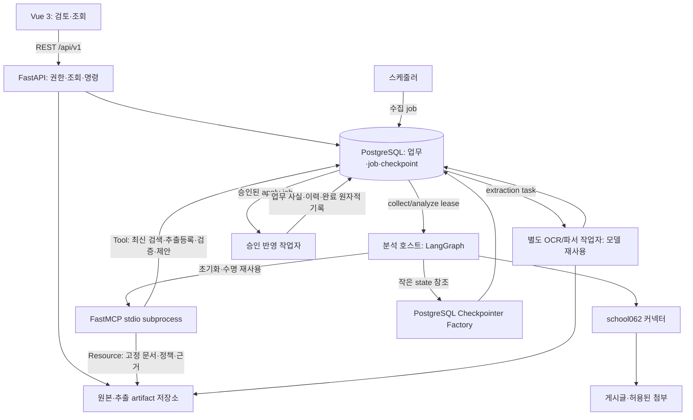
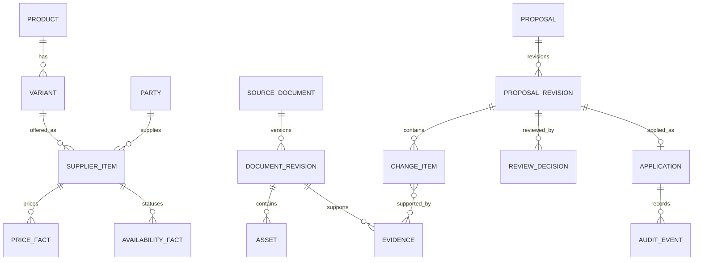
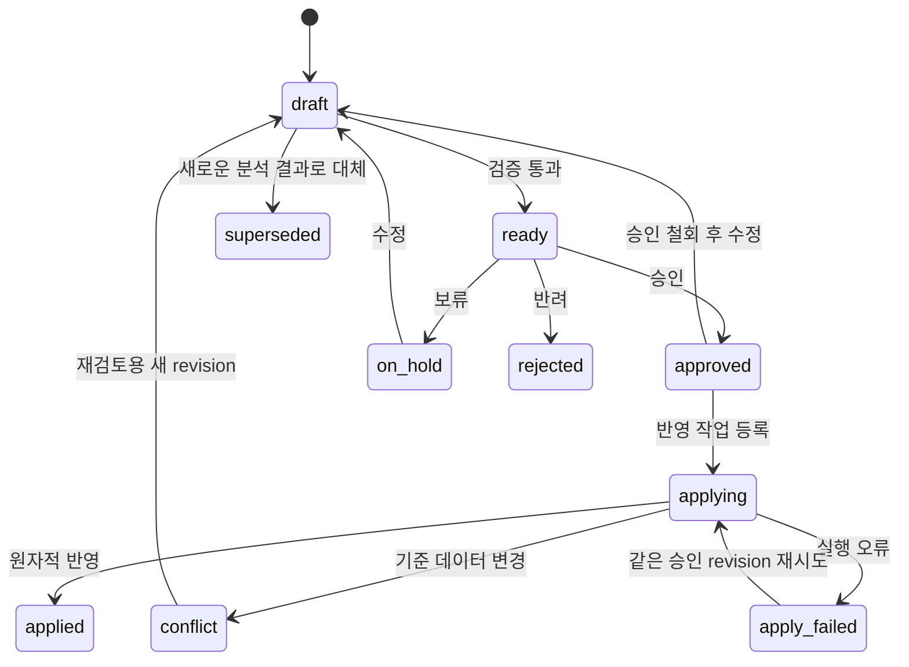

# 아키텍처와 데이터 모델

## 1. 배포 구조

초기에는 모듈 단위로 책임을 나누고 API·작업자·스케줄러를 별도 프로세스로 실행한다. 모든 모듈을 독립 마이크로서비스로 배포하지 않는다.



API의 응답 후 실행하는 단순 메모리 BackgroundTasks를 수집·OCR의 유일한 작업 큐로 사용하지 않는다. 작업 테이블이 실행 책임을 보관한다. FastAPI도 무거운 별도 프로세스 작업에는 별도 작업 시스템을 고려하도록 안내한다. [공식 안내](https://fastapi.tiangolo.com/tutorial/background-tasks/)

프런트 배포 서버가 `/api`를 FastAPI로 전달한다. 기존 `web_demo_server.py`와 8100/8600 데모 프록시는 신규 앱에서 배포용 프록시 설정으로 대체한다. 개발 시 Vue 개발 서버가 `/api`를 전달한다.

## 2. 제안하는 저장소 구조

아래는 구현할 목표 구조이며 현재 생성된 애플리케이션 파일 목록이 아니다.

```text
frontend/src/
  views/ components/ composables/ api/ stores/ router/ types/
backend/app/
  api/v1/                 # HTTP 계약, 역할 확인, DTO
  domain/                 # 상품·가격·상태·대체·변경안 규칙
  services/               # 수집등록·분석·검토·반영 유스케이스
  repositories/           # PostgreSQL 접근, 트랜잭션 경계
  workflows/              # LangGraph 분석 흐름과 작은 상태
  mcp/                    # 6 Tool / 5 Resource / 3 Prompt 어댑터
  persistence/            # async pool와 checkpointer factory
  policies/ prompts/      # 버전 고정 규칙·분석 템플릿
  connectors/school062/   # 목록·본문·첨부, 서버측 로그인 세션
  parsers/                # HTML, XLS/XLSX, PDF, PaddleOCR 어댑터
  storage/                # 원본·파생 이미지·서명 URL
  workers/                # lease, 실행, 재시도, 취소
  scheduler/              # 정기 작업 등록
  auth/                   # 사용자·세션·CSRF
migrations/ tests/ doc/food-agent/
```

기존 `agent/deps.py`의 명시적 의존성 주입 원칙은 유지한다. `graph.py`는 단계별 모듈로 나누고 기존 장애 진단용 프롬프트·기본 시스템명·실습용 지연·v1·강제 검수 통과 코드는 사용하지 않는다. 기존 채팅 대화 저장소는 업무 기록으로 재사용하지 않는다.

## 3. 분석과 반영의 책임

분석 파이프라인: 원문·프로필·처리 버전 고정 → segment 계획 → parse Tool로 추출 등록 → 고정 Resource로 문맥 조립 → Prompt 기반 사건 추출·조회 Tool → 허용 operation 구성 → 코드 검증 → 필요한 경우 의미 검토·상한형 보완 → 변경안 저장 → 종료. MCP Prompt 자체가 이 순서를 실행하거나 승인하지 않는다. 호스트가 표준 템플릿을 요청하고 그래프가 필수 단계를 강제한다.

AI는 사건·사실·후보를 제안한다. SQL, 트랜잭션, 상태 전이, 승인 여부는 코드가 결정한다. 재분석은 새 결과와 새 revision을 만들고, 승인된 내용은 조용히 바꾸지 않는다.

사용자 승인 대기는 업무 DB 상태다. worker나 HTTP 요청을 점유하지 않는다. 배포용 분석에는 PostgreSQL checkpointer와 factory를 채택한다. analysis_run_id별 thread에 입력·처리 버전·segment/artifact 참조와 cursor를 저장한다. job lease와 fencing token으로 한 run의 동시 재개를 막는다. 같은 입력·처리 버전의 재시도만 복구하고 새 입력/정책/force 재분석은 새 run이다. 체크포인트는 실행 복구용이며 승인·업무 사실이나 DB 반영의 중복 방지를 대신하지 않는다. 자세한 상한·보존·실험은 [메모리 체크리스트](./memory-checklist.md)와 [런타임 정책](./runtime-policy.json)을 따른다.

## 4. 주요 엔터티와 관계



| 데이터 | 필수 개념 |
|---|---|
| party | 업체 ID·표준명·별칭·manufacturer/brand/supplier 역할. 게시자명은 별도로 보존 |
| product | 제조사·브랜드·제품명·제품 생애 상태·version |
| variant | 제품 ID·규격 원문·정규화 규격·바코드·version |
| supplier_item | 규격 ID·공급처 ID·공급처 품목코드·판매 단위·version |
| price_fact | 상품·금액(decimal)·통화·가격 단위·수량·부가세·가격 유형·조건키·적용 기간·근거 |
| availability_fact | 공급처 상품·공급 상태·기간·사유·근거 |
| product_status_fact | 제품 전체 active/discontinued/unknown·기간·사유·근거. 공급 상태와 분리 |
| substitution | 기존 공급처 상품·구성 그룹·대체 후보·기간·원문 설명·관계 확정 여부·근거 |
| document/revision | 사이트/게시판/원문ID·원문URL·게시시각·수집시각·본문 hash·첨부 목록·access status |
| asset | 내용 hash·MIME·크기·저장키·원본/파생 관계. 바이너리는 DB 밖에 보관 |
| extraction | 입력 hash·파서/OCR/모델/프롬프트/스키마 버전·텍스트 블록·표 구조·오류 |
| evidence | 불변 원문 revision·문장/셀/좌표 위치·인용문·추출 ID |
| proposal/revision | 상태·표현 version·불변 내용 revision·변경 항목·차단 사유·검토 기준 대상 버전 |
| decision | approve/reject/hold·대상 내용 revision·검토자·사유·시각 |
| application | proposal+approved_revision 고유·job·pending/applied/conflict/failed·완료시각 |
| audit_event | transaction·application·작업별 대상·전후 스냅샷·actor·recorded_at·effective period·근거·정정 관계 |
| job | 유형·상태·현재 단계·attempt·lease 만료·fencing token·analysis_run_id·입출력 ID·오류·진행률 |
| analysis_run | 고정 원문 revision·profile·코드/모델/파서/프롬프트/정책/schema·segment manifest·checkpoint thread 매핑 |
| extraction_task | 한 segment 파서/OCR 작업·고정 입력·lease·fencing token·산출물·오류 |

정형 업무 데이터는 관계형 컬럼을 사용한다. 자유 형태의 OCR 결과·원문 구조와 operation payload에는 JSONB를 허용한다. 모든 상품을 큰 JSON 문서 하나로 저장하지 않는다.

## 5. 가격과 시간 규칙

금액은 DB numeric, API는 10진 문자열이다. JS 부동소수점으로 회계 금액을 누적 계산하지 않는다. `quantity=1, unit=kg`와 `quantity=1, unit=bag`은 다른 가격이다. `condition_key`는 표준화한 거래 조건의 ID이며 초기에는 일반 공개 조건만 허용한다. 세금 미기재는 unknown이다.

업무 적용일은 date, 기록·게시·수집·승인 시각은 timezone 포함 date-time으로 저장한다. 표준 저장 시각은 UTC, 화면은 Asia/Seoul이다. 한국 날짜 기준 `[from,to)`를 사용한다. 종료일이 없으면 무기한이며 공급 재개 예정일을 추측하지 않는다.

미래 사실도 승인·반영은 가능하다. `applied`는 DB 기록 완료를 뜻하고 `effective_state=scheduled`는 아직 적용 전임을 뜻한다. 현재 조회는 `as_of`가 기간에 포함되는 확정 사실을 선택한다. API 조회가 DB 상태를 수정하거나 예약 작업 완료 여부에 의존하지 않는다.

같은 상품·사실 종류·가격 조건키·동일 범위에서 충돌하는 사실은 자동 latest-wins 처리하지 않는다. 기존 사실을 정정할 때는 `supersedes_fact_id`를 명시하고 검토한다. 원래 사실은 보존하며, 새 사실의 구간에 한해서 교체 관계를 평가한다. 부분 구간 정정은 기존 유효 구간을 분할하는 적용 알고리즘과 인수 테스트가 필요하다.

## 6. 상태 전이



`draft`는 승인 불가 차단 항목이 있는 상태, `ready`는 검증상 승인 가능한 상태다. draft에도 hold/reject 결정을 허용한다. on_hold는 수정 없이 재검증해 ready로 돌릴 수 있다. rejected/superseded/applied는 읽기 전용이다. 반려·반영한 내용을 다시 다룰 때는 이를 참조하는 새 제안을 만든다. applying 중 편집·승인 철회는 불가하다.

`revision`은 업무 내용 변경 시 증가한다. `version`은 상태·결정·내용 변경 모두에서 증가하며 ETag로 사용한다. 승인 기록은 `approved_revision`에 고정된다. 승인 후 수정하려면 철회가 먼저 필요하고 과거 승인 기록은 삭제하지 않는다.

작업 상태: queued → running → succeeded / partial / failed / cancelled. partial은 일부 수집·분석이 완료되었지만 접근 불가·누락 등의 결과가 있음을 뜻한다. 업무 반영은 partial을 허용하지 않는다. 실패한 작업의 retry는 원래 작업을 보존하고 새 job을 만든다. apply 재시도는 같은 application을 이어서 처리한다.

## 7. 중복·동시성·트랜잭션

1. 수집 고유키는 source+board+external_post_id. 내용 hash는 본문·제목·의미 있는 첨부 기준이며 조회수·메뉴는 제외한다.
2. 동일 파일 hash는 원본 객체를 재사용하되 게시글별 출처 연결은 보존한다.
3. 교차 게시 중복은 공급처·대상 규격·사건 종류·적용 기간·내용으로 후보화한다. 정확하게 확인된 사건은 한 논리 사건과 여러 근거로 연결한다. 모호하면 검토한다.
4. Idempotency-Key는 actor+HTTP method+path+키 범위로 관리한다. 키와 요청 hash는 기록한다. 같은 키·같은 내용은 기존 응답, 다른 내용은 409다. 헤더 검사는 부작용보다 앞서 실행한다.
5. 업무 반영 고유키는 proposal_id+approved_revision. 요청 키 보존 기간(기본 24시간)을 넘겨도 이 고유키로 중복 반영을 막는다.
6. 반영 요청 트랜잭션에서 승인 상태와 revision을 확인하고 application·job·applying 상태를 함께 기록한다. 큐가 DB이므로 별도 메시지 발행 유실이 없다.
7. 작업자는 짧은 트랜잭션에서 lease를 확보한다. OCR/LLM 중에는 DB 잠금을 보유하지 않는다.
8. 실제 반영 트랜잭션에서 application·대상들을 정렬된 순서로 잠그고 현재 version·기간 충돌·원문 revision 유효성을 재확인한다.
9. 업무 사실과 생성된 ID, 필드별 근거, audit_event, application 완료, proposal applied, job succeeded를 같은 DB 트랜잭션에 저장한다.
10. 충돌은 업무 변경 없이 conflict로 기록하고 재검토한다. DB 재시도 가능 오류는 제한된 backoff로 재시도한다. 최대 횟수 후 실패하며 강제로 성공 처리하지 않는다.

낡은 화면 ETag는 412, 최신 표현을 사용했지만 업무 사실이 충돌하면 409다. 원문이 새 revision으로 바뀐 경우 오래된 근거를 가진 제안은 반영 전에 재검토한다. 새 게시글이 생겼다는 사실만으로 무관한 제안을 전부 무효화하지 않는다.

## 8. 근거와 원문 뷰어

HTML 근거: 저장된 정제 본문의 block_id와 Unicode code point 시작/끝 위치. JS UTF-16 오프셋과 혼동하지 않도록 변환한다. 변경되는 live DOM selector만 저장하지 않는다.

이미지/PDF 근거: 원본 또는 고정된 렌더 asset ID·페이지·가로세로 크기·왼쪽 위 원점의 정규화 bbox `[x0,y0,x1,y1]`. OCR 전 회전·crop·확대가 있으면 원본 좌표로 되돌리는 transform과 파생 asset을 기록한다. `0 <= x0 < x1 <= 1` 및 y도 동일하게 검증한다.

엑셀 근거: 원본 asset ID·sheet name·cell range·추출된 셀 값과 병합 범위. 원본 파일은 유지한다. 외부 링크·매크로는 실행하지 않는다.

원문 snapshot HTML은 script·이벤트 handler·외부 추적 요소를 제거하고 sandbox iframe에서 표시한다. 파일은 인증 후 짧은 접근 URL(기본 5분)을 발급한다. URL 만료 시 재발급하며 공개 버킷으로 노출하지 않는다. viewer는 파일별 접근 권한을 확인한다.

## 9. 운영과 자원

- 모델과 파서는 worker 프로세스 수명 동안 재사용한다. OCR worker 수 증가에 따른 모델 메모리 복제를 측정한다.
- 파일 hash+파서/OCR 버전+옵션+추출 스키마로 캐시한다. 같은 추출 결과를 여러 문서가 참조할 수 있다.
- 문서·페이지·표별로 나누되 표 제목·각주·전역 적용일 등의 문맥을 잃지 않는다.
- 계정 비밀은 서버 설정/비밀 저장소에 두고 API·로그·브라우저에 반환하지 않는다. 인증 갱신이 필요하면 source 접근 상태와 작업 오류로 표시한다.
- 허용 호스트·리다이렉트 대상·MIME·용량·페이지·압축 해제 크기·변환 시간을 제한한다. 사용자가 제출한 임의 URL을 서버가 자유롭게 가져오지 않는다.
- 재시도는 일시적 오류에만 적용한다. 잘못 읽힌 숫자를 같은 요청의 무한 재시도로 해결하지 않는다.
- job_id, request_id, document_revision_id, proposal_id, application_id를 로그에서 연결한다. OCR 추적과 업무 감사 이력은 분리한다.

## 10. v0.2 보완 계약

MCP 어댑터는 [기능 분류](./capability-design.md)를 따르고 실제 CRUD와 승인은 분석 도구 목록에서 제외한다. API·분석 호스트·MCP 자식·OCR 작업자·반영 작업자 사이에 pool과 모델 객체가 메모리상 공유된다고 가정하지 않는다. 호환되는 psycopg async pool만 같은 프로세스에서 공유하고 총 연결 수는 합산한다. Checkpointer 초기화는 배포 준비 단계에서 수행하고 일반 요청 중 setup을 반복하지 않는다.

원문·표·Tool 결과를 events/messages/collected에 계속 추가하지 않는다. 이벤트는 별도 제한된 기록과 job 상태로 보관한다. 그래프 state는 ID·cursor 중심이며 256KiB 상한을 적용한다. 보완/검토/도구/시간/토큰 예산 초과는 명시적 미완료이며 승인 blocker가 된다. 실제 SDK 호환성과 복구·자원 시험은 구현 후 검증한다.
