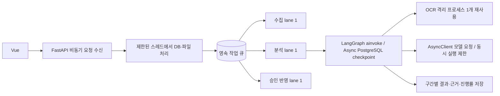

# 비동기 처리·성능·메모리 개선 (2026-10-20)

## 확인한 병목

자료 등록 API는 원래도 작업을 큐에 넣고 먼저 응답했지만, API 내부의 동기 DB·암호 검증·일부 엑셀 처리가 이벤트 루프에서 실행됐다. 작업자는 수집·분석·승인 반영을 모두 한 건씩 처리했고, 모델 호출은 동기 HTTP였다. OCR은 이미지마다 새 프로세스에서 모델을 초기화했다.

실제 작업 `63684138-c4af-4978-b381-f7906166e085`는 이미지 7개를 포함한 게시글에서 815개 원문 구간을 추출해 67개 묶음으로 나눴다. 식품 소개 중심의 자료가 공지로 분류되면서 소개 정보에도 반복 검증이 수행됐다. 전환 시점에 34개 묶음, 모델 68회, 모델 처리 누적 2,628.426초가 기록됐다. 완료된 34개 묶음과 추출 근거를 보존하여 같은 작업 ID로 재개했다. 이는 전후 동일 자료 전체 완료시간 비교 결과가 아니라 병목과 전환 지점의 기록이다.

## 적용 구조

- API의 동기 업무 처리를 이벤트 루프 밖으로 이동했다. 페이지 조회가 같은 DB 요청 안에서 추가 연결을 열던 부분을 제거해 동시 조회 시 연결 풀 고갈 위험을 줄였다. API 스레드는 8개, 큰 파일 업로드는 동시 2개로 제한한다.
- 수집·분석·반영은 각각 한 lane을 사용한다. 긴 분석이 수집이나 승인 반영을 막지 않는다. 기본 분석 동시 실행은 1개로 유지해 로컬 모델 메모리 증폭을 막는다.
- 모델 호출과 체크포인트 저장은 비동기 API를 사용한다. 문서 처리 중 HTTP 연결을 재사용하고 종료·취소 시 닫는다. 모델 요청 기본 동시 실행 1개, 설정 상한 2개다.
- 식품 기준정보·신제품 소개만 있는 추출에는 업무 변경의 2차 검증을 생략한다. 가격·공급 상태·단종·대체 등 업무 변경은 검증을 유지한다. 출처 연결, 스키마 검사, 값 검사, 사용자 승인은 계속 수행한다.
- 모델 입력에서 반복되는 OCR 좌표를 제거했다. 원문 좌표는 근거 데이터에 남아 화면 대조에 사용된다. 한글 입력 구간 분할의 반복 인코딩을 줄이고 중복 이벤트 대조에 집합을 사용한다.
- 긴 문서는 기본 600초 처리 구간이 끝난 뒤 저장한 묶음 경계에서 같은 작업을 다시 큐에 넣는다. 완료한 묶음을 재호출하지 않고 다른 대기 분석에도 실행 순서를 양보한다. 실행 권한(fencing) 검사와 취소 검사를 유지한다.
- 진행률은 고정 55% 대신 완료한 구간 수를 사용한다. 작업에 모델 호출 수·누적 모델 시간·토큰 수·작업자 최대 RSS를 기록한다. 최대 RSS는 해당 프로세스의 최고치이며 현재 RSS나 문서 단독 사용량이 아니다.

## 메모리 제한

실제 설정은 `backend/app/runtime/limits.py`에서 읽는다. 추출 텍스트 기본 4MiB, 분석 보고서 8MiB, 모델 입력 11,000바이트, 문서 전체 입력/출력 토큰 500,000/200,000 상한을 둔다. 초과 시 결과를 조용히 자르지 않고 자료 분할이 필요하다는 오류를 반환한다.

OCR은 원본 이미지가 API·모델 호스트에 쌓이지 않도록 별도 프로세스에서 실행한다. 한 번 불러온 가중치를 재사용하며, 동시 1개 요청, 유휴 60초 후 종료, 20회 요청 후 재시작한다. 이미지·PDF 임시 파일은 요청 종료 시 정리하고 표준 오류 로그를 무제한 메모리 버퍼에 모으지 않는다. 모델 서버의 유휴 보관 기본값은 2분이다.

## 검증과 한계

동시 요청 중 API 응답 유지, 수집/분석 lane 분리, 모델 요청 상한과 연결 재사용, 실행 중 취소, 구간 저장·재개와 중복 호출 방지, OCR 프로세스 재사용·유휴 해제·시간 초과 정리, 토큰/결과 크기 제한을 테스트했다. 기존 승인·단가·DTO·삭제 기능의 회귀 테스트도 포함한다.

실제 동일 이미지에서 같은 OCR 프로세스로 90개 구간을 두 번 읽었다. 첫 요청 12.879초, 두 번째 10.347초로 약 20% 짧아졌다. 단일 이미지 표본이며 전체 문서나 다른 환경에서 같은 개선율을 보장하지 않는다. 측정 원본은 `ocr-reuse-benchmark.json`에 있다.

비동기는 로컬 모델 자체의 토큰 생성 속도를 높이지 않는다. 8B 모델의 생성 시간은 남은 주요 병목이다. 동시 모델 요청을 무제한으로 늘리거나 작은 모델로 품질 검증 없이 바꾸지 않았다. OS 수준의 프로세스 전체 메모리 강제 제한, 완료 체크포인트의 자동 보존기간 정리, 모든 DB 저장소의 async 전환은 추가 작업이다.
