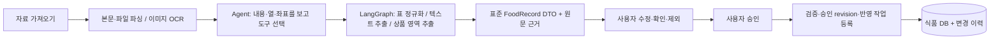

<!--
==============================================================================
FMS_FILE_SPEC
service-workflow.md - 프로젝트 문서 service-workflow
==============================================================================
설명:
    - 프로젝트 문서 service-workflow
입력·출력 명세:
    - 입력: 설계·구현·측정·검증 근거
    - 출력: 설명·명세·예제·검증 또는 발표 안내
실행 가정:
    - 계획·테스트 대역·실제 실행 결과를 구분하고 현재 상태는 README 및 검증 근거 확인
작성 정보:
    - 작성자: 김재현(Finn)
    - 이메일: penguin.klg@gmail.com
    - 작성일: 2026-10-22 (최초 Git 등록일 기준)
    - 라이선스: 미지정
    - 버전: 0.1.0
    - 상태: Development
변경 이력 (Revision History):
    DATE        AUTHOR      VERSION  DESCRIPTION
    --------------------------------------------------------------------
    2026-10-22  미지정      v0.1.0   파일 역할·입출력·가정·이력 명세 추가

    2026-10-22  김재현(Finn) v0.1.0   자료·Agent·검수 승인·식품 DB 중심 흐름 및 알레르기 표기 정리

    상세 Git 이력: git log --follow -- doc/food-agent/service-workflow.md
    공통 규칙: doc/file-header-policy.md
==============================================================================
-->
# 자료에서 검수·승인을 거쳐 식품 DB까지

작성자: 김재현(Finn) · penguin.klg@gmail.com · 2026-10-22. 라이선스: 미지정.

## 사용자가 하는 일

1. **자료 가져오기**: 사이트 자료를 수집하거나 파일을 올린다. 새 자료는 자동 분석한다. 연결 정보는 여기서 설정한다.
2. **검수·승인**: Agent가 추출한 표준 식품 DTO를 원문과 대조한다. 수정·확인·제외를 결정하고 마지막에 ‘확인한 품목 승인·반영’을 누른다.
3. **식품 DB**: 반영된 식품과 단가, 근거·변경 이력을 조회한다. 식품 상세에서 정보와 사유를 수정·저장할 수 있다.
4. **Agent 로그**: 실행 중·완료·실패 작업을 조회하고 자료별 도구 선택 이유, 입력 준비 상태, 실제 AI 호출 시간·토큰, DB 후보 조회와 반영 결과를 확인한다. 원문과 검수 화면으로 바로 이동한다.

별도 대시보드·수동 JSON 변경안 편집·변경안 직접 작성 화면을 제거했다. 단가표는 식품 DB에서 열고, 작업 진행은 해당 자료에서 확인한다. 검증·변경 묶음·승인 revision·백그라운드 반영은 내부 안전 장치로 유지하되 사용자가 화면 사이를 이동해 순서대로 실행하지 않는다. 이전 수동 기록은 조회만 지원한다.

## Agent와 도구의 경계

Agent는 자료별 `normalize_table`, `extract_text`, `extract_image_regions`, `request_review`와 이유를 선택한다. LangGraph는 추출 → 계획 → 선택된 도구 실행 → 필요한 경우 DB 조회·매칭 → 검토본 생성 단계를 관리한다. 이미지 도구 안에서는 OCR 좌표로 상품 영역을 선택한 뒤 해당 상품의 텍스트를 LLM에 전달한다. 미리 정해진 확장자 라우팅이나 챗봇 응답 생성이 서비스 중심이 아니다.

상품 영역을 결정한 뒤에는 OCR 조각마다 JSON 위치 정보를 반복해서 보내지 않고 한 상품 텍스트로 합친다. 모든 원문 evidence ID는 별도로 유지하고 추출 DTO에 연결한다. 긴 표 응답이 출력 상한에 걸리면 원본 행 경계에서 분할하고, 변경된 실행 그룹을 저장해 재개할 수 있게 한다. 한 상품의 이미지 영역은 임의로 잘라 추정하지 않는다. 영역에 배정된 근거가 미분류 목록에도 중복된 경우 중복 미분류만 제거한다. 알 수 없는 근거 ID·상품 간 중복 배정·누락 등으로 안전한 자동 추출을 할 수 없는 이미지는 전체 원문과 사유를 확인 대상으로 보존하고 나머지 자료를 처리한다. 연결 실패를 정상 추출로 처리하지 않는다.

## 승인과 수정 API

- `POST /api/v1/analysis-runs/{id}/approve`: 최신 검토 `version`을 받는다. 확인된 품목만 기존 검증·승인 로직에 전달하고 반영 작업을 등록한다. 검사 실패 시 전체 요청 트랜잭션을 롤백한다. 미확인·제외 항목은 저장하지 않는다. 같은 요청 키 재전송은 같은 결과를 돌려준다.
- `PATCH /api/v1/foods/{id}`: `If-Match` 버전과 `food_record`, `reason`이 필요하다. 관리자·검토자만 가능하다. 원문 근거는 보존하고 수정 전후·담당자·사유·변경 경로를 감사 이력에 남긴다. 단가 이력의 사실 레코드를 임의로 덮어쓰지 않는다. DB 식품 정보 수정은 사용자의 명시적 저장이며 Agent에 이 권한을 부여하지 않는다.

## 알레르기 표기

`(5,6,12)`, `5,6,15,18`, `알러지: 1,2,5`, `5.6.12`처럼 괄호 여부와 무관한 학교급식 알레르기 번호 표기를 정규화한다. 예: 5=대두, 6=밀, 12=토마토, 15=닭고기, 18=조개류. 번호 기준은 [인천광역시교육청 학교급식 식품알레르기 안내](https://inpei.ice.go.kr/icefood/cm/cntnts/cntntsView.do?cntntsId=629&mi=10779)를 확인했다.

원문 문자열을 보존하고 ‘원문 표시 있음’으로 분류한다. ‘검토 완료’나 알레르기 없음으로 자동 판정하지 않는다. 같은 시설·혼입 문맥은 별도 구분하고 규격·날짜·유효하지 않은 번호는 함유 정보로 확정하지 않는다. LLM에도 열·주변 문구·상품 위치를 보고 알레르기 원문을 보존하도록 지시한다. OCR 오인식과 모호한 숫자는 여전히 사용자 대조가 필요하다.

## 검증과 현재 한계

Backend 138개·Frontend 14개 회귀 테스트, Vite 빌드 및 파일 명세 검사를 통과했다. 통합 테스트는 격리 DB에서 수행했고, 확인 전 식품 미등록·한 번의 승인 후 반영·중복 요청 재사용·오래된 검토 차단·식품 수정의 권한/버전/이력·OCR 41줄의 근거 보존·출력 상한 시 행 분할을 검증한다. 실제 로컬 모델의 요청 문법 수락 검증과 대역 기반 기능 검증을 구분한다.

실제 자료 분석은 아직 OCR 및 모델의 영역 판단 정확도·생성 시간에 영향을 받는다. 일부 자료는 원문 확인 대상으로 남을 수 있다. 자동 화면 검증은 내장 브라우저 응답 실패와 시스템 제어 권한 대기로 완료하지 못했다. 사용자 승인 없이 실제 식품 DB에 테스트 값을 넣지 않았다.

수집 진행의 숫자는 게시글 번호와 처리 개수를 구분한다. `SCAN_CONTINUES`는 정상 범위 종료 안내로 한 번에 묶고 실제 다운로드 실패와 분리한다. 첨부 크기 제한은 유지하며 새 오류 기록에는 게시판·글 번호·파일명을 보존한다.

## 단가표 전용 경로

`품 목`, `개별중량`, `성분 및 함량`, 학교가의 규격/kg/개당 가격과 알레르기 번호 열을 인식한다. 병합 셀은 XLSX에 명시된 병합 범위만 펼치며 비어 있는 일반 셀을 임의로 채우지 않는다. 원문 행은 그대로 보존하고 병합 원래 셀과 현재 규격 행의 근거를 모두 연결한다. 제목행 다음의 실제 헤더를 찾아 표로 자동 등록한다.

Agent가 `normalize_table` 도구를 선택하면 원본 표 등록과 식품 DTO 정규화를 실행한다. 표 행별 LLM 해석은 하지 않는다. 업체별 가격 열은 `prices.source_columns`에 열 이름·금액·규격/kg/개당 기준·명시된 부가세 여부로 보존한다. 포장 규격 가격과 1kg 가격, 1개 가격을 하나의 단가로 합치거나 공급 단가로 자동 확정하지 않는다. 이 확장 필드는 선택 항목이므로 기존 DTO도 읽을 수 있다.

기존 추출 캐시를 새 분석에서 갱신할 때는 스프레드시트만 다시 읽고 이미지 OCR·본문 추출은 재사용한다. 진행 중인 기존 분석의 evidence ID는 변경하지 않는다.

실제 공유된 업체 가격표 한 파일을 표 파서로 확인했을 때 약 0.068초에 원문 20구간에서 18개 행, 가격 열 값 23개, 알레르기 표시 18개 행을 정규화했다. 이 수치는 파일 파싱만의 단일 측정이며 전체 Agent 실행 시간이나 정확도 비율을 뜻하지 않는다. 행 추출 LLM 호출은 0회였다.

Agent 진행 단계 기록은 작업별 최근 100개로 제한하고 같은 단계의 반복 갱신은 중복 기록하지 않는다. 원문 전체나 회원 비밀번호를 로그에 추가하지 않는다.
