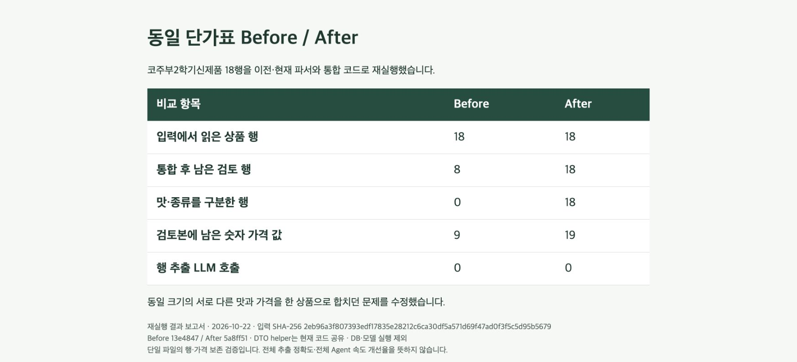

<!--
==============================================================================
FMS_FILE_SPEC
01-table-preservation.md - 프로젝트 문서 01-table-preservation
==============================================================================
설명:
    - 프로젝트 문서 01-table-preservation
입력·출력 명세:
    - 입력: 설계·구현·측정·검증 근거
    - 출력: 설명·명세·예제·검증 또는 발표 안내
실행 가정:
    - 계획·테스트 대역·실제 실행 결과를 구분하고 현재 상태는 README 및 검증 근거 확인
작성 정보:
    - 작성자: 김재현(Finn)
    - 이메일: penguin.klg@gmail.com
    - 작성일: 2026-10-22 (최초 Git 등록일 기준)
    - 라이선스: 미지정
    - 버전: 0.1.0
    - 상태: Development
변경 이력 (Revision History):
    DATE        AUTHOR      VERSION  DESCRIPTION
    --------------------------------------------------------------------
    2026-10-22  미지정      v0.1.0   파일 역할·입출력·가정·이력 명세 추가

    상세 Git 이력: git log --follow -- doc/submission/before-after/01-table-preservation.md
    공통 규칙: doc/file-header-policy.md
==============================================================================
-->
# 01. 같은 식품명·규격의 다른 맛이 사라진 문제

2026-10-22 실제 수집 XLSX 한 파일을 이전·현재 파서와 통합 코드에 재실행했습니다. 비교 입력의 SHA-256과 결과는 [JSON](../table-preservation-benchmark.json)에 있습니다.

| 항목 | Before | After |
|---|---:|---:|
| 파싱한 행 | 18 | 18 |
| 통합 후 검토 행 | 8 | 18 |
| 맛·종류 구분 행 | 0 | 18 |
| 숫자 가격 값 | 9 | 19 |
| 행 추출 LLM 호출 | 0 | 0 |

Before는 13e4847의 documents.py/consolidation.py, After는 5a8ff51의 해당 코드입니다. FoodRecord helper는 현재 코드를 공유했습니다. DB 저장·모델·네트워크는 제외했습니다. 과거 서비스 환경 전체를 복원한 실험이 아니라 파서·통합 변경의 회귀 재현입니다. 가격 값 개수는 정답률이 아닙니다.



```sh
.venv/bin/python scripts/benchmark-table-preservation.py /개인/보유/단가표.xlsx \
  --output /tmp/table-result.json
```

원본 파일은 개인 보유 경로에 두며 저장소에 올리지 않습니다. 실제 기수집 첨부 재등록 Agent 작업은 별도로 약 6.027초, qwen3:4b planner 1회, 18개 검토 항목을 기록했습니다. 이는 이전 버전과의 속도 비교가 아닙니다. 전체 성능·비용·Retry·필드 정확도의 반복 비교는 미측정입니다.

과거 OCR 예열 12.879초/10.347초 기록은 초기화·예열을 포함한 다른 실험입니다. 이번 Before/After 성과나 전체 Agent 개선율과 합치지 않습니다.

## 원인과 수정 지점

명시적인 병합 셀 복원이 충분하지 않고 맛·종류와 가격 조건이 식품 식별/통합에 반영되지 않아, 서로 다른 원본 행을 중복으로 취급했습니다. 파싱 자체는 18행이었으므로 수집량을 늘리거나 LLM을 반복 호출해 해결할 문제가 아니었습니다.

`parsers/xlsx_merges.py`, `parsers/documents.py`, `domains/catalog/record.py`, `domains/analysis/consolidation.py`에서 병합 셀의 anchor를 보존하고 맛·규격·가격 충돌을 구분했습니다. `backend/tests/test_consolidation.py`와 `test_workflow.py::test_approved_same_size_flavors_keep_separate_catalog_variants`가 회귀를 검사합니다.

발표 문장: “18행을 읽었는데 검토에서는 8행만 남았습니다. 추론을 더 시킨 게 아니라, 서로 다른 맛과 가격을 중복으로 합친 로직을 고쳐 18행을 보존했습니다.”

[사례 목록](../before-after.md) · [README](../../../README.md)
