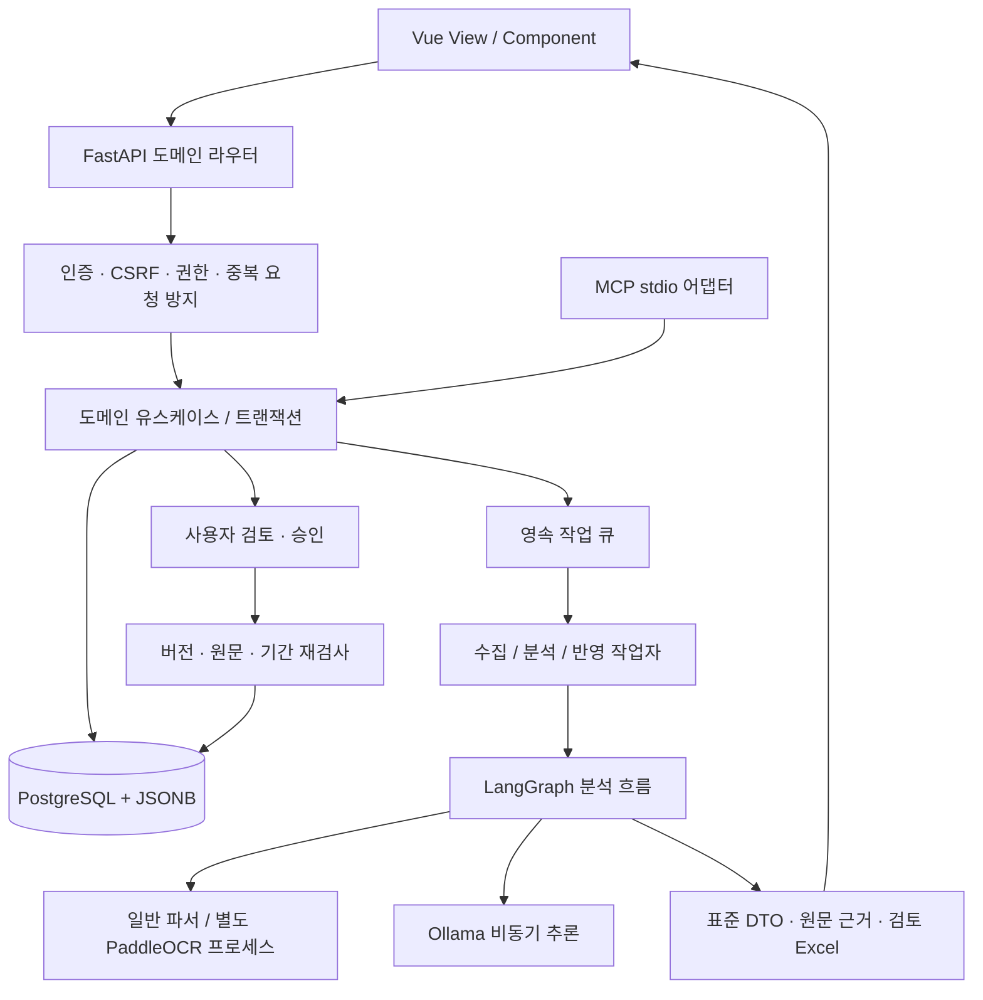
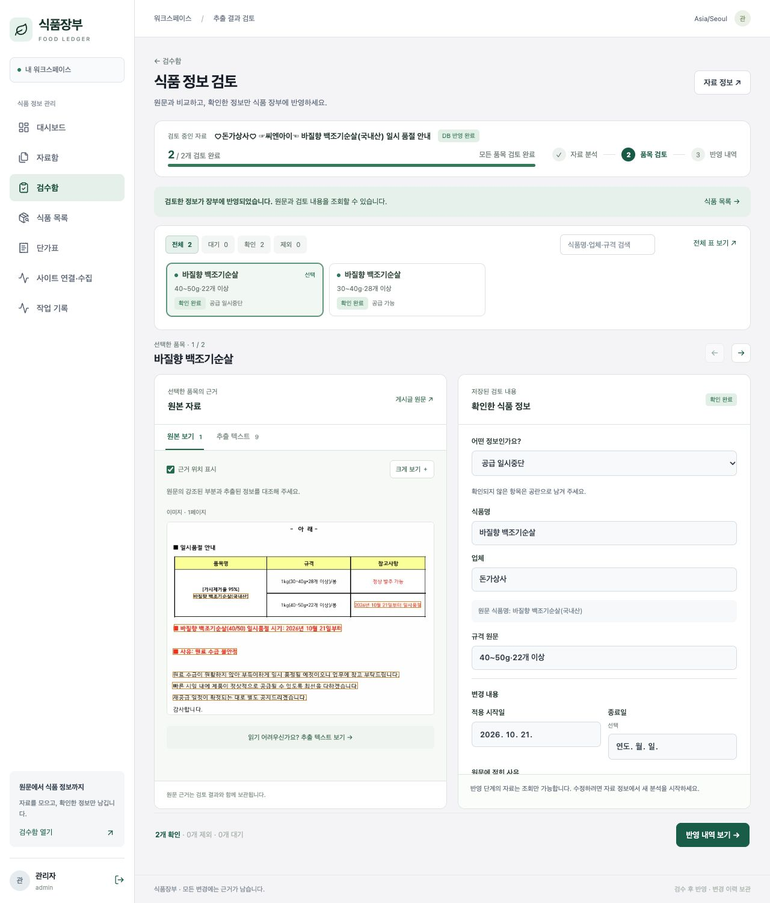

<!--
==============================================================================
FMS_FILE_SPEC
readmd.md - 프로젝트 문서 readmd
==============================================================================
설명:
    - 프로젝트 문서 readmd
입력·출력 명세:
    - 입력: 설계·구현·측정·검증 근거
    - 출력: 설명·명세·예제·검증 또는 발표 안내
실행 가정:
    - 계획·테스트 대역·실제 실행 결과를 구분하고 현재 상태는 README 및 검증 근거 확인
작성 정보:
    - 작성자: 김재현(Finn)
    - 이메일: penguin.klg@gmail.com
    - 작성일: 2026-10-21 (최초 Git 등록일 기준)
    - 라이선스: 미지정
    - 버전: 0.1.0
    - 상태: Development
변경 이력 (Revision History):
    DATE        AUTHOR      VERSION  DESCRIPTION
    --------------------------------------------------------------------
    2026-10-21  미지정      v0.1.0   최초 Git 등록 a11ef05a
    2026-10-21  미지정      v0.1.0   파일 역할·입출력·가정·이력 명세 추가

    2026-10-21  김재현(Finn) v0.1.0   Agent 도구 선택 기반 리빌드·업무 경계 및 검증

    2026-10-22  김재현(Finn) v0.1.0   자료·Agent·검수 승인·식품 DB 중심 흐름 및 알레르기 표기 정리

    2026-10-22  김재현(Finn) v0.1.0   실제 화면·비교 근거·5분 발표 자료 작성

    상세 Git 이력: git log --follow -- readmd.md
    공통 규칙: doc/file-header-policy.md
==============================================================================
-->

> **README 중심 5분 발표**는 [README.md](README.md), [발표 흐름](doc/submission/presentation-5min.md), [Before/After](doc/submission/before-after.md)를 기준으로 합니다. 이 문서는 설치·상세 구현 참고용입니다.


> 2026-10-22 제출·발표 최신 요약은 [README](README.md)를 기준으로 합니다. 실제 화면, Backend 142개·Frontend 14개 검증, 동일 단가표 비교, [5분 PDF](output/presentation/food-ledger-5min.pdf)와 [PPTX](output/presentation/food-ledger-5min.pptx), [300초 대본](doc/submission/presentation-5min.md)을 추가했습니다. 아래의 과거 측정·리팩토링 기록은 해당 시점의 결과입니다.


> 현재 사용자 흐름: **자료 가져오기 → Agent 도구 선택·LangGraph 처리 → 검수·승인 → 식품 DB**. 주요 메뉴는 네 개이며 수동 JSON 변경안 작성·별도 대시보드를 제거했습니다. 최신 API·알레르기 번호·식품 수정 정책은 [서비스 흐름 명세](doc/food-agent/service-workflow.md)를 우선 참고하세요.

# skala-FMS · 식품장부

## 1. 서비스 목적과 범위

학교급식 식품 공지와 단가표에서 정보를 모아 **같은 형식의 식품 정보로 정리하고, 원문과 비교한 뒤 승인한 내용만 DB에 반영**하는 서비스입니다. 게시글의 텍스트, 이미지 OCR, Excel·PDF 첨부를 다루며 품절·공급 재개·단가 변경·신규 식품 정보와 근거 이력을 관리합니다.

현재 단계는 실행 가능한 개발 MVP입니다. 로컬 Ollama의 `qwen3:4b`는 처리 도구 선택에, `qwen3:8b`는 비정형 정보 추출에 사용합니다. 모델이 분석 계획과 구조화 추출을 수행하고, 서버가 규격·품목 연결 및 변경안 검증을 담당합니다. **LLM이 임의 SQL을 실행하거나 승인을 대신하지 않습니다.**

자료를 수집한 결과가 곧 최신 식품 DB라는 뜻은 아닙니다. 원본 자료, AI 추출 결과, 사람의 검토, 승인된 업무 사실을 구분합니다. 미확인 정보는 공란으로 유지합니다.

## 2. 주요 기능과 사용자 여정

| 순서 | 사용자 행동 | 시스템 처리 |
|---|---|---|
| 1 | 파일 등록 또는 사이트 업데이트 수집 | 원문·첨부 보관, 변경 감지, 분석 작업 등록 |
| 2 | 작업 진행 확인 | 텍스트 파싱·OCR, AI 계획·추출, 근거 연결, Excel 생성 |
| 3 | 품목 선택 후 원문 대조·수정 | 모든 입력을 표준 FoodRecord DTO로 표시, 속성·알레르기 분리 |
| 4 | 품목 확인 또는 이번 반영에서 제외 | 검토 이력 저장, 다음 대기 품목으로 이동; 식품 DB는 아직 변경하지 않음 |
| 5 | 최종 대상 확인 후 승인·반영 | 버전·원문·적용 기간 검사 후 별도 작업자가 원자적으로 반영 |
| 6 | 식품·단가·이력 조회 | 현재/예약 단가, 공급 상태, 변경 사유·원문 링크 조회 |

- **자료함**: 파일 등록, 선택·전체 선택, 삭제·복구, 조건을 충족한 자료 영구 삭제.
- **사이트 연결·수집**: school062.com 계정 저장·연결 확인, 새 글/수정 글 수집, 분석 자동 등록. 자동 수집은 worker가 실행 중일 때 동작합니다.
- **검수 화면**: 상태별 필터·검색·전체 DTO 표, 원본/추출 텍스트 전환, 이미지 확대·근거 영역 표시, 저장하지 않은 수정 보호, 반영 완료 조회 상태 구분.
- **단가 조회**: 승인된 단가의 업체·규격·단위·가격 범위 조회. 원본 Excel 시트는 자료의 열 형태로 필터·정렬·페이지 조회합니다.
- **식품 상세**: 규격·업체·식품 속성·알레르기·공급 상태·변동 이력 및 레퍼런스 조회.
- **작업 기록**: 수집·분석·반영 진행, 실패 사유, 재시도와 가능한 작업의 취소.

챗봇은 기본 기능에 포함하지 않았습니다. 현재 핵심 여정은 자료 검토와 장부 반영이며, 챗봇 없이 전 과정을 사용할 수 있습니다.

## 3. 아키텍처



**도메인별 모듈형 모놀리스**입니다. API와 worker는 별도 프로세스로 실행하며 DB·도메인 서비스를 공유합니다. 도메인을 나누기 위해 서비스마다 별도 DB나 네트워크 호출을 만들지 않았습니다. 프런트는 View가 사용자 흐름과 API 호출을 조합하고, Component가 폼·표·근거 비교를 담당합니다.

## 4. 백엔드 도메인 구조

```text
backend/app/
├── api/                 # FastAPI 조립, HTTP 공통 처리, 라우터 등록
├── domains/
│   ├── identity/        # 세션, 로그인·로그아웃, 권한
│   ├── ingestion/       # 수집·원문·첨부·회원 연결·삭제/복구
│   ├── catalog/         # 표준 FoodRecord, 식품·규격·업체 조회
│   ├── pricing/         # 원본 단가표·시트·열 필터·가격 변경안
│   ├── analysis/        # 분석 작업 등록, LangGraph, LLM, Excel
│   ├── review/          # 품목 검토, 변경안·승인, 원자적 DB 반영
│   ├── jobs/            # 영속 작업 큐·작업 상태·worker
│   └── reporting/       # 대시보드 집계 조회
├── infrastructure/      # DB 연결·저장 공통 함수, 버전별 계약 검증
├── parsers/             # 텍스트·Excel·PDF·OCR 파서
├── connectors/          # 사이트별 수집/로그인 어댑터
├── runtime/             # 실행 예산·동시성·중단 제어
├── mcp/                 # 도메인 서비스를 노출하는 stdio 어댑터
└── seed.py              # 명시적으로 실행하는 가상 예제 시드
```

| 책임 | 현재 경로 | 구현 포인트 |
|---|---|---|
| 애플리케이션 조립 | `api/main.py` | 라우터·미들웨어·수명 관리, SPA 정적 파일 |
| 공통 HTTP 경계 | `api/transport.py` | 업로드/CSRF 제한, 인증, 권한, 중복 요청 방지, DB 트랜잭션 |
| 실제 도메인 API | `domains/*/api.py` | 도메인별 명시적 FastAPI 경로와 업무 처리 |
| 표준 식품 정보 | `domains/catalog/record.py` | nullable DTO, 식품명·규격·속성·알레르기 정규화 |
| 식품 읽기 | `domains/catalog/queries.py` | 시점별 식품·규격·단가 조회 |
| 승인된 DB 쓰기 | `domains/review/application.py` | 대상/원문 버전·기간 충돌 검사, 전체 롤백, 감사 이력 |
| 분석 등록/실행 | `domains/analysis/service.py`, `workflow.py` | 영속 작업 등록과 분석 단계 구분 |
| AI 모델 연동 | `domains/analysis/provider.py` | 재사용 HTTP 연결, 비동기 호출, 동시성 제한·출력 검증 |
| 데이터 접근 | `infrastructure/database.py` | PostgreSQL 연결 풀, 공통 레코드 접근 |

읽기 코드에 승인된 변경의 반영 함수를 두지 않습니다. 사용하지 않는 `services/`, `ai/`, `food/`, `domain/`, `workflows/`, `workers/`, `db.py` 호환 경로를 제거했으며 도메인 경로만 사용합니다. 완전한 ORM/Repository 재작성이나 모든 업무 객체의 DDD 전환까지 수행한 것은 아닙니다.

## 5. 제공 ZIP에서 재사용·변경한 부분

원본 장애 진단 프로젝트와 사용하지 않는 호환 모듈을 제거했습니다. 실습 구조 비교용 원본은 이전 Git 커밋에서 확인할 수 있습니다.

| 제공 구성 | 식품 서비스에서의 활용 |
|---|---|
| `web_chat.html` | Vue 사용 방식은 재사용하고, 신규 화면은 `frontend/src/views/`·`components/`로 구성 |
| `server.py` | FastAPI 재사용; 현재 파일은 신규 `api/main.py`를 노출하는 ASGI 진입점 |
| `agent/graph.py` | LangGraph 재사용; 식품 흐름은 `domains/analysis/workflow.py`로 재구성 |
| `agent/ollama_llm.py` | 로컬 모델 연동 개념 재사용; 신규 식품 프롬프트·JSON 스키마·비동기 provider 구현 |
| `agent/openai_llm.py` | 원본 코드는 Git 이력에서 확인 가능. 신규 기본 경로는 Ollama이며 OpenAI 전환은 추가 어댑터 작업 필요 |
| `agent/fake_llm.py` | 운영 모델로 쓰지 않음; 신규 테스트는 명시적인 TestModel과 HTTP mock 사용 |
| `agent/session_store.py` | SQLite 채팅 기록은 기본 업무 저장소로 쓰지 않음; PostgreSQL에 작업·추출·검토·승인·이력 저장 |
| `mcp_server.py` | 식품 Tool·Resource·Prompt를 제공하는 신규 stdio 진입점으로 교체 |
| `agent/mcp_client.py` | 원본은 Git 이력에서 확인 가능. 신규 MCP 전송 검증은 FastMCP Client를 사용 |
| `data/` | 장애 샘플은 제거. 신규 시드는 가상 식품·단가·공지이며 실제 회원 정보와 수집 자료는 포함하지 않음 |

## 6. Agent·LLM·전처리·DB의 역할

기본 분석 흐름은 다음과 같습니다.

```text
등록·수집 → 영속 analyze 작업 → 원문 관찰(일반 읽기·OCR, 근거 보존)
  → Agent가 자료별 도구·이유 결정
      ├ normalize_table: 읽은 표 → DTO
      ├ extract_text: 비정형 텍스트 → LLM → DTO
      ├ extract_image_regions: OCR 좌표 → 상품 영역 판단 → 영역별 LLM → DTO
      └ request_review: 원문 확인 요청
  → 공통 DTO 정규화·근거 검사·중복 통합
  → Agent가 match_catalog를 선택한 경우에만 읽기 전용 DB 후보 조회
  → 한 검토본·Excel → 사용자 수정·확인
  → 확인한 품목의 변경안 준비 → 명시적 승인 → apply 작업 → DB·이력
```

Agent의 도구 선택 결과가 실제 실행기를 제어합니다. 도구를 생략하거나 사용할 수 없는 도구를 선택하면 검증 오류로 중단합니다. 이미지에서는 첫 네 줄을 모든 상품의 공통 정보로 강제 사용하지 않습니다. OCR 좌표 기반 영역 판단에서 상품 근거·공통 범례·미분류 원문을 구별합니다. 미분류 구간은 경고·근거 보기·Excel에 남기며 처리 완료 구간으로 계산하지 않습니다.

추출 Agent는 승인용 변경안이나 확정 식품을 생성하지 않습니다. 검토에서 확인한 DTO만 review 도메인의 staging으로 넘기고, application이 승인된 변경을 원자적으로 반영합니다. 같은 모델로 추출 결과를 다시 생성하는 전수 2차 호출은 제거했습니다. 형식·금액·근거·단종 표현 등의 서버 검증과 사용자 검토는 유지합니다.

원문은 저장소에 보관하고 LangGraph checkpoint에는 ID만 전달합니다. 실행 재개 정보는 근거 ID·문자 범위를 저장하며 원문 전체를 중복 저장하지 않습니다. 완료한 도구와 이미지 영역 계획은 저장하여 이어서 처리할 때 재호출하지 않습니다.

현재 로컬 모델은 텍스트 모델이므로 이미지 내용을 관찰하기 위한 최초 OCR은 필요합니다. 상품 영역은 이 OCR의 좌표와 텍스트로 판단합니다. 원본 픽셀을 직접 보는 멀티모달 모델이나 영역 crop 재인식까지 구현됐다는 뜻은 아닙니다. 이 한계와 실제 모델 검증 범위는 [리빌드 명세](doc/food-agent/agent-rebuild.md)에 구분했습니다.

`FOOD_ANALYSIS_MODE=rules`는 명시 형식의 자동 테스트용 대역입니다. 운영 기본값은 Agent이며 모델 오류를 규칙 처리로 숨기지 않습니다. MCP는 동일 도메인 기능의 외부 Tool·Resource·Prompt 어댑터이고, 내부 실행은 매번 MCP 자식 프로세스를 띄우지 않습니다.

## 7. 표준 DTO와 데이터 저장

업체별 표현이 달라도 추출·검토·식품 화면은 `food-record-v2`를 사용합니다.

| DTO 영역 | 예시 |
|---|---|
| 식품 식별 | `food_name`, `raw_food_name`, `food_code`, `record_type` |
| 업체 | `company_id`, `company_name` — 제조사·브랜드를 새 입력 항목으로 나누지 않음 |
| 규격 | `specification`: 낱개 용량·단위, 포장 개수, 전체 용량·단위, 판매 단위, 원문 |
| 식품 속성 | `attributes`: 맛·종류, 산지·원산지, 등급, 원재료·비율, 표시 기준, 용도, 원문 |
| 알레르기 | `contains`, `may_contain`, `free_from_claims`, `candidates`, `review_status`, 원문 |
| 자료 가격 열 | `prices`: 자료 적용가·조사가 1~3; 확정 공급 단가와 구분 |
| 추적 정보 | `field_sources`, `issues`, 비고 |

예: `CJ씨푸드 맛있는빅후랑크(오리지날_100g*10입 1Kg/EA)`는 식품명·업체·맛·낱개 규격·포장 수량·전체 규격·판매 단위를 분리하는 대상입니다. 규칙과 LLM이 후보를 만들지만, 업체명이 모호한 경우 사람이 확인해야 합니다. 확정할 수 없는 값을 추정해 채우지 않습니다.

공란(`null`)과 0원은 다릅니다. 알레르기 후보와 원문의 함유 표시는 다르며, 표시가 없다는 이유로 안전/불포함이라고 판단하지 않습니다.

저장소는 PostgreSQL + JSONB입니다. 식품·규격·공급 품목과 업무 사실은 관계를 유지하고, 가변 식품 속성·원본·추출 결과는 JSONB로 보관합니다. 업무 적용일과 실제 기록 시점을 분리하고 기존 사실을 수정 이력 없이 덮어쓰지 않습니다. 승인된 정보의 원문 근거를 파괴하는 자료 영구 삭제는 차단합니다.

## 8. MCP Tool·Resource·Prompt

| 형태 | 실제 제공 기능 | 구분 이유 |
|---|---|---|
| 읽기 Tool | `find_product_candidates`, `get_supplier_item_facts`, `get_product_history` | 인자에 따라 DB를 조회하는 실행 기능 |
| 신뢰된 host 전용 Tool | `parse_document_segment`, `validate_change_set`, `stage_change_proposal` | 분석 작업 등록·변경안 검사/초안 저장. 기본 서버에는 노출하지 않음 |
| Resource | 스키마, 정책, 문서 구간, 추출 구간, evidence | URI로 읽는 버전별 문맥·근거 |
| Prompt | `analyze_food_notice`, `analyze_price_table`, `review_change_evidence` | 재사용 가능한 작업 안내 |

기본 모드는 읽기 Tool 3개, Resource 템플릿 5종, Prompt 3개입니다. `--host`는 신뢰된 별도 프로세스용 Tool 3개를 추가합니다. **승인·최종 DB 반영·임의 SQL Tool은 제공하지 않습니다.** stdio는 실행한 사용자의 DB 권한을 사용하며 원격 인증 서버가 아닙니다.

```sh
.venv/bin/python mcp_server.py
# 신뢰된 host 도구가 필요한 별도 클라이언트에서만 사용
.venv/bin/python mcp_server.py --host
```

## 9. 로컬 실행 — macOS / PostgreSQL 17

필수: Python 3.12 이상, Node 22, PostgreSQL 17. 선택: Ollama와 `qwen3:8b`, 이미지 처리를 위한 Python 3.11 PaddleOCR 환경. 기본 모델은 메모리를 많이 사용하므로 설치한 모델과 장치 용량을 확인하세요.

```sh
git clone https://github.com/SKALA-G116/skala-FMS.git
cd skala-FMS
python3 -m venv .venv
.venv/bin/python -m pip install -r backend/requirements.lock.txt
npm --prefix frontend ci
npm --prefix frontend run build
cp .env.food.example .env.food
```

`.env.food`의 `DATABASE_URL`, 초기 계정용 `FOOD_SEED_PASSWORD`를 본인 환경에 맞게 수정합니다. macOS Homebrew의 PostgreSQL 17 경로가 다르면 `PG_BIN`을 지정하세요.

```sh
# 기본: /opt/homebrew/opt/postgresql@17/bin
./scripts/start-postgres.sh
# 가상 예제 계정/식품을 최초 한 번 명시적으로 생성
.venv/bin/python -m backend.app.seed
# 실제 AI 분석을 사용하려면 Ollama를 실행하고 모델을 준비
ollama pull qwen3:4b
ollama pull qwen3:8b
# Ollama 서비스가 실행 중인 상태에서 API+worker 시작
bash run.sh
```

`http://127.0.0.1:8100`으로 접속합니다. 시드를 실행했다면 계정은 `admin`, `reviewer`, `operator`, `reader`이고 비밀번호는 시드 시점의 `FOOD_SEED_PASSWORD`입니다. API 시작만으로 계정/시드를 생성하지 않습니다. 기존 사용자가 있으면 시드는 데이터를 덮어쓰지 않습니다.

macOS 개발 스크립트는 `.local/pgdata`, 포트 `55432`의 로컬 PostgreSQL 클러스터를 사용합니다. DB 접속은 현재 OS 사용자 기준이며 로컬 trust 인증으로 시작합니다. 외부 DB를 사용할 때는 이 스크립트 대신 DB를 별도로 준비하고 API와 worker를 직접 실행합니다.

```sh
.venv/bin/uvicorn backend.app.api.main:app --host 127.0.0.1 --port 8100
# 별도 터미널
.venv/bin/python -m backend.app.domains.jobs.worker
# 프런트 개발 서버를 사용할 때
npm --prefix frontend run dev
```

Vite는 `/api`를 8100으로 전달합니다. 새 프런트 빌드는 API가 시작되기 전에 생성해야 합니다. 현재 실행 중인 다른 프로젝트가 같은 포트/클러스터를 사용한다면 동시에 중복 실행하지 않습니다.

## 10. 선택 OCR 환경

API/LLM 환경과 분리한 Python 3.11 환경에서 설치합니다. 이미지가 없으면 OCR 없이 텍스트·Excel 경로를 테스트할 수 있습니다.

```sh
python3.11 -m venv .venv-ocr
.venv-ocr/bin/python -m pip install -r backend/requirements-ocr.lock.txt
```

`.env.food`에 `FOOD_OCR_ENABLED=true`, `FOOD_OCR_PYTHON=/절대경로/skala-FMS/.venv-ocr/bin/python`을 설정합니다. 최초 실행 시 OCR 모델 다운로드가 필요합니다. API 프로세스 안에 Paddle 모델을 적재하지 않으며, OCR 자식 프로세스를 재사용한 뒤 유휴 시 정리합니다. 모델 가중치는 저장소에 포함하지 않습니다. 플랫폼별 Paddle 설치와 최초 가중치 다운로드는 별도 확인이 필요합니다.

## 11. Docker 실행

```sh
export POSTGRES_PASSWORD='본인의_DB_비밀번호'
export FOOD_SEED_PASSWORD='본인의_초기_계정_비밀번호'
# Docker Desktop의 host Ollama 기본 연결 주소
export FOOD_MODEL_URL='http://host.docker.internal:11434'
docker compose -f compose.food.yml up --build -d
docker compose -f compose.food.yml exec api python -m backend.app.seed
```

DB와 원본 assets는 영속 볼륨으로 보관합니다. 기본 Docker 이미지에는 PaddleOCR를 설치하지 않았습니다. 이미지 OCR을 사용할 때는 별도 OCR 실행 환경/이미지 작업이 필요합니다. 이번 로컬 검증 환경에는 Docker가 없어 Docker 빌드·기동은 실행 검증하지 않았습니다.

## 12. 주요 API와 공통 규칙

실행한 API의 `/docs`, `/openapi.json`에서 도메인별 실제 경로를 확인할 수 있습니다. 실제 라우터에는 고유 operation ID와 path parameter를 제공합니다. 상세 요청/응답 스키마는 [버전별 계약](doc/food-agent/openapi.json), [API 안내](doc/food-agent/api-guide.md)를 함께 확인하세요. 모든 계약 필드의 응답 일치까지 인증한 것은 아닙니다.

| 도메인 | 대표 API |
|---|---|
| 인증 | `GET /api/v1/auth/csrf`, `POST/DELETE /api/v1/auth/session`, `GET /api/v1/auth/me` |
| 수집자료 | `POST /api/v1/documents/import`, `POST /api/v1/collection-runs`, `GET /api/v1/documents` |
| 회원 연결 | `GET/POST /api/v1/sources/{id}/connection`, `POST .../connection/test` |
| 분석 | `POST /api/v1/analysis-runs`, `GET .../{id}/report` |
| 품목 검토 | `PATCH /api/v1/analysis-runs/{id}/items/{item_id}`, `POST .../{id}/review-proposals` |
| 승인·반영 | `POST /api/v1/proposals/{id}/decisions`, `POST .../{id}/applications` |
| 식품·이력 | `GET /api/v1/foods`, `GET /api/v1/products/{id}`, `GET .../{id}/history` |
| 단가·원본 표 | `GET /api/v1/prices`, `GET /api/v1/price-workbooks/{id}`, `GET /api/v1/price-sheets/{id}/rows` |
| 삭제·복구 | `DELETE /api/v1/foods/{id}`, `POST .../{id}/restore`, `POST /api/v1/document-actions` |
| 비동기 작업 | `GET /api/v1/jobs/{id}`, `POST .../{id}/retry`, `POST .../{id}/cancel` |

- 세션 쿠키와 CSRF 토큰을 사용합니다. 일반 업무 변경에는 `Idempotency-Key`가 필요합니다.
- 변경안 수정/승인 등에는 조회 응답의 `ETag`를 `If-Match`로 보냅니다. 오래된 버전은 412로 차단합니다.
- 수집·분석·반영은 작업 ID와 함께 202를 반환하고 worker에서 실행합니다.
- 로그인·로그아웃은 업무 변경 권한 및 업무용 중복 요청 키와 분리합니다. 조회 전용 사용자도 정상 로그아웃할 수 있습니다.

권한: admin 전체 관리, operator 수집자료 관리, reviewer 검토·승인과 식품 관리, reader 조회. 기존 사이트 계정은 설정 화면에서 입력하며 암호화해 저장합니다. 키 파일을 잃으면 저장된 연결 정보를 복구할 수 없습니다.

## 13. 성능·메모리 관리

| 항목 | 현재 관리 방식 |
|---|---|
| HTTP 처리 | 비동기 본문 읽기, DB/Excel/암호 해시는 제한된 스레드 풀에서 실행 |
| 작업 분리 | 수집·분석·반영 3개 작업 lane, 영속 큐·lease·fence로 중복 실행 제어 |
| LLM | AsyncClient 재사용, 기본 동시 요청 1개(설정 최대 2), 호출 timeout, 입력·출력·누적 토큰 예산 |
| 분석 상태 | LangGraph checkpoint에는 ID 위주로 저장; 큰 원문과 추출 결과는 저장소에 보관 |
| 장시간 작업 | 기본 600초 시간 구간 뒤 진행 상태를 보존하고 재등록; 취소·정상 종료 시 이어서 처리 |
| OCR | 별도 프로세스 1개 직렬 재사용, 기본 60초 유휴 해제·20회 처리 후 재시작 |
| 파일/추출 | 업로드 25MB, PDF 20페이지, 이미지 1,600만 픽셀, 추출 구간/텍스트·결과 크기 제한 |
| Excel | read-only 행 순회, workbook/스트림 닫기, 셀·압축 해제 크기 제한, 페이지 조회 |
| DB | 프로세스당 최대 6개 연결. 업로드 동시 진입 2개, HTTP 동기 작업 스레드 8개 |

메모리 상한은 Python worker와 별도 모델 프로세스를 각각 봐야 합니다. worker RSS가 낮아도 Ollama 모델의 RAM/VRAM이 작은 것은 아닙니다. 조회의 일부는 개발용 2,000건 상한을 두며 대규모 운영에는 SQL 검색·페이지네이션 확대가 필요합니다.

## 14. 기능 테스트와 실제 결과

테스트는 반드시 이름이 `_test`로 끝나는 별도 DB에서 실행합니다. **해당 테스트 DB의 테이블을 초기화하므로 운영 DB URL을 사용하지 않습니다.** 테스트 원본 파일은 임시 assets 디렉터리로 분리합니다.

```sh
# 환경에 맞는 createdb 경로/계정 사용
/opt/homebrew/opt/postgresql@17/bin/createdb -h 127.0.0.1 -p 55432 food_fms_refactor_test
DATABASE_URL=postgresql://localhost:55432/food_fms_refactor_test \
FOOD_ANALYSIS_MODE=rules FOOD_SEED_PASSWORD=local-food-2026 \
.venv/bin/python -m pytest backend/tests -q
node --test frontend/tests/reviewJourney.test.js
npm --prefix frontend run build
```

이번 로컬 검증: 백엔드 **69개 통과**. 프런트 결과와 최종 검증 기록은 [초기 리팩토링 보고서](doc/food-agent/initial-refactor.md)에 기록합니다. 백엔드 실제 검증 환경은 macOS / Python 3.14 / PostgreSQL 17이며, Python 3.12 컨테이너 실행과 실제 외부 사이트/실제 LLM/OCR 전체 재수집은 이 테스트 결과에 포함하지 않습니다.

| 기능 | 실제 테스트 입력/조건 | 확인한 결과 |
|---|---|---|
| 등록→분석→검토→반영 | 테스트 공지 + 명시적 TestModel | 표준 DTO, 근거 연결, 검토 Excel 생성, 승인 전 facts 불변 |
| 규칙 데모 | `item DEMO-002 \| 공급 일시중단 \| 2026-11-01 \| 테스트 사유` | 영속 분석 작업 완료, 변경안 생성 |
| 단가 추출 | 500g / 72,000원 / 적용일·사유가 분리된 본문 | 근거 3개 연결, quantity=500·unit=g 유지 |
| 승인 후 원자적 반영 | 대상 버전을 검토 후 변경 | TARGET_CHANGED, 전체 facts 롤백 |
| 기간 이력 | 기존 단가의 일부 기간 정정 | 정정 전/기간 중/정정 후 가격을 각각 조회 |
| 중복 요청 | 같은 키·같은 본문 / 같은 키·다른 본문 | 동일 결과 반환 / 409 차단 |
| 보안 | 미인증, reader의 변경, CSRF 누락 | 401/403; reader 로그아웃은 204 |
| 장애·예외 | OCR timeout, 모델 HTTP 실패·스키마 오류, 잘못된 evidence | 오류 코드 반환, 작업/리소스 정리, 잘못된 변경 반영 차단 |
| 비동기성 | 느린 DB 응답 중 `/health` 요청, 지연 모델 응답 | 이벤트 루프 차단 방지 테스트 통과 |
| MCP | 실제 stdio Client로 tools/resources/prompts 조회 | 기본 읽기 도구만 노출, 승인/임의 SQL 없음 |
| 도메인 경계 | 전체 등록 라우터·import 검사 | 단일 도메인 소유, 고유 operation ID, 경로 변수 문서, 호환 경로 역의존 없음 |

테스트 대역의 성공을 실제 모델의 정확도나 실제 웹사이트 로그인 성공으로 보고하지 않습니다. 이전 실기동 성능 측정 자료는 `doc/food-agent/`의 performance 문서를 참고하되 이번 리팩토링의 신규 성능 측정과 구분하세요.

## 15. 실제 화면

다음은 현재 Vue 검수 화면의 실행 캡처입니다. 신규 도메인 분리는 같은 프런트와 API 계약을 유지합니다.



## 16. 남은 한계와 다음 변경 방향

- 범용 MCP 자율 계획 루프, OpenAI 신규 식품 어댑터, 대화형 챗봇은 기본 경로에 없습니다.
- 모든 업체 양식/OCR의 정확도를 보장하지 않습니다. 특히 복잡한 표·대체품 구성 관계는 검토가 필요합니다.
- 일부 DB 레코드 조회는 개발용 상한을 사용합니다. 전체 검색·페이지 처리와 저장 계층의 세분화가 다음 단계입니다.
- 자동 수집은 worker 실행 중 동작합니다. 다중 worker 운영, 배포·관측·백업·계정 수명 주기는 추가 운영 설계가 필요합니다.
- 초기 migration은 멱등 SQL 실행 방식이며 전용 마이그레이션 버전 관리 도구로 교체할 여지가 있습니다.
- 영구 삭제는 삭제 보관된 원본 중 승인 정보가 참조하지 않는 경우만 허용합니다. 승인 이력 삭제를 통해 제약을 우회하지 않습니다.

## 17. 저장소 포함·제외 기준

소스·마이그레이션·가상 예제·테스트·실행 화면·문서를 포함합니다. `.env`, 사이트 회원 계정, 암호화 키, DB/세션 파일, 실수집 assets, 가상환경, node_modules, 모델 가중치, 로컬 로그와 빌드 산출물은 제외합니다. 루트 `README.md`는 GitHub 첫 화면용 안내이고, 요청한 상세 명세 파일명은 이 문서 `readmd.md`입니다.

## 18. 최종 제출·평가 기준과 발표 준비

제출용 10개 항목은 루트 [README.md](README.md)의 1~10절로 정리했습니다. 특히 선정 배경, 문제/구현/검증 대응표, 기술 선택의 비용, 개발 중 문제와 해결 과정, Before/After의 측정 한계를 보완했습니다.

- [평가 기준 대조·최종 확인 상태](doc/submission/requirements-audit.md)
- [Before/After 근거와 추가 실측 계획](doc/submission/before-after.md)
- [설명과 시연을 합친 5분 구성·대본](doc/submission/presentation-5min.md)
- [시연 환경·리허설·Zoom 준비 안내](doc/submission/demo-guide.md)
- 시연 입력: `demo/notice.txt`, `demo/prices.csv` (가상 자료)
- 읽기 전용 사전 점검: `.venv/bin/python scripts/demo-preflight.py --help`

문서·CI·테스트 완료와 실제 발표 준비 완료를 구분합니다. 발표 환경의 실제 모델/선택 OCR 전체 처리, 브라우저 E2E, Zoom 화면·소리·해상도와 전체 Agent Before/After 반복 측정은 직접 확인해야 하는 항목으로 남겼습니다. 발표 자료는 Markdown 구성·대본이며 PowerPoint 파일을 생성한 것은 아닙니다.
